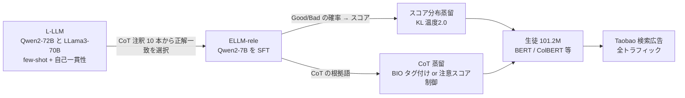

# Explainable LLM-driven Multi-dimensional Distillation for E-Commerce Relevance Learning

- **Link**: <https://arxiv.org/abs/2411.13045>（PDF: <https://arxiv.org/pdf/2411.13045>。HTML 版は 404 のため PDF から本文を取得）
- **Authors**: Gang Zhao, Ximing Zhang（同等貢献）, Chenji Lu, Hui Zhao, Tianshu Wu, Pengjie Wang, Jian Xu, Bo Zheng（Taobao & Tmall Group of Alibaba, Beijing）
- **Year**: 2025（arXiv v1 2024-11-20, v2 2025-02-08）
- **Venue**: WWW 2025 Companion（"Accepted by WWW 2025 oral"）
- **Type**: Academic Paper
- **証拠の質**: **一次資料**（企業著者の論文。オフライン評価と 2 週間の A/B テスト。全トラフィックで稼働中と記載）
- **蒸留の種別**: **真の蒸留を 2 段階で実施**（① 70B 級 LLM の CoT を 7B へ「データ蒸留」、② 7B 教師のスコア分布と CoT を 101M の生徒へ「多次元蒸留」）

## Abstract

> 原文の冒頭を一部引用し、残りは要約で示します（PDF より取得）。

"Effective query-item relevance modeling is pivotal for enhancing user experience and safeguarding user satisfaction in e-commerce search systems." LLM-based relevance models show strong long-tail generalization, but (1) massive parameters make online deployment difficult and (2) LLM relevance modeling is a black box whose knowledge is hard to extract. The authors propose an Explainable LLM-driven Multi-dimensional Distillation framework with (1) an explainable LLM for relevance modeling (ELLM-rele) that models relevance as Chain-of-Thought reasoning, and (2) a multi-dimensional knowledge distillation (MKD) architecture that transfers both the relevance score distribution and CoT reasoning knowledge to interaction-based and representation-based students. Offline evaluations and online experiments on the Taobao search ad scene demonstrate the effectiveness.

## Abstract (Japanese Translation)

EC 検索では、クエリと商品の関連度モデルがユーザー体験と満足度の要です。LLM による関連度判定は、従来の専用モデルより高い性能とロングテールへの汎化を示しますが、(1) パラメータが巨大でオンライン配信が難しい、(2) 判定がブラックボックスで内部知識を取り出して使いにくい、という問題があります。本論文は、(1) 関連度判定を中間ステップに分解し **CoT 推論としてモデル化する説明可能な LLM（ELLM-rele）** と、(2) **関連度スコアの分布と CoT の推論知識の両方** を、交差型（interaction-based）・表現型（representation-based）の生徒へ移す **多次元蒸留（MKD）** を提案します。オフライン評価と Taobao 検索広告でのオンライン実験で有効性を示しました。

## Overview



- **Stage A（大→中）**: 70B 級の LLM 2 種で CoT 注釈を作り、**7B を SFT**（データ蒸留）。
- **Stage B（中→小）**: 7B 教師が 3,000 万件の未ラベルペアに CoT とスコアを付け、**101.2M の生徒へ多次元蒸留**。
- **成果**: 生徒の ROC-AUC は各ベースライン比 +2.2〜+4.1pt。A/B テスト（5% トラフィック × 2 週間）で **CTR +0.17%、Goodrate +0.89%、ロングテール Goodrate +1.96%**。MKD は **Taobao 検索広告の全トラフィック** に展開済み。

## Problem

- **配信コスト**: 7B LLM の推論は 1,000 ペアあたり 84 秒（直接判定）〜432 秒（CoT 付き）で、オンライン不可（Table 3）。
- **ブラックボックス**: 既存の LLM 蒸留はハードラベルの移転にとどまり、LLM の内部知識（スコア分布・推論過程）を使えていない。
- **7B の CoT 能力不足**: 日次で数百万件を推論する制約から 7B を選ぶ必要があるが、7B は微調整なしでは CoT が弱い。
- **生徒の構造の違い**: 交差型（BERT）と表現型（双塔・ColBERT）で、知識の注入方法を変える必要がある。

## Proposed Method

**ELLM-rele（説明可能な LLM 関連度モデル）**

1. 大型 LLM（Qwen2-72B, LLama3-70B）に、システムプロンプト $S$・few-shot 例 $E$・クエリ $Q_i$・タイトル $T_i$ を与える:

$$
P_{L\text{-}LLM}=\mathrm{Concat}(S,E,Q_i,T_i)
$$

2. 自己一貫性（各モデル 5 サンプル × 2 モデル = 10 本の CoT）を取り、人手ラベルと一致する CoT を 1 本選ぶ:

$$
\mathrm{Collection}_{CoT}=\{\arg\max P(y_i\mid P_{L\text{-}LLM},\theta_{Qwen}),\ \arg\max P(y_i\mid P_{L\text{-}LLM},\theta_{Llama})\}
$$

3. Qwen2-7B を CoT 注釈で SFT（few-shot は推論時間が増えるため使わない）:

$$
\mathcal{L}_{LLM}=-\frac{1}{N}\sum_{i=1}^{N}\log P(C_i\mid S,Q_i,T_i)
$$

**MKD（多次元蒸留）**

4. **スコアの射影**: 教師の Good / Bad トークン確率を正規化して連続スコアにする:

$$
s_T(Q_i,T_i)=\frac{e^{p_T(\text{Good}\mid Q_i,T_i)}}{e^{p_T(\text{Good}\mid Q_i,T_i)}+e^{p_T(\text{Bad}\mid Q_i,T_i)}}
$$

5. **スコア分布蒸留（KL）**:

$$
\mathcal{L}_{score}=\frac{1}{N}\sum_{i=1}^{N}\mathrm{KL}\left(s_T(Q_i,T_i)\,\|\,p_S(y\mid Q_i,T_i)\right)
$$

6. **CoT 蒸留（交差型 = 系列タグ付け）**: CoT から根拠語を抽出し、BIO タグ（B-rele / I-rele / B-irrele / I-irrele / O）を付け、CRF で学習:

$$
\mathcal{L}_{cot}=-\frac{1}{N}\sum_{i=1}^{N}\left(\sum_{j=1}^{l_q}\log P(\hat{c}_{q_j}\mid h_{q_j})+\sum_{j=1}^{l_t}\log P(\hat{c}_{t_j}\mid h_{t_j})\right)
$$

7. **CoT 蒸留（表現型 = 注意スコア制御）**: 根拠語は $\hat{a}=1$、無関係語は $\hat{a}=-1$ とし、トークン間コサイン類似度 $a_{i,j}=\frac{h_{q_i}\cdot h_{t_j}}{\|h_{q_i}\|\|h_{t_j}\|}$ を max-pooling した $a_{q_i}=\max_k a_{i,k}$, $a_{t_i}=\max_k a_{k,i}$ を $\hat{a}$ に近づける:

$$
\mathcal{L}_{cot}=\frac{1}{N}\sum_{i=1}^{N}\left(\sqrt{\frac{1}{n_q}\sum_{\hat{a}_{q_j}}(a_{q_j}-\hat{a}_{q_j})^2}+\sqrt{\frac{1}{n_t}\sum_{\hat{a}_{t_j}}(a_{t_j}-\hat{a}_{t_j})^2}\right)
$$

8. **総損失**:

$$
\mathcal{L}=\lambda_1\mathcal{L}_{score}+\lambda_2\mathcal{L}_{cot}+\frac{\lambda_3}{N}\sum_{i=1}^{N}\mathrm{CE}(\hat{y}_i\mid Q_i,T_i)
$$

- $(\lambda_1,\lambda_2,\lambda_3)=(1.0, 0.1, 0.5)$（交差型）、$(1.0, 0.01, 0.5)$（表現型）。KL の温度は 2.0。

## Algorithm (Pseudocode)

```
Algorithm: ELLM-MKD
Input : 人手ラベル D = {(Q,T,L)} 約34万件, 未ラベル U 3000万件
Output: 配信用生徒 S (101.2M)

# Stage A: CoT データ蒸留
1. for (Q,T,L) in D:
       cots ← 5×Qwen2-72B(P) ∪ 5×LLama3-70B(P)       // 自己一貫性
       C ← 判定が L と一致する CoT を 1 本選択
2. ELLM ← SFT(Qwen2-7B, {(S,Q,T) → C})                // 16×H20, 8k steps, 10h

# Stage B: 多次元蒸留
3. for (Q,T) in U:
       (cot, pGood, pBad) ← ELLM(Q,T)
       s_T ← softmax(pGood, pBad)[Good]
       tags ← parse(cot) → BIO / attention factors
4. S ← train(L = λ1 KL(s_T||p_S) + λ2 L_cot(tags) + λ3 CE(y))   // 32×H20
5. deploy S (ColBERT 型 6 層) in Taobao search ads
```

## Architecture / Process Flow

```
[人手ラベル 34万] ──> [70B級 LLM ×2: CoT 生成 + 自己一貫性] ──> [CoT 注釈]
                                                              │
                                                              v
[未ラベル 3000万] ──> [ELLM-rele (Qwen2-7B)] ──┬─> スコア分布 s_T ──> KL ──┐
                                               └─> CoT 根拠語 ──> BIO/注意 ─┤
                                                                            v
                                               [生徒 BERT / S-BERT / Poly / ColBERT (101.2M)]
                                                                            │
                                                                            v
                                                          [Taobao 検索広告 (全トラフィック)]
```

## Figures & Tables

### Table 1: データ統計（* は ELLM-rele の疑似ラベルに基づく値）

| 分割 | サンプル | クエリ | 商品 | Good | Bad |
|---|---|---|---|---|---|
| Train | 337,066 | 84,227 | 327,303 | 244,188 | 92,878 |
| Valid | 43,887 | 31,099 | 43,595 | 32,219 | 11,668 |
| Test | 43,888 | 31,043 | 43,536 | 31,967 | 11,921 |
| Unlabeled | 30,000,000 | 6,295,824 | 11,888,256 | 23,223,531* | 6,776,469* |

CoT 語（CoT に含まれるクエリ・商品中のフレーズ数）は 1,733,110* と 119,147,259* と記載（PDF の抽出で列の対応が崩れているため、どちらが学習/未ラベルかは原文で要確認）。クエリ平均 6 文字、タイトル平均 34 文字（中国語）。

### Table 2: 主結果（テストセット ROC-AUC % / Neg PR-AUC %）

| モデル | 種別 | ROC-AUC | Neg PR-AUC |
|---|---|---|---|
| Sentence-BERT | 表現型 | 78.5 | 61.3 |
| Poly-Encoder | 表現型 | 81.7 | 65.2 |
| ColBERT | 表現型 | 84.4 | 69.0 |
| ReprBERT | 表現型 | 83.8 | 68.5 |
| BERT | 交差型 | 87.2 | 73.0 |
| Walmart-LLM（Qwen2-7B で再実装） | LLM | 91.7 | 76.4 |
| **ELLM-rele** | LLM（教師） | **92.5** | **78.2** |
| MKD S-BERT | 生徒 | 81.1 | 64.6 |
| MKD Poly | 生徒 | 85.8 | 69.8 |
| MKD ColBERT | 生徒 | 87.2 | 72.9 |
| MKD BERT | 生徒 | 89.4 | 75.5 |

```
ROC-AUC（%）: ベースライン → MKD
S-BERT   78.5 |███████████████▋ → 81.1 (+2.6)
Poly     81.7 |████████████████▎ → 85.8 (+4.1)
ColBERT  84.4 |████████████████▉ → 87.2 (+2.8)
BERT     87.2 |█████████████████▍ → 89.4 (+2.2)
教師 ELLM-rele 92.5
```

### Table 3: モデルの効率（H20 1 枚で 1,000 ペアあたりの平均時間, ms）

| モデル | パラメータ | 推論時間 | 学習時間 |
|---|---|---|---|
| Sentence-BERT / MKD S-BERT | 101.2M | 121 | 64,663 / 65,400 |
| Poly-Encoder / MKD Poly | 101.2M | 151 | 65,445 / 66,182 |
| ColBERT / MKD ColBERT | 101.2M | 135 | 64,417 / 65,155 |
| BERT / MKD BERT | 101.2M | 7,344 | 54,583 / 55,210 |
| Walmart-LLM | 7B | 84,000 | – |
| ELLM-rele | 7B | 432,000 | – |

> **ColBERT 生徒は ELLM-rele の約 3,200 倍高速**（135ms 対 432,000ms / 1,000 ペア）。MKD は学習時のみ働くため、推論時間・パラメータは不変です。

### Table 4: アブレーション（差分は各フルモデル比）

| 変種 | ELLM-rele ROC / PR | MKD ColBERT ROC / PR | MKD BERT ROC / PR |
|---|---|---|---|
| フルモデル | 92.5 / 78.2 | 87.2 / 72.9 | 89.4 / 75.5 |
| w/o CoT 推論 | −0.8 / −1.8 | – | – |
| w/o スコア蒸留 | – | −0.9 / −1.6 | −0.6 / −0.9 |
| w/o CoT 蒸留 | – | −0.5 / −0.9 | −0.4 / −0.5 |
| w/o スコア & CoT | – | −1.1 / −2.0 | −0.8 / −1.2 |
| w/o MKD（疑似ラベルなし） | – | −2.8 / −3.9 | −2.2 / −2.5 |

### オンライン A/B テスト

| 項目 | 値 |
|---|---|
| ベースライン | 6 層の ColBERT 型（クエリ長 16 / タイトル長 32） |
| トラフィック | 各群 5% |
| 期間 | 2 週間 |
| CTR | +0.17% |
| Goodrate（人手評価） | +0.89% |
| ロングテールの Goodrate | +1.96% |
| 展開 | MKD は Taobao 検索広告の全トラフィックで稼働 |

### 手法比較

| 観点 | ELLM-MKD（本論文） | Walmart（01） | ReprBERT |
|---|---|---|---|
| 教師 | Qwen2-7B（70B 級の CoT で SFT） | Mistral-7B | 交差型 BERT |
| 移転する知識 | スコア分布 + CoT（根拠語） | スコア差 | 中間表現 |
| 生徒 | 交差型・表現型の両方 | 交差型 BERT | 表現型 |
| 説明可能性 | あり（CoT） | なし | なし |

## Experiments & Evaluation

### Setup

- 実装: ELLM-rele は H20 × 16、global batch 256、lr 1e-5、8,000 steps（10 時間）。CoT 生成は TopP 0.7 / TopK 50 / 温度 0.8。生徒は H20 × 32、batch 256、lr 5e-6、系列長 32/64。
- 指標: ROC-AUC、Neg PR-AUC（負例を正クラスとして算出。不適切な商品の検出力を見る）、オンラインは CTR と Goodrate。

### Main Results

- ELLM-rele は BERT 比 ROC-AUC +5.3pt、Walmart-LLM 比 +0.8pt。
- MKD は 4 種の生徒すべてで改善（ROC-AUC +2.2〜+4.1pt）。MKD Poly は ReprBERT を 2.0pt 上回る。

### Ablation Study

- 最も効くのは **疑似ラベル付き未ラベルデータの追加**（ColBERT で ROC −2.8pt を回復）。
- スコア分布（ソフトラベル）はハードラベルより良い（+0.9 / +0.6pt）。CoT 蒸留はさらに上乗せ（+0.5 / +0.4pt）。

## 蒸留のビジネス価値式への当てはめ

| 項 | 報告内容 |
|----|---------|
| $(C_{teacher}-C_{student})Q$ | 推論時間が約 3,200 分の 1（ColBERT 生徒 vs 7B CoT 教師）。日次数百万件の推論制約のため 7B を選んだと明記 |
| $C_{train}$ | 教師 SFT は H20 × 16 で 10 時間 |
| $\Delta\text{Acc}$ | 生徒は教師より ROC-AUC 3.1〜11.4pt 低いが、従来の本番モデルより上 |
| ビジネス成果 | CTR +0.17%、Goodrate +0.89%（ロングテール +1.96%） |

## Practical Takeaways

1. **2 段の蒸留**: 70B 級で CoT を作り 7B に覚えさせ、7B で大量の未ラベルを採点して 100M に移す、という段階化はコスト面で現実的。
2. **教師の確率分布を捨てない**: Good / Bad トークン確率をスコアにしてから KL 蒸留するだけで、ハードラベルより改善。
3. **CoT は「根拠語のタグ」に変換して生徒へ**: 生徒に文章を生成させず、トークンレベルの補助タスクにすれば推論コストは増えない。
4. **教師 LLM は配信後も使える**: ELLM-rele は関連度ラベル付け支援・誤り分析にも使われている。

## Notes

- ベースラインとして「Walmart-LLM」を同じ Qwen2-7B で再実装し比較している（01 の Walmart 系手法との公平比較）。
- AliExpress の LRKD（06）は本手法（MKD）を比較対象にしている。
- **（2026-10-22 追記・検証）** arXiv PDF をテキスト抽出して、教師 Qwen2-7B（CoT データは Qwen2-72B と Llama3-70B の few-shot で生成）、蒸留用の追加未ラベル 3,000 万件、生徒 101.2M（MKDColBERT）、A/B（Taobao 検索広告トラフィックの 5%、2 週間連続）、CTR +0.17%、Goodrate +0.89%、ロングテール +1.96%、学習 8,000 ステップ・計 10 時間、w/o MKD で ROC-AUC −2.8 を再確認した。「約 3,200 倍」は Table 3 の推論時間（ELLM-rele 7B 432,000 対 MKDColBERT 135）から本レポートが算出した値。
