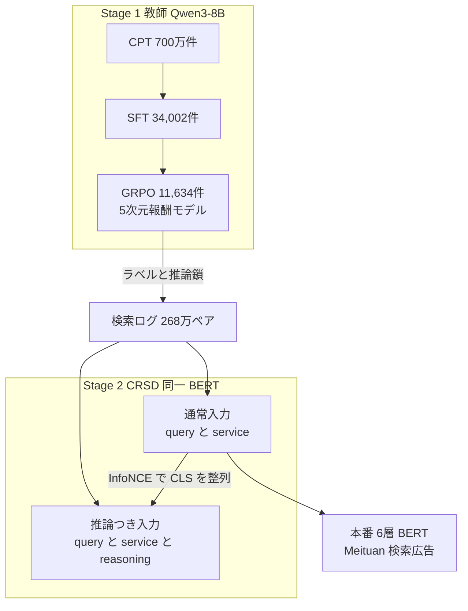

# From Reasoning LLMs to BERT: A Two-Stage Distillation Framework for Search Relevance

- **Link**: <https://arxiv.org/abs/2510.11056v3>（HTML: <https://arxiv.org/html/2510.11056v3>）
- **日本語の紹介ページ**: alphaXiv「推論LLMからBERTへ：検索関連性のための2段階蒸留フレームワーク」<https://www.alphaxiv.org/ja/abs/2510.11056>（二次）
- **Authors**: Runze Xia（同等貢献）, Yupeng Ji, Yuxi Zhou, Haodong Liu, Teng Zhang（Meituan, Shanghai）, Piji Li（責任著者, Nanjing）
- **Year**: 2026（arXiv v1 2025-10-13, v3 2026-01-24）
- **Venue**: Proceedings of the ACM Web Conference 2026（WWW '26）, DOI 10.1145/3774904.3792801
- **Type**: Academic Paper
- **証拠の質**: **一次資料**（企業著者の論文。2 週間の A/B テストと本番導入を記載）
- **蒸留の種別**: **真の蒸留**（推論 LLM 教師が付けたラベルと推論鎖を、BERT へ自己蒸留で内部化）

## Abstract

> 原文の逐語転載は引用上限を超えるため要約で示します。

The paper addresses query-service relevance prediction in e-commerce search, where latency limits prevent direct LLM use. It proposes a two-stage framework: (1) a domain-adapted teacher LLM built through continued pre-training, supervised fine-tuning, and preference optimization with a multi-dimensional reward model, which annotates search-log pairs with relevance labels and reasoning chains; (2) a lightweight BERT student trained with Contrastive Reasoning Self-Distillation (CRSD), which lets the model internalize reasoning without the reasoning path at inference. The authors report offline gains and online A/B improvements on Meituan's search advertising system.

## Abstract (Japanese Translation)

EC（生活サービス）検索における「クエリ × サービス（店舗・商品）」の関連度予測では、レイテンシ制約のため LLM を直接使えません。本論文は 2 段階の枠組みを提案します。(1) 継続事前学習・教師あり微調整・多次元報酬モデルによる選好最適化で **ドメイン適応した教師 LLM** を作り、検索ログのペアに関連度ラベルと推論鎖を付与します。(2) 軽量な BERT 生徒を **対照的推論自己蒸留（CRSD）** で学習し、推論時には推論鎖なしで、その判断ロジックを内部化します。美団（Meituan）の検索広告でオフライン改善とオンライン A/B の改善を報告しています。

## Overview

- **教師**: Qwen3-8B を CPT（約 700 万件）→ SFT（34,002 件）→ GRPO（11,634 件, 5 次元の報酬モデル）で強化。Macro F1 0.7174。
- **生徒**: 6 層の中国語 BERT（パラメータ数の記載なし）。入力は「[CLS] query [SEP] service」で最大 64 トークン。
- **蒸留**: 268 万件のログペアに教師が付けたラベルと推論鎖を使い、**同じ BERT を「推論つき入力（教師役）」と「通常入力（生徒役）」で並走** させ、[CLS] 表現を InfoNCE で揃える。
- **成果**: 生徒の Macro F1 0.7076（教師の 98.6%）。A/B（10% トラフィック × 2 週間）で **広告 CTR +0.91%、CVR +1.06%、GTV +0.40%**。上位 5 件の bad case 率が 30.5pt 低下。

## Problem

- **レイテンシ**: LLM は直接使えない。
- **構造の違い**: 生成型 LLM（デコーダ）と BERT（エンコーダ）の構造差が大きく、標準的な蒸留では推論能力を移しにくい。
- **推論鎖の扱い**: 推論鎖を入力に使うと推論時にも推論鎖が必要になり、配信できない。
- **教師の質**: 汎用 LLM は zero-shot / few-shot では関連度判定が弱い（Qwen3-8B zero-shot の Macro F1 0.3955）。

## Proposed Method

**Stage 1: ドメイン適応した推論 LLM 教師**

1. **CPT**: 約 700 万件・7 種類のタスク（クエリ理解、サービス理解、query2service、service2query、pointwise / pairwise / setwise 関連度）。batch 32、lr 1e-5、cosine、warmup 0.1、2 epoch、最大 2,048 トークン。
2. **SFT**: 人手注釈 34,002 件の ⟨query, service, reasoning, answer⟩。

$$
\mathcal{L}_{\text{SFT}}=-\sum_{i=1}^{N}\log P_\theta(r_i,a_i\mid q_i,s_i)
$$

3. **報酬モデル**: SFT モデルから初期化し、5 次元（クエリ理解、サービス理解、業務ルール遵守、推論の一貫性、答えの正しさ）を 0〜4 で採点。専門家評価との一致率 89.77%。
4. **GRPO**: 11,634 件、1 プロンプト 16 応答、lr 6e-7（VERL 実装、報酬モデルは vLLM で配信）。

$$
R_{\text{final}}=\alpha\cdot R_{\text{thinking}}+\beta\cdot R_{\text{label}},\qquad
\hat{A}_{i,t}=\frac{R^{i}_{\text{final}}-\mathrm{mean}(\{R^{j}_{\text{final}}\}_{j=1}^{G})}{\mathrm{std}(\{R^{j}_{\text{final}}\}_{j=1}^{G})}
$$

- $R_{\text{thinking}}$ は最初の 4 次元の平均、$R_{\text{label}}$ は 5 次元目（答えの正しさ）。

**Stage 2: CRSD（対照的推論自己蒸留）**

5. 比較用の「ベースライン推論蒸留」: 推論鎖の BGE-M3 埋め込みに BERT の表現を近づける。

$$
\mathcal{L}_{\text{total}}=\mathcal{L}_{CE}+\mu\mathcal{L}_{\cos},\quad \mu=0.1
$$

6. CRSD: 同じ BERT に (a) 通常入力「query, service」（最大 64）と (b) 推論鎖を付けた入力（最大 150）を入れ、それぞれ分類させつつ [CLS] を対照学習で揃える。

$$
\mathcal{L}_{\text{sce}}=\mathrm{CE}(y_s,y),\qquad \mathcal{L}_{\text{tce}}=\mathrm{CE}(y_r,y)
$$

$$
\mathcal{L}_{\text{align}}=-\sum_{i=1}^{N}\log\frac{\exp(\mathrm{sim}(\mathrm{cls}_i,\mathrm{cls}_{r_i})/\tau)}{\sum_{j=1}^{N}\exp(\mathrm{sim}(\mathrm{cls}_i,\mathrm{cls}_{r_j})/\tau)}
$$

$$
\mathcal{L}_{\text{CRSD}}=\mathcal{L}_{\text{sce}}+\gamma\mathcal{L}_{\text{tce}}+\delta\mathcal{L}_{\text{align}},\qquad \gamma=\delta=0.01
$$

- $y_s$: 通常入力の予測、$y_r$: 推論鎖つき入力の予測、$\mathrm{cls}_i$ / $\mathrm{cls}_{r_i}$: それぞれの [CLS] 表現、$\tau$: 温度。
- 学習: 定数 lr 5e-5、実効 batch 4,096、5,000 steps、AdamW、DDP。

**Features**:

- **推論時は通常入力だけ** を使う。推論鎖は学習時のみ。
- 「教師」と「生徒」が同じパラメータを共有する **自己蒸留** で、デコーダとエンコーダの構造差を回避する。

## Algorithm (Pseudocode)

```
Algorithm: Two-stage Reasoning Distillation (Meituan)
Input : ドメインコーパス 700万, 人手注釈 34,002 + 11,634, 検索ログ 268万ペア
Output: 6層 BERT 生徒

# Stage 1
1. M ← CPT(Qwen3-8B, 7 tasks, 700万件)
2. M ← SFT(M, {(q,s) → (reasoning, answer)})
3. RM ← train reward model(5 dims, 0-4)
4. M ← GRPO(M, R_final = α R_thinking + β R_label, G=16)
5. for (q,s) in logs: (r, y) ← M(q,s)          // 268万件に推論鎖とラベル

# Stage 2: CRSD
6. for batch:
       h_s ← BERT([CLS] q [SEP] s)               // 生徒役
       h_r ← BERT([CLS] q [SEP] s [SEP] r)       // 教師役（同一パラメータ）
       L ← CE(h_s, y) + γ CE(h_r, y) + δ InfoNCE(cls_s, cls_r)
7. deploy BERT with input (q, s) only
```

## Architecture / Process Flow



## Figures & Tables

論文の図は HTML 版で画像として取得できなかったため、キャプションと再現図で示します。

- **Figure 1**: 教師の 3 段パイプライン（CPT、SFT、選好最適化）
- **Figure 2**: ベースラインの推論蒸留手法
- **Figure 3**: CRSD の概要と $\mathcal{L}_{\text{align}}$ の説明図

### データセット

| データ | 規模・内訳 |
|---|---|
| CPT コーパス | 約 700 万件（7 タスク） |
| SFT / GRPO 用注釈 | 34,002 / 11,634（計 4.5 万件超） |
| 蒸留データ | 約 268 万ペア（Irrelevant 16.2% / Moderate 11.7% / Relevant 72.1%） |
| テストセット | 約 12,000 件（人手注釈、相互検証） |

### Table 3: 教師 LLM とベースライン

| 手法 | Accuracy | Macro F1 | Weighted F1 |
|---|---|---|---|
| Qwen3-8B（zero-shot） | 0.5480 | 0.3955 | 0.5748 |
| Qwen3-8B（few-shot） | 0.5893 | 0.4375 | 0.6254 |
| DeepSeek-R1（zero-shot） | 0.5140 | 0.4067 | 0.5827 |
| DeepSeek-R1（few-shot） | 0.6197 | 0.4696 | 0.6638 |
| SFT ベースライン | 0.7708 | 0.6980 | 0.7485 |
| CPT + SFT | 0.7762 | 0.7032 | 0.7538 |
| + GRPO（ラベル報酬） | 0.7812 | 0.7101 | 0.7634 |
| **+ GRPO（重み付き報酬）** | **0.7873** | **0.7174** | **0.7701** |

> 汎用の DeepSeek-R1（few-shot）でも Macro F1 0.4696 にとどまり、**ドメインデータで微調整した 8B 教師（0.7174）が大きく上回る**。教師は「大きい汎用モデル」より「ドメイン適応した中型モデル」が良いことを示します。

### Table 4: 生徒の蒸留手法

| 手法 | Accuracy | Macro F1 | Weighted F1 |
|---|---|---|---|
| ベースライン（標準蒸留） | 0.7645 | 0.6945 | 0.7461 |
| ベースライン推論蒸留 | 0.7678 | 0.6959 | 0.7486 |
| CRSD（$\mathcal{L}_{align}$ のみ） | 0.7707 | 0.6993 | 0.7522 |
| **CRSD Full** | **0.7761** | **0.7076** | **0.7583** |

McNemar 検定で CRSD vs ベースラインは $p<10^{-8}$。CRSD は教師の Macro F1 の **約 98.6%**（0.7076 / 0.7174）を保持。

### Table 5: 推論鎖の妥当性のアブレーション

| 手法 | Accuracy | Macro F1 | Weighted F1 |
|---|---|---|---|
| CRSD Full | 0.7761 | 0.7076 | 0.7583 |
| 推論鎖なし | 0.7639 | 0.6947 | 0.7463 |
| ランダムな推論鎖 | 0.7624 | 0.6918 | 0.7440 |

> ランダムな推論鎖では効果が消える → 改善は「入力が長くなったこと」ではなく **推論内容そのもの** による。

### Table 6: オンライン A/B テスト（相対改善, 2 週間, 実験群 10% / ベースライン 30%）

| 指標 | 変化 |
|---|---|
| 広告 CTR | +0.91% |
| 広告 CVR | +1.06% |
| GTV | +0.40% |
| UVCTR | +0.11% |
| PVCTR | +0.18% |

専門家レビュー: 5,521 クエリの上位 5 件で bad case 率が 30.5pt 低下。

```
オンライン改善率
CVR    |██████████████████████ +1.06%
CTR    |███████████████████ +0.91%
GTV    |████████ +0.40%
PVCTR  |████ +0.18%
UVCTR  |██ +0.11%
```

### 手法比較

| 観点 | CRSD（本論文） | 埋め込み整列（ベースライン） | Taobao MKD（04） | Amazon RGD（08） |
|---|---|---|---|---|
| 推論鎖の使い方 | 同じ BERT の教師役入力 | BGE-M3 埋め込みへ整列 | 根拠語の BIO タグ | T5 デコーダで生成（補助） |
| 推論時の追加計算 | なし | なし | なし | なし |
| 構造差の扱い | 自己蒸留で回避 | 埋め込み空間で吸収 | トークン単位の補助タスク | エンコーダ-デコーダ |

## Experiments & Evaluation

### Setup

- 指標は Accuracy、Macro F1、Weighted F1（AUC は報告なし）。テストは人手注釈 約 12,000 件。

### Main Results

- 教師は CPT・SFT・GRPO の積み上げで Macro F1 0.6980 → 0.7174。
- 生徒は CRSD で標準蒸留比 Macro F1 +1.31pt。

### Ablation Study

- 推論鎖を除く・ランダム化すると標準蒸留並みに戻る。

## 蒸留のビジネス価値式への当てはめ

| 項 | 報告内容 |
|----|---------|
| $(C_{teacher}-C_{student})Q$ | 「桁違いに小さく速い」との定性記述のみ。レイテンシ・コストの数値は **非公開** |
| $C_{data}$ | 人手注釈 4.5 万件超 + 教師による 268 万件 |
| $\Delta\text{Acc}$ | Macro F1 で教師比 −1.4%（98.6% を保持） |
| ビジネス成果 | CTR +0.91%、CVR +1.06%、GTV +0.40% |

## Practical Takeaways

1. **教師はドメイン適応した 8B で十分**: 汎用の巨大推論モデル（R1）を few-shot で使うより、CPT+SFT+GRPO した 8B の方がずっと良い。
2. **推論鎖は「学習時だけの入力」として使う**: 生徒に推論を生成させずに、判断ロジックを表現に埋め込める。
3. **報酬は答えだけでなく推論過程も評価**: 推論の質を報酬に入れると教師がさらに良くなる（Macro F1 +0.73pt）。

## Notes

- 学術側の著者（Piji Li）と美団の共同研究。
- 国内向けには alphaXiv の日本語ページで要旨が読めます。
- **（2026-10-22 追記・検証）** arXiv HTML 版（v3）で、Qwen3-8B（CPT → SFT → GRPO）、6 層 BERT、CRSD、約 268 万件のラベル付け、生徒 Macro F1 0.7076（教師 0.7174 の約 98.6%）、A/B（実験群 10%・対照群 30%、2 週間）、AdCTR +0.91% / AdCVR +1.06% / GTV +0.40% / UVCTR +0.11% / PVCTR +0.18%、上位 5 件の bad case 率 30.5pt 減（5,521 クエリの人手レビュー）、DeepSeek-R1 few-shot Macro F1 0.4696 を再確認した。なお、汎用 Qwen3-8B の few-shot は 0.4375 であり、「8B で 0.72」は **ドメイン微調整後の教師** の値である点に注意。
