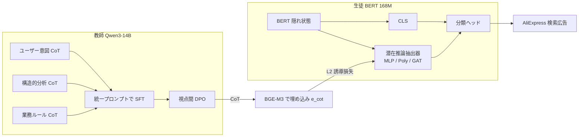

# Thinking Broad, Acting Fast: Latent Reasoning Distillation from Multi-Perspective Chain-of-Thought for E-Commerce Relevance

- **Link**: <https://arxiv.org/abs/2601.21611v1>（HTML: <https://arxiv.org/html/2601.21611v1>）
- **Authors**: Baopu Qiu（同等貢献）, Hao Chen, Yuanrong Wu（浙江大学, インターン時）, Changtong Zan, Chao Wei（責任著者）, Weiru Zhang, Xiaoyi Zeng（Alibaba International Digital Commerce Group, Hangzhou）
- **Year**: 2026（arXiv 2026-01-29）
- **Venue**: Proceedings of the ACM Web Conference 2026（WWW '26）
- **Type**: Academic Paper
- **証拠の質**: **一次資料**（企業著者の論文。AliExpress 検索広告で 7 日間の A/B テスト）
- **蒸留の種別**: **真の蒸留**（14B 教師の多視点 CoT を、BERT の「潜在推論ベクトル」へ埋め込み整列で蒸留）

## Abstract

> 原文の逐語転載は引用上限を超えるため要約で示します。

Single-perspective chain-of-thought misses the multifaceted nature of e-commerce relevance, and existing distillation methods discard CoT structure at inference. The paper proposes Multi-Perspective CoT (MPCoT) for the teacher, combining SFT and DPO, and Latent Reasoning Knowledge Distillation (LRKD) for the student, which keeps a lightweight latent reasoning extractor at inference. Online, it reports +1.42% RPM and +0.4% relevance satisfaction on a platform serving tens of millions of users daily.

## Abstract (Japanese Translation)

単一視点の CoT では EC の関連度の多面性（ユーザー意図・構造的な属性比較・業務ルール）を捉えきれず、既存の蒸留手法は推論時に CoT の構造を捨ててしまいます。本論文は、教師側に **多視点 CoT（MPCoT）** を SFT と DPO で学習させ、生徒側には推論時も軽量な **潜在推論抽出器** を残す **潜在推論知識蒸留（LRKD）** を提案します。日に数千万人が使うプラットフォームで、**RPM +1.42%、関連度満足度 +0.4%** を報告しています。

## Overview

- **教師**: Qwen3-14B（LoRA）。3 つの視点（ユーザー意図 / 構造的分析 / 業務ルール）の CoT を 1 つのプロンプトで SFT し、視点間の対立サンプルで DPO。
- **生徒**: BERT-multilingual-base（168.15M）+ 潜在推論抽出器（MLP / Poly-Encoder / GAT）。
- **蒸留**: 抽出器が出す潜在推論ベクトル $r_{qp}$ を、教師 CoT の BGE-M3 埋め込み $e_{cot}$ に L2 で近づける。
- **成果**: 生徒（LRKD-GAT）は AliExpress で ACC 53.17 → 57.36、F1 49.34 → 52.29。A/B（各群 10%, 7 日）で **RPM +1.42%、CTR +0.48%、RS +0.4%**。
- **効率**: 14B 教師は 100 件で 46.8 秒、生徒は 132〜149ms（約 350 倍高速）。

## Problem

- **単一視点の限界**: 1 つの観点の CoT では、ブランド違い・カテゴリ違い・アクセサリ不一致などの多様な不一致を網羅できない。
- **CoT 構造の喪失**: 既存の CoT 蒸留（CED-KD、MKD など）は推論時に CoT 情報を使わないため、蒸留した知識が表現に十分残らない。
- **多言語・多クラス**: AliExpress は 6 言語・6 クラス（Strongly Relevant、Brand / Category / Model / Attribute / Accessory Mismatch）。

## Proposed Method

**MPCoT（教師）**

1. 3 視点それぞれで CoT を生成し、**予測ラベルが正解と一致した CoT だけ** を残す。
2. 3 視点のデータを 1 つの統一プロンプトにまとめて SFT:

$$
\mathcal{L}_{SFT}=-\sum\log P(r,y\mid q,p;\theta)
$$

3. 視点間で判定が割れたサンプルで DPO。棄却応答 = 失敗した視点の応答、選択応答 = 他視点の pass@5 で得た正解の推論:

$$
\mathcal{L}_{DPO}=-\mathbb{E}\left[\log\sigma\left(\pi_\theta(y^+\mid q,p)-\pi_\theta(y^-\mid q,p)\right)\right]
$$

（論文の記載どおり。標準 DPO の参照方策の項が式から省かれている点に注意）

**LRKD（生徒）**

4. BERT の隠れ状態 $H$ とマスク $M_{qp}$ から潜在推論ベクトルを抽出:

$$
r_{qp}=R(H,M_{qp})\in\mathbb{R}^{d}
$$

- MLP: トークンごとの MLP → マスク付き平均プーリング
- Poly-Encoder: 学習可能なコンテキストコード $K=32$ で注意 → 平均
- GAT: 有効トークン上のグラフ注意 → ノード平均

5. 分類は [CLS] と $r_{qp}$ の連結から線形ヘッドで行う（$\mathcal{L}_{cls}$ = CE）。
6. 誘導損失で教師 CoT の埋め込みへ近づける:

$$
\mathcal{L}_{guide}=\left\|r_{qp}-e_{cot}\right\|_2^2,\qquad
\mathcal{L}_{total}=\mathcal{L}_{cls}+\lambda\mathcal{L}_{guide},\quad\lambda=0.1
$$

- $e_{cot}$: 凍結した BGE-M3（最大 1,024 トークン）による教師 CoT の文埋め込み。

**Features**:

- 推論時も抽出器は残る（追加 0.46〜16.54ms）が、CoT の生成は不要。
- 教師: SFT 3 epoch（lr 5e-5, batch 32）、DPO 3 epoch（lr 5e-6, batch 64）。生徒: 5 epoch、lr 2e-6、batch 256、入力 128 トークン。

## Algorithm (Pseudocode)

```
Algorithm: MPCoT + LRKD
Input : 学習データ (q, p, y), 3 視点のプロンプト
Output: BERT + 潜在推論抽出器

# Teacher
1. for view in {UserIntent, Structured, BusinessRule}:
       D_view ← {(q,p,r,y) | Teacher(view) の判定 == y}
2. T ← SFT(Qwen3-14B LoRA, ∪ D_view, unified prompt)
3. for 判定が割れたサンプル:
       y- ← 失敗した視点の応答; y+ ← pass@5 で得た正解の推論
   T ← DPO(T, (y+, y-))
4. for (q,p): e_cot ← BGE-M3(T(q,p).rationale)

# Student
5. for batch:
       H ← BERT(q, p); r ← R(H, M)               // MLP / Poly / GAT
       logit ← W [CLS ; r]
       L ← CE(logit, y) + 0.1 * ||r - e_cot||^2
6. deploy BERT + R (CoT 生成なし)
```

## Architecture / Process Flow



## Figures & Tables

### 論文の図（arXiv HTML から参照）


- **Figure 1**: 単一視点から多視点の推論への移行の説明図（画像 URL は HTML から特定できず）
- **Figure 4**: CoT の主要キーワードに対するプローブ F1（潜在推論ベクトル vs [CLS]）。下の数値表を参照

### Table 1: 主結果（ACC / F1, %）

| モデル | AliExpress | ESCI-US | ESCI-JP | ESCI-ES |
|---|---|---|---|---|
| **教師** | | | | |
| Best-SingleCoT few-shot | 54.92 / 47.01 | 59.39 / 48.05 | 58.72 / 48.90 | 58.95 / 52.88 |
| Best-SingleCoT SFT | 59.81 / 53.87 | 63.20 / 50.21 | 60.11 / 49.97 | 60.62 / 55.28 |
| Best-SingleCoT SFT+DPO | 64.83 / 58.26 | 69.49 / 50.08 | 65.39 / 51.14 | 68.10 / 58.21 |
| ProgressiveCoT SFT | 61.47 / 54.22 | 62.86 / 48.45 | 62.33 / 50.01 | 61.03 / 54.05 |
| MPCoT few-shot | 55.86 / 48.00 | 57.51 / 45.09 | 55.82 / 45.61 | 57.62 / 49.49 |
| MPCoT SFT | 64.45 / 62.18 | 64.26 / 49.48 | 64.17 / 48.06 | 61.37 / 56.02 |
| **MPCoT SFT+DPO** | **68.36 / 65.90** | **70.23 / 51.85** | **69.72 / 53.69** | 67.32 / **60.31** |
| **配信可能なベースライン** | | | | |
| BERT-multilingual-base | 53.17 / 49.34 | 66.83 / 41.38 | 62.36 / 42.60 | 64.50 / 53.25 |
| **生徒** | | | | |
| CED-KD | 56.82 / 50.87 | 67.49 / 43.71 | 62.94 / 43.10 | 64.51 / 53.61 |
| MKD（Taobao, 04） | 55.93 / 50.65 | 68.34 / 42.45 | 62.50 / 43.17 | 65.64 / 54.93 |
| LRKD-MLP | 56.04 / 50.98 | 66.94 / 42.61 | 62.19 / 42.96 | 64.99 / 54.61 |
| LRKD-Poly | 56.92 / 51.37 | 67.92 / 44.33 | 63.44 / 45.27 | 65.89 / 55.47 |
| **LRKD-GAT** | **57.36 / 52.29** | **68.73 / 45.83** | **63.96 / 47.21** | **66.30 / 55.89** |

> 注: 教師（68.36）と生徒（57.36）の差は 11pt と大きく、**生徒は教師に遠く及ばない**。LRKD は「ベースライン BERT からの上積み」（+4.2pt）を得る手法と読むのが妥当です。

### Table 2: 効率（A100, 100 件バッチの推論時間）

| モデル | パラメータ | 推論時間（ms） |
|---|---|---|
| MPCoT 教師 | 14B | 46,800 |
| BERT-multilingual-base | 168.15M | 132.22 |
| + LRKD-MLP | 169.33M | 134.02 |
| + LRKD-Poly | 168.18M | 132.68 |
| + LRKD-GAT | 168.74M | 148.76 |

### Table 3: 多視点 SFT のアブレーション（AliExpress / ESCI-US）

| モデル | AliExpress ACC | F1 | ESCI-US ACC | F1 |
|---|---|---|---|---|
| User Intent SFT | 58.49 | 51.96 | 63.20 | 50.21 |
| + User Intent DPO | +4.46 | +3.98 | +5.12 | −0.14 |
| + MPCoT DPO | +3.08 | +3.11 | +2.95 | −1.45 |
| Structured Analysis SFT | 57.81 | 51.02 | 62.63 | 48.05 |
| + Structured Analysis DPO | +4.89 | +4.01 | +4.78 | +2.00 |
| + MPCoT DPO | +3.44 | +2.12 | +5.79 | +0.30 |
| Business Rules SFT | 59.81 | 53.87 | 56.89 | 45.06 |
| + Business Rules DPO | +5.02 | +4.39 | +12.60 | +5.02 |
| + MPCoT DPO | +3.88 | +2.01 | +9.63 | +2.56 |
| MPCoT SFT+DPO | 68.36 | 65.90 | 70.23 | 51.85 |

### Table 4: LRKD のアブレーション

| モデル | AliExpress ACC | F1 | ESCI-US ACC | F1 |
|---|---|---|---|---|
| LRKD-Poly | 56.92 | 51.37 | 67.92 | 44.33 |
| 抽出器なし | −1.49 | −0.89 | −1.73 | −1.35 |
| 誘導損失なし | −1.38 | −1.04 | −1.98 | −1.55 |
| LRKD-GAT | 57.36 | 52.29 | 68.73 | 45.83 |
| 抽出器なし | −1.35 | −1.15 | −1.09 | −1.11 |
| 誘導損失なし | −1.42 | −1.13 | −2.14 | −2.06 |

### Table 5: 詳細アブレーション（ESCI-JP / ESCI-ES 列を追加）

| モデル | ESCI-JP ACC | F1 | ESCI-ES ACC | F1 |
|---|---|---|---|---|
| User Intent SFT | 60.11 | 49.97 | 60.62 | 55.28 |
| + User Intent DPO | +5.28 | +1.17 | +7.48 | +2.93 |
| + MPCoT DPO | +3.63 | +0.14 | +4.79 | −1.29 |
| Structured Analysis SFT | 59.67 | 47.61 | 59.95 | 51.48 |
| + Structured Analysis DPO | +6.45 | +1.45 | +7.48 | +6.19 |
| + MPCoT DPO | +3.76 | −0.19 | +2.92 | +0.06 |
| Business Rules SFT | 55.53 | 46.90 | 55.07 | 49.92 |
| + Business Rules DPO | +11.35 | +2.08 | +12.27 | +7.63 |
| + MPCoT DPO | +8.59 | +1.02 | +7.94 | +3.22 |
| MPCoT SFT+DPO | 69.72 | 53.69 | 67.32 | 60.31 |
| LRKD-Poly | 63.44 | 45.27 | 65.89 | 55.47 |
| 抽出器なし | −2.34 | −0.98 | −1.92 | −1.40 |
| 誘導損失なし | −2.39 | −1.03 | −2.95 | −1.51 |
| LRKD-GAT | 63.96 | 47.21 | 66.30 | 55.89 |
| 抽出器なし | −1.76 | −0.95 | −2.41 | −1.22 |
| 誘導損失なし | −3.03 | −1.62 | −2.88 | −1.34 |

（AliExpress / ESCI-US 列は Table 3・4 と同じ値のため省略）

### Table 6: 視点の多様性と構造効率

| モデル | AliExpress ACC | F1 | ESCI-US ACC | F1 |
|---|---|---|---|---|
| 教師 S-CoT SFT+DPO（サイズ一致） | 66.49 | 62.50 | 69.98 | 50.05 |
| 教師 MPCoT SFT+DPO | 68.36 | 65.91 | 70.23 | 51.85 |
| 生徒 平均アンサンブル（BERT 3 個） | 55.10 | 50.01 | 68.05 | 42.33 |
| 生徒 LRKD-Combined | 57.28 | 51.86 | 68.76 | 45.02 |
| 生徒 LRKD-GAT | 57.36 | 52.29 | 68.73 | 45.83 |

LRKD-Combined は教師学習コストが約 3 倍。

### Figure 4 の数値: プローブ F1（ESCI-US, 上位 15 キーワード平均）

| 表現 | プローブ F1 |
|---|---|
| [CLS] | 0.221 |
| 潜在推論ベクトル | 0.403（+81.8%, paired t-test p<0.05, 10 回） |

### オンライン A/B テスト（AliExpress 検索広告）

| 項目 | 値 |
|---|---|
| 期間 | 7 日 |
| トラフィック | LRKD 10% / 推論部品なしの同等生徒 10% |
| RPM | +1.42% |
| CTR | +0.48% |
| RS（関連度満足度, 人手） | +0.4% |

## Experiments & Evaluation

### Setup

- データ: Amazon ESCI（US / JP / ES, 各 10 万学習・1 万テスト, 4 クラス）、AliExpress 社内（約 10 万学習・2 万テスト, 6 言語・6 クラス。**抽出分布は実トラフィックと異なる** と明記）。

### Main Results

- MPCoT SFT+DPO は単一視点の最良より AliExpress で +3.5pt。
- LRKD-GAT は BERT 比 AliExpress ACC +4.19pt、F1 +2.95pt。

### Ablation Study

- 抽出器・誘導損失のどちらを外しても 1〜3pt 低下。
- 3 つの BERT のアンサンブルより、1 つの LRKD 生徒の方が良い。

## 蒸留のビジネス価値式への当てはめ

| 項 | 報告内容 |
|----|---------|
| $(C_{teacher}-C_{student})Q$ | 推論 約 350 倍高速（46,800ms 対 132〜149ms / 100 件） |
| $\Delta\text{Acc}$ | 教師比 −11pt（ACC）と大きい。ただしベースライン BERT 比 +4.2pt |
| ビジネス成果 | RPM +1.42%（広告収益に直結する指標） |

## Practical Takeaways

1. **CoT は複数視点で作る**: 単一視点より多視点の方が教師の質が上がる。
2. **生徒に小さな「推論用モジュール」を残す**: 推論時のコスト増は最大 12.5%（GAT）で、効果は 1〜3pt。
3. **教師と生徒の差は大きく残る**: 6 クラスの細かい関連度では、BERT 級の生徒が教師に並ぶのは難しい。

## Notes

- 日本語（ESCI-JP）でも同様の傾向が出ており、**日本語 EC での適用可能性** を示唆します。
- HTML の後半（付録 E のケーススタディ詳細）は取得範囲外で未確認です。
- **（2026-10-22 追記・検証）** arXiv HTML 版で RPM +1.42% / CTR +0.48% / RS +0.4%、A/B（各 10% × 7 日）、教師 Qwen3-14B、生徒 168.15M（+LRKD GAT 168.74M）、ACC 53.17 → 57.36、F1 49.34 → 52.29 を再確認した。「約 350 倍」は論文が明記した値ではなく、Table 2 の 100 件あたり推論時間（教師 46,800ms、BERT 132ms、LRKD-GAT 148.76ms）から本レポートが算出した概算（BERT 比 約 354 倍、LRKD-GAT 比 約 315 倍）である。「教師比 −11pt」も AliExpress の ACC（教師 68.36 対 生徒 57.36）から算出した値で、ESCI-US では差が約 1.5pt にとどまる。
