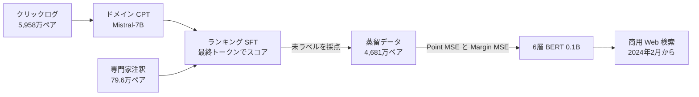

# Best Practices for Distilling Large Language Models into BERT for Web Search Ranking（DisRanker）

- **Link**: <https://arxiv.org/abs/2411.04539v1>（HTML: <https://arxiv.org/html/2411.04539v1>）
- **Authors**: Dezhi Ye, Junwei Hu, Jiabin Fan, Bowen Tian, Jie Liu, Haijin Liang, Jin Ma（Tencent。メールドメインが tencent.com）
- **Year**: 2025（arXiv 2024-11-07）
- **Venue**: COLING 2025 Industry Track（ACL Anthology ID 2025.coling-industry.11）
- **Type**: Academic Paper
- **証拠の質**: **一次資料**（企業著者の論文。1 週間の A/B テスト、2024 年 2 月から商用 Web 検索エンジンで稼働と記載。エンジン名は非公開）
- **蒸留の種別**: **真の蒸留**（7B LLM ランカーのスコアを、6 層 BERT へ point-wise + margin MSE で蒸留）

## Abstract

> 原文の逐語転載は引用上限を超えるため要約で示します。

The paper proposes DisRanker, which transfers the ranking ability of an LLM teacher to a compact BERT-style student. The pipeline has three parts: domain continued pre-training on clickstream data, supervised fine-tuning with a rank loss using an end-of-sequence token as the sentence representation, and distillation with a hybrid point-wise and margin MSE loss. Offline and online evaluations confirm the efficacy, and the model has been integrated into a commercial web search engine as of February 2024.

## Abstract (Japanese Translation)

LLM 教師のランキング能力をコンパクトな BERT 型生徒へ移す **DisRanker** を提案します。手順は 3 つです。(1) クリックストリームを使ったドメイン継続事前学習、(2) 文末トークンを文表現とするランキング損失での教師あり微調整、(3) point-wise と margin MSE を組み合わせた損失による蒸留。オフライン・オンライン評価で有効性を確認し、**2024 年 2 月から商用 Web 検索エンジンに統合** されています。

## Overview

- **教師**: Mistral-7B-v0.1（脚注。本文 4.2 節は LLaMA 2 7B と記載し不整合あり）。CPT → ランキング SFT。
- **生徒**: 6 層 BERT（bert-base-multilingual-cased 由来, 0.1B）。
- **成果**: 生徒の nDCG@5 0.8536（BERT-large 蒸留 0.8367 より上）。A/B で **PageCTR +0.47%、UserCTR +0.58%、滞在時間 +1.2%、ΔGSB +12%**。
- **レイテンシ**: 教師 約 100ms → 生徒 約 10ms（A10, batch 48, 系列長 256）。

## Problem

- **LLM はランキング精度が高いが遅い**: 7B で 1 バッチ 約 100ms。
- **LLM とランキングのずれ**: 生成目的で事前学習された LLM は、クエリ-文書の関連度を判断する表現が弱い。
- **文表現の取り方**: デコーダでは先頭トークンが文全体を見られない。
- **蒸留損失の選択**: point-wise は絶対値、margin は順序を重視し、一長一短。

## Proposed Method

1. **ドメイン継続事前学習（CPT）**: クエリを入力、クリックされたタイトル・要約を出力として生成学習（約 5,958 万ペア）。

$$
\mathcal{L}_{CPT}=-\sum_{t}\log P(w_t\mid \text{query}, w_{<t})
$$

2. **ランキング SFT**: 入力 `<s>query:title:summary</s>` の最終トークン `</s>` の隠れ状態を密層でスカラー化。ヒンジ型のランキング損失（マージン $\mathcal{T}=0.1$）:

$$
\mathcal{L}_{rank}=\max\left(0,\ \mathcal{T}-\left(f(q,d^+)-f(q,d^-)\right)\right)
$$

（論文の記載は $\mathrm{Max}(0, f(q,d^+)-f(q,d^-), \mathcal{T})$ で、マージンの位置が崩れているため、標準的なヒンジ形で示しました）

3. **蒸留（ハイブリッド損失）**:

$$
\mathcal{L}_{Point}=\mathrm{MSE}\left(Sim_T(q,d^+),Sim_S(q,d^+)\right)+\mathrm{MSE}\left(Sim_T(q,d^-),Sim_S(q,d^-)\right)
$$

$$
\mathcal{L}_{Margin}=\mathrm{MSE}\left(Sim_T(q,d^+)-Sim_T(q,d^-),\ Sim_S(q,d^+)-Sim_S(q,d^-)\right)
$$

$$
\mathcal{L}_{hybrid}=\mathcal{L}_{Point}+\beta\cdot\mathcal{L}_{Margin},\qquad\beta=0.4
$$

- $Sim_T$ / $Sim_S$: 教師 / 生徒のスコア、$d^+$ / $d^-$: より関連の高い / 低い文書。

## Algorithm (Pseudocode)

```
Algorithm: DisRanker
Input : クリックログ (5,958万), 注釈データ (79.6万), 検索ログ (4,681万)
Output: 6層 BERT ランカー

1. LLM ← CPT(Mistral-7B, query → clicked title+summary)
2. LLM ← SFT(LLM, input "<s>query:title:summary</s>", score = Dense(h_</s>), hinge rank loss T=0.1)
3. for (q, d+, d-) in search logs: s+ ← LLM(q,d+), s- ← LLM(q,d-)
4. BERT6 ← minimize Point-MSE + 0.4 * Margin-MSE
5. deploy BERT6 (≈10ms/batch on A10)
```

## Architecture / Process Flow



## Figures & Tables

### 論文の図


- **Figure 1**: LLM デコーダから BERT エンコーダへのランク蒸留の概要
- **Figure 2**: 蒸留の流れ（Step 1: ランキング損失で LLM を SFT、Step 2: LLM が未ラベルデータを採点、Step 3: ハイブリッド損失で BERT へ蒸留）
- **Figure 3**: ドメイン継続事前学習（クエリからクリックされたタイトル・要約を生成）
- **Figure 4**: テストデータにおける LLM 教師・BERT 微調整・BERT 生徒の出力スコア分布

### Table 1: データ

| 段階 | クエリ | Query-Doc ペア | 備考 |
|---|---|---|---|
| CPT | 10,468,974 | 59,579,125 | クリックストリーム [Query, Title, Summary] |
| KD | 5,939,563 | 46,814,775 | 匿名検索ログ |
| SFT | 106,496 | 796,095 | 専門家注釈 |
| Test | 13,094 | 104,960 | |

ラベルは 0〜4（bad / fair / good / excellent / perfect）。

### Table 2: LLM ランカーの比較（テストセット）

| モデル | PNR | nDCG@5 |
|---|---|---|
| BERT-Base | 3.252 | 0.8336 |
| BERT-large | 3.426 | 0.8412 |
| GPT4-Pointwise | 3.01 | 0.8251 |
| GPT4-Pairwise | 3.14 | 0.8273 |
| GPT4-Listwise | 3.19 | 0.8299 |
| TSRankGPT | 3.475 | 0.8505 |
| RankLLaMA | 3.514 | 0.8611 |
| LLM2Vec | 3.496 | 0.8604 |
| DisRanker-Teacher | 3.546 | 0.8709 |
| **DisRanker-Teacher with CPT** | **3.643** | **0.8793** |

> **GPT-4 のプロンプト利用は BERT-Base より低い**（nDCG@5 0.8251〜0.8299）。ドメイン適応した 7B 教師が必要なことを示します。

### Table 3: 蒸留損失のアブレーション（6 層 BERT 生徒）

| 戦略 | PNR | nDCG@5 |
|---|---|---|
| BERT-large 蒸留 | 3.352 | 0.8367 |
| Instruction distillation | 3.538 | 0.8464 |
| Point-wise | 3.534 | 0.8496 |
| Margin-wise | 3.554 | 0.8460 |
| **Hybrid-loss** | **3.593** | **0.8536** |

```
nDCG@5（生徒 6 層 BERT）
BERT-large distill |████████████████ 0.8367
Instruction distil |████████████████▉ 0.8464
Point-wise         |█████████████████ 0.8496
Margin-wise        |████████████████▉ 0.8460
Hybrid             |█████████████████▏ 0.8536   (教師 0.8793)
```

### Table 4: オンライン A/B（1 週間, 6 層 BERT ベースライン比）

| 指標 | 変化 | p 値 |
|---|---|---|
| PageCTR | +0.47% | 0.025 |
| UserCTR | +0.58% | 0.018 |
| Change Query Ratio（再検索率） | −0.38% | 0.026 |
| Dwell time | +1.2% | 0.016 |
| ΔGSB | +12% | 0.002 |

専門家レビュー（200 クエリ）: Good : Same : Bad = 54 : 116 : 30。

### Table 5: レイテンシ（A10, batch 48, 最大系列長 256）

| モデル | パラメータ | レイテンシ |
|---|---|---|
| LLM（教師） | 7B | 約 100ms |
| BERT-12 | 0.2B | 約 20ms |
| BERT-6 | 0.1B | 約 10ms |

### 手法比較

| 観点 | DisRanker | Walmart（01） | Instruction Distillation（Sun ら, 2023） |
|---|---|---|---|
| 教師 | Mistral-7B（CPT + SFT） | Mistral-7B（SFT） | ペアワイズ LLM ランカー |
| 生徒 | 6 層 BERT | BERT-Base 交差 | ポイントワイズ LLM |
| 損失 | Point + 0.4 Margin MSE | 拡張 Margin MSE | 教師のペア予測を模倣 |
| 本番 | 商用 Web 検索 | Walmart.com | なし |

## Experiments & Evaluation

### Setup

- 指標: PNR（正順ペア / 逆順ペア比）、nDCG@5。オンラインは CTR、再検索率、滞在時間、GSB。
- オンラインのベースラインは「24 層 BERT から蒸留した 6 層 BERT」。

### Main Results

- CPT で教師の nDCG@5 0.8709 → 0.8793。
- 生徒はハイブリッド損失で 0.8536（point-wise 比 +1.6% PNR）。

### Ablation Study

- margin 損失は PNR に、point-wise 損失は nDCG に効き、両者の組合せが最良。

## 蒸留のビジネス価値式への当てはめ

| 項 | 報告内容 |
|----|---------|
| $(C_{teacher}-C_{student})Q$ | レイテンシ 約 10 分の 1（100ms → 10ms / batch） |
| $C_{data}$ | 専門家注釈 79.6 万件 + クリックログ |
| $\Delta\text{Acc}$ | nDCG@5 で教師比 −0.026 |
| ビジネス成果 | 滞在時間 +1.2%、UserCTR +0.58% |

## Practical Takeaways

1. **教師にはクリックログで CPT**: 生成目的の LLM をドメインに合わせるだけで、ランカー性能が上がる。
2. **デコーダの文表現は最終トークン**: ランキング SFT では `</s>` の隠れ状態を使う。
3. **損失はハイブリッド**: point-wise と margin を β=0.4 で混ぜる。
4. **GPT-4 のプロンプト利用は本番ランカーの教師としては弱い**。

## Notes

- 本文の教師モデル名（Mistral / LLaMA 2）と Table 5 のパラメータ数に不整合があり、再現時は注意が必要です。
- 限界: 単一の社内データ・単一エンジン、1 週間の A/B、200 クエリのレビュー。
- **（2026-10-22 追記・検証）** arXiv HTML 版で、教師 Mistral-7B-v0.1（CPT + ランキング SFT）、生徒 6 層 BERT 0.1B、蒸留ペア 46,814,775 件、ハイブリッド損失の nDCG@5 0.8536（BERT-large 蒸留 0.8367）、GPT-4 pointwise 0.8251 対 BERT-Base 0.8336、レイテンシ 約 100ms → 約 10ms、A/B 1 週間（PageCTR +0.47%、UserCTR +0.58%、滞在 +1.2%、ΔGSB +12%）、2024 年 2 月の商用稼働を再確認した。「教師比 −0.026」は論文に明記はなく、CPT 教師 0.8793 と生徒 0.8536 の差から本レポートが算出した値（非 CPT 教師 0.8709 との差は 0.0173）。GPT-4 の値は pointwise のもので、pairwise 0.8273 / listwise 0.8299 はやや高い。
