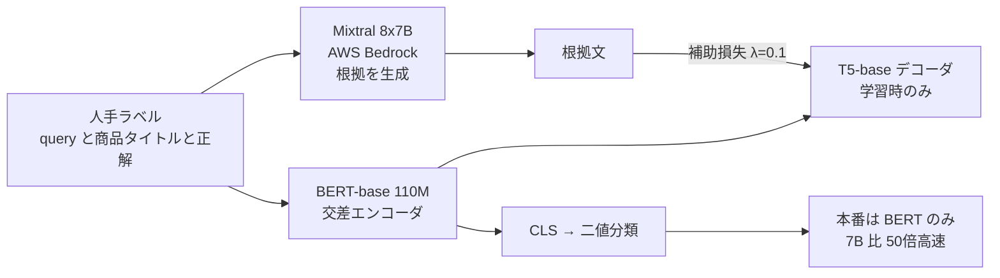

# Rationale-Guided Distillation for E-Commerce Relevance Classification: Bridging Large Language Models and Lightweight Cross-Encoders

- **Link**: <https://aclanthology.org/2025.coling-industry.12.pdf>（Amazon Science の掲載ページ: <https://www.amazon.science/publications/rationale-guided-distillation-for-e-commerce-relevance-classification-bridging-large-language-models-and-lightweight-cross-encoders>）
- **Authors**: Sanjay Agrawal, Faizan Ahemad（同等貢献）, Vivek Sembium（Amazon, India）
- **Year**: 2025
- **Venue**: Proceedings of the 31st International Conference on Computational Linguistics: Industry Track（COLING 2025）, pp.136–148
- **Type**: Academic Paper
- **証拠の質**: **一次資料**（企業著者の査読付き論文）。ただし **オフライン評価のみ** で、「使用データは匿名化・集約済みで本番分布を表さない」と明記。**本番 A/B の報告はない**
- **蒸留の種別**: **根拠（rationale）蒸留**（LLM の説明文を補助タスクとして小型交差エンコーダに学習させる。Distilling Step-by-Step 系）

## Abstract

> 原文の要点を引用・要約で示します（PDF より取得）。

"Accurately classifying the relevance of Query-Product pairs is critical in online retail stores such as Amazon." LLMs excel at this task but their high computational demands constrain deployment. The authors propose a distillation approach that uses "rationales" generated by LLMs to guide smaller cross-encoder models, enabling distillation into smaller cross-encoders deployable in production without requiring the LLM. "Our method achieves average ROC-AUC improvements of 1.4% on 9 multilingual e-commerce datasets, 2.4% on 3 ESCI datasets, and 6% on GLUE datasets over vanilla cross-encoders. Our 110M parameter BERT model matches 7B parameter LLMs in performance (< 1% ROC-AUC difference) while being 50 times faster per sample."

## Abstract (Japanese Translation)

Amazon のような EC では、クエリと商品の関連度を正しく分類することが重要です。LLM はこのタスクが得意ですが、計算コストが大きく本番配信を妨げます。本論文は、**LLM が生成した「根拠（rationale）」で小型の交差エンコーダを導く蒸留手法** を提案します。根拠は LLM の判断の要点を含み、学習効率を高め、LLM なしで本番配信できる小型モデルへの蒸留を可能にします。9 つの多言語 EC データで平均 ROC-AUC +1.4%、ESCI 3 データで +2.4%、GLUE で +6%（いずれも素の交差エンコーダ比）を達成し、**110M の BERT が 7B の LLM と同等（ROC-AUC 差 1% 未満）で、1 件あたり 50 倍高速** です。

## Overview

- **根拠の生成**: Mixtral 8x7B Instruct（AWS Bedrock 経由）に「[Query] is [Product Title] relevant? [Relevance]. Explain why.」と尋ね、正解ラベル付きで説明文を書かせる。
- **生徒**: BERT-base（110M, 12 層, 768 次元）交差エンコーダ + T5-base デコーダ（学習時のみ）。
- **性能の天井**: LLaMA2-7B / Mistral-7B-v0.3 の最終層に線形層を付けて学習したもの（「Performance ceiling」）。
- **結論**: 1 万件の少量データでは 9 中 6 地域で微調整 7B LLM を上回り、10 万件では 9 中 1 地域で上回る。**データが少ないほど根拠蒸留が効く**。

## Problem

- **計算量**: 20B LLM で 5,000 万ペアを分類すると単一 GPU で数日かかるが、交差エンコーダなら数時間。
- **本番構成**: 頻出クエリの商品集合をオフラインで事前生成し、関連度モデル（軽量交差エンコーダ）で不適切な ⟨query, product⟩ を除外する。毎日数百万ペアを評価するため小型である必要がある。
- **少量データ**: 地域ごとに人手ラベルが限られる（各 10 万件）。

## Proposed Method

**手順（論文の 3 ステップ）**

1. **LLM の直接回答**: zero-shot / few-shot で「Yes / No」を答えさせる（ベースライン。>20pt 低い）。
2. **LLM + 線形層の微調整**: 最終隠れ状態 $h_i=\theta_{LLM}(q_i,p_i)$ に線形層 $\hat{y}_i=Wh_i+b$ を付けて BCE 学習（LLM は固定）。これを「性能の天井」とする。
3. **根拠の生成と交差エンコーダへの蒸留**: 交差エンコーダ-デコーダ構造で、BERT が分類、T5 デコーダが LLM の根拠を生成する補助タスクを学習。推論時は BERT のみ。

**Key Formulas**:

$$
h_i=\mathrm{BERT}(q_i,p_i),\qquad \hat{y}_i=\sigma(W h_{CLS}+b),\qquad r_i=\mathrm{Decoder}(h_i)
$$

$$
\mathcal{L}_{total}=\mathcal{L}_{classification}+\lambda\mathcal{L}_{aux},\qquad\lambda=0.1
$$

$$
\mathcal{L}_{classification}=-\frac{1}{N}\sum_{i=1}^{N}\mathcal{L}_{CE}(y_i,\hat{y}_i),\qquad
\mathcal{L}_{aux}=-\frac{1}{N}\sum_{i=1}^{N}\sum_{t=1}^{T}\log P(r_{i,t}\mid r_{i,<t},h_i)
$$

**実務的な工夫（4.4 節）**:

- **デコーダのウォームアップ**: まずデータの 50% で BERT を凍結しデコーダだけ学習（$\mathcal{L}_{warmup}=\mathcal{L}_{aux}$）、その後学習の最初の 30% でエンコーダを線形ウォームアップ。
- **CLS をデコーダ入力から除く**: 実験的に比較。
- **埋め込み型の根拠**（計算節約版）: BGE-M3 で根拠文を埋め込み、BERT の平均プーリング表現を変換して近づける:

$$
\mathcal{L}_{aux}=\left\|h_{transformed}-e_{reasoning}\right\|_2
$$

- $r_{i,t}$: 根拠の $t$ 番目のトークン、$h_i$: BERT の隠れ状態、$\lambda$: 補助損失の重み。

## Algorithm (Pseudocode)

```
Algorithm: Rationale-Guided Distillation (RGD)
Input : 人手ラベル D = {(q, p, y)}, LLM = Mixtral-8x7B-Instruct (Bedrock)
Output: BERT-base 交差エンコーダ (110M)

1. for (q,p,y) in D:
       r ← LLM("[q] is [p] relevant? [y]. Explain why.")   // 正解付きで根拠を生成
2. Phase A (warm-up): freeze BERT; train T5 decoder on 50% data, L = L_aux
3. Phase B: linear warm-up of encoder over first 30% steps
4. train: L = CE(y, σ(W h_CLS + b)) + 0.1 * L_aux(r | h)
5. deploy BERT + classification head only (decoder discarded)
```

## Architecture / Process Flow



## Figures & Tables

論文の図は PDF のため画像 URL を取得していません。キャプションと再現で示します。

- **Figure 1**: Cross-Encoder-Decoder for Reasoning Distillation（上の構成図）
- **Figure 2**: 注意マップと Shapley 値の可視化。(a) BERT ベースラインは関連トークンへの注目が不安定、(b) 提案モデルはクエリトークンへの注目と解釈性が向上
- **Figure 3**: 実務的な工夫ごとのサンプル数 vs AUC-ROC（Table 3 と同じデータ）
- **Figure 4〜6（付録）**: 埋め込み型根拠、ベースライン、LLM+線形層の構成

### Table 1: 多言語データでの相対 ROC-AUC（BERT = 1x 比, 括弧は 95% 信頼区間）

| 地域 | 学習件数 | +Reasoning（提案） | LLaMA2 / Mistral-7B の最良（微調整） | LLM ZS / FS |
|---|---|---|---|---|
| AU | 10K | +2.21%（±0.70） | −0.06%（±0.58） | −23.14% / −15.53% |
| AU | 100K | +1.21%（±1.20） | +2.19%（±1.31） | |
| ES | 10K | +2.84%（±1.11） | −0.73%（±0.49） | −28.01% / −15.64% |
| ES | 100K | +1.45%（±1.39） | +3.98%（±1.16） | |
| BR | 10K | +0.37%（±1.05） | −1.69%（±0.82） | −24.50% / −18.30% |
| BR | 100K | +1.14%（±1.21） | +1.62%（±1.32） | |
| AE | 10K | +1.45%（±0.94） | +3.85%（±1.18） | −29.77% / −20.48% |
| AE | 100K | +1.83%（±1.20） | +3.13%（±1.31） | |
| FR | 10K | +2.11%（±0.96） | +1.85%（±0.84） | −36.49% / −18.12% |
| FR | 100K | +2.16%（±1.24） | +2.47%（±1.24） | |
| MX | 10K | +0.32%（±0.84） | +4.28%（±1.08） | −27.87% / −15.05% |
| MX | 100K | +2.16%（±1.23） | +3.64%（±1.34） | |
| Saudi Arabia | 10K | +1.56%（±0.95） | −0.45%（±0.72） | −30.06% / −19.68% |
| Saudi Arabia | 100K | +2.20%（±1.21） | +1.37%（±1.21） | |
| DE | 10K | +2.14%（±0.85） | +4.56%（±0.98） | −24.70% / −7.52% |
| DE | 100K | +1.81%（±1.15） | +4.97%（±1.26） | |
| IN | 10K | +1.76%（±1.05） | +0.61%（±0.94） | −23.27% / −12.37% |
| IN | 100K | +0.87%（±1.24） | +4.28%（±1.35） | |
| ESCI US | 100K | +2.55%（±1.29）※ | +4.34%（±1.17）※ | −16.29% / −9.61% |
| ESCI JP | 100K | +1.53%（±1.09）※ | +1.60%（±0.97）※ | −33.61% / −25.55% |
| ESCI ES | 100K | +4.59%（±1.29）※ | +3.77%（±1.17）※ | −29.47% / −15.45% |

> 列の対応は、本文の「10K で 9 中 6 地域、100K で 9 中 1 地域が LLM を上回る」という記述と照合して確認しました（多言語 9 地域は記述と一致）。
> ※ ESCI 行は、本文が「ESCI では 7B の性能の天井も上回る」と述べており、PDF テキスト抽出での列順が多言語部分と異なる可能性があります。**ESCI 行の列の帰属は原文で要確認** です。

```
10K サンプルでの改善率（BERT 比）: 提案 vs 微調整 7B LLM
AU  提案 +2.21 |███████████  LLM -0.06 |
ES  提案 +2.84 |██████████████ LLM -0.73 |
DE  提案 +2.14 |██████████  LLM +4.56 |██████████████████████
MX  提案 +0.32 |█  LLM +4.28 |█████████████████████
```

### Table 2: GLUE と QADSM（ROC-AUC）

| データ | BERT | +Reasoning（提案） | LLaMA2 / Mistral-7B の最良 |
|---|---|---|---|
| QQP | 0.9571（±0.006） | 0.9625（±0.009） | 0.9728（±0.004） |
| RTE | 0.4754（±0.011） | 0.5873（±0.007） | 0.8867（±0.005） |
| MRPC | 0.7955（±0.008） | 0.8811（±0.003） | 0.9486（±0.010） |
| QNLI | 0.9467（±0.005） | 0.9531（±0.012） | 0.9887（±0.002） |
| CoLA | 0.5912（±0.009） | 0.6130（±0.007） | 0.9060（±0.011） |
| SST2 | 0.9488（±0.004） | 0.9480（±0.006） | 0.9907（±0.008） |
| **QADSM** | 0.7174（±0.010） | **0.9123（±0.005）** | 0.8787（±0.007） |

> クエリ-文書関連度の QADSM では、提案手法が **微調整 7B LLM を上回る**（0.9123 対 0.8787）。一般的な言語理解タスク（RTE / CoLA）では LLM に大差で負ける。

### Table 3: IN（英語）データでのサンプル数別アブレーション（BERT = 1x 比）

| サンプル数 | with Reasoning | + Decoder Warmup | + Ignore CLS | Reasoning Embeddings |
|---|---|---|---|---|
| 100 | +2.94% | **+5.24%** | +0.80% | +3.71% |
| 500 | +3.14% | **+4.98%** | +1.49% | +3.48% |
| 1,000 | +3.39% | **+5.76%** | +1.76% | +3.79% |
| 5,000 | +2.55% | **+2.88%** | +2.72% | +3.72% |
| 10,000 | +1.15% | **+1.75%** | +0.97% | +1.70% |
| 50,000 | +0.62% | **+0.93%** | −0.55% | +0.48% |
| 100,000 | +0.24% | **+0.87%** | +1.24% | +1.05% |

（列の帰属は本文「Decoder Warmup が一貫して最良、Reasoning Embeddings は full decoder にほぼ並ぶ」で照合）

```
Decoder Warmup の改善率とサンプル数
100     |██████████████████████████ +5.24%
1,000   |█████████████████████████████ +5.76%
10,000  |█████████ +1.75%
100,000 |████ +0.87%
```

### 手法比較

| 観点 | RGD（本論文） | Distilling Step-by-Step（Hsieh ら, 2023） | Taobao MKD（04） | Meituan CRSD（05） |
|---|---|---|---|---|
| 根拠の教師 | Mixtral 8x7B | PaLM 540B | Qwen2-7B（70B 級の CoT で SFT） | Qwen3-8B |
| 生徒 | BERT 110M 交差エンコーダ | T5（テキスト生成） | BERT / ColBERT 101M | 6 層 BERT |
| 根拠の使い方 | T5 デコーダで生成（補助） | マルチタスク生成 | BIO タグ | 自己蒸留の教師入力 |
| 本番 A/B | なし | なし | あり | あり |

## Experiments & Evaluation

### Setup

- データ: 9 地域（AU, ES, BR, AE, FR, MX, Saudi Arabia, DE, IN）各 10 万学習・1 万テスト、Amazon ESCI（US / JP / ES）、GLUE、QADSM。
- ベースライン: MS MARCO で追加学習した BERT-base。全実験 10 回の平均と 95% 信頼区間。

### Main Results

- 10K: 9 中 6 地域で微調整 7B を上回る。100K: 9 中 1 地域。
- ZS / FS の LLM は 20pt 以上低い → **LLM は微調整が必須**。

### Ablation Study

- デコーダのウォームアップで、根拠単体より最大 2pt 改善。
- 改善幅はサンプル数が増えるほど縮小（100 → 10K で +4.4pt、10K → 100K で +2.9pt の絶対性能向上）。

## 蒸留のビジネス価値式への当てはめ

| 項 | 報告内容 |
|----|---------|
| $(C_{teacher}-C_{student})Q$ | 1 件あたり 50 倍高速（110M 対 7B） |
| $C_{data}$ | 根拠生成は Bedrock の Mixtral。コスト非公開 |
| $\Delta\text{Acc}$ | ROC-AUC 差 1% 未満（著者の主張） |
| ビジネス成果 | **報告なし**（オフラインのみ） |

## Practical Takeaways

1. **人手ラベルが少ない地域・カテゴリほど根拠蒸留が有効**（1 万件以下で最大の効果）。
2. **LLM は根拠を「正解ラベル付き」で書かせる**: ラベルを与えて説明だけ生成させるので、根拠の誤りが少ない。
3. **埋め込み型の根拠** は計算が軽く、デコーダ方式にほぼ並ぶ。
4. **商用 LLM（Bedrock）を根拠生成に使う構成**: 自社クラウドのマネージド LLM を教師にする例（C2 と接続）。

## Notes

- Amazon India の同チームは EMNLP 2023 Industry で KD-Boost（リアルタイム意味マッチングの知識蒸留）も発表しています。
- 本論文は「本番配信可能」と述べますが、**本番 A/B の結果は含みません**。H1（本番の定量成果）の根拠としては弱い資料です。
