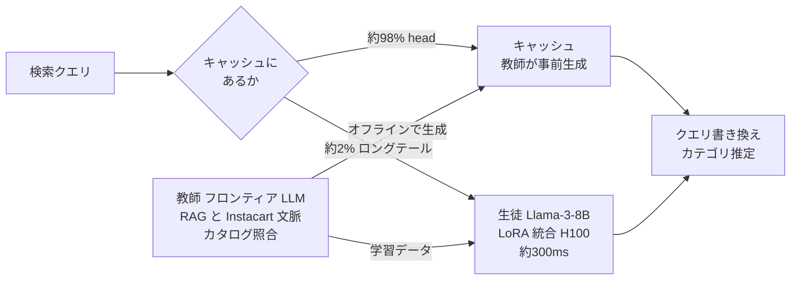

# Building The Intent Engine: How Instacart is Revamping Query Understanding with LLMs

- **Source**: Instacart（Yuanzheng Zhu, Guanghua Shu, Raochuan Fan, Vinesh Gudla, Tejaswi Tenneti）
- **Date**: 2025-11-21
- **Link**: <https://company.instacart.com/tech-innovation/building-the-intent-engine-how-instacart-is-revamping-query-understanding-with-llms>（同内容: <https://tech.instacart.com/building-the-intent-engine-how-instacart-is-revamping-query-understanding-with-llms-3ac8051ae7ac> は 403 で取得不可）
- **補助資料**: ZenML 要約 <https://www.zenml.io/llmops-database/rebuilding-query-understanding-for-e-commerce-search-with-llms>（二次）
- **Type**: Technical Article（企業エンジニアリングブログ）
- **証拠の質**: **一次資料（ベンダー＝自社申告のブログ）**。査読はなく、A/B の統計的有意性は記載なし
- **蒸留の種別**: **黒箱蒸留（教師出力による SFT）**。教師 = オフライン RAG で強化したフロンティア LLM、生徒 = Llama-3-8B（LoRA）。生徒は 8B と大きく、「小型化」よりも **「自社配信できる開放モデルへの置換」** が目的

## Overview

Instacart は、検索のクエリ理解（クエリ書き換え・カテゴリ推定などの「Intent Engine」）を LLM で作り直しました。戦略は「コンテキストエンジニアリング + ガードレール」から始め、最終目標を **「独自知識を LLM に直接蒸留する微調整」** に置く段階的なものです。

- **教師（オフライン）**: 名称非公開のフロンティア LLM を、上位の購入ブランド・カテゴリなどの Instacart 文脈で強化した RAG パイプライン。出力はカタログと照合して検証し、**head クエリのキャッシュ** と **生徒の学習データ** を生成。
- **生徒（リアルタイム）**: Llama-3-8B を教師データで LoRA 微調整。キャッシュに無いロングテールクエリ（全体の約 2%）をリアルタイム処理。
- **成果**: 生徒は教師とほぼ同等（F1 95.7% 対 95.8%）。A/B で **ロングテールの不満 −50%、平均スクロール深さ −6%**。

## Key Technical Content

### Architecture / Design



### Implementation Steps

1. **教師パイプライン**: フロンティア LLM に上位ブランド・カテゴリなどの文脈を RAG で与え、出力をカタログで検証。
2. **head のキャッシュ化**: 高頻度クエリの結果を事前計算して保存。
3. **学習データ生成**: 教師の高品質な出力を生徒の SFT データにする。
4. **生徒の LoRA 微調整**: Llama-3-8B。
5. **レイテンシ最適化**: そのままでは A100 で約 700ms → LoRA アダプタの統合（−30%）と H100 への移行で目標の約 300ms。
6. **量子化の見送り**: FP8 はさらに約 10% 速くなるが recall が下がったため、非量子化で配備。
7. **GPU のオートスケール**: 閑散時間帯は GPU 台数を減らす。

### Key Formulas / Metrics

| 指標 | 生徒（Llama-3-8B 微調整） | 教師（大型ベースライン） |
|---|---|---|
| Precision | 96.4% | 95.4% |
| Recall | 95.0% | 96.2% |
| F1 | 95.7% | 95.8% |

$$
F_1=\frac{2PR}{P+R}=\frac{2\times0.964\times0.950}{0.964+0.950}\approx0.957
$$

## Figures & Tables

### レイテンシの推移

| 段階 | レイテンシ | 備考 |
|---|---|---|
| そのまま（A100） | 約 700ms | |
| LoRA アダプタ統合 | 約 −30% | |
| + H100 | 約 300ms | 目標達成 |
| + FP8 量子化（不採用） | さらに約 −10% | recall 低下のため不採用 |

```
レイテンシ（ms）
A100 素    |███████████████████████████████████ ~700
統合+H100  |███████████████ ~300
(FP8)      |█████████████ ~270 (不採用)
```

### オンライン成果（A/B）

| 指標 | 結果 |
|---|---|
| 対象 | 下位 2% のロングテールクエリ |
| 平均スクロール深さ | −6%（目的の商品が早く見つかる） |
| ロングテールの検索結果への不満 | −50% |
| 規模 | 週あたり数百万件のコールドスタートクエリ |
| クエリ書き換えのカバレッジ | 50% → 95% 超（ZenML 要約）。precision 90% 超（検索結果に引用されたブログ本文） |

### 蒸留と量子化の区別

| 施策 | 種別 | 採否 |
|---|---|---|
| 教師出力で Llama-3-8B を SFT | **蒸留（黒箱）** | 採用 |
| LoRA アダプタの統合 | 推論最適化 | 採用 |
| FP8 量子化 | **量子化（蒸留ではない）** | 不採用（recall 低下） |
| head クエリのキャッシュ | 事前計算 | 採用 |

## Practical Takeaways

1. **キャッシュ + 蒸留モデルの二層構成**: 98% はキャッシュで済ませ、残り 2% だけを蒸留モデルで処理すると、8B でも費用が見合う。
2. **教師は「RAG で強化した商用 LLM」でもよい**: 生徒の学習データは、教師 + 自社文脈 + カタログ検証で作る。
3. **量子化は品質を必ず確認**: recall が落ちるなら採用しない判断が必要。

## Notes

- 教師モデル名は非公開。商用 API を教師にしている場合、利用規約（C8）との関係が論点になります。
- 生徒が 8B と大きいため、「小型化」よりも **自社 GPU で配信できる開放モデルへの置き換え（コスト・レイテンシ・データ管理）** が主目的と読めます。
- 金額ベースのコスト削減は非公開です。
