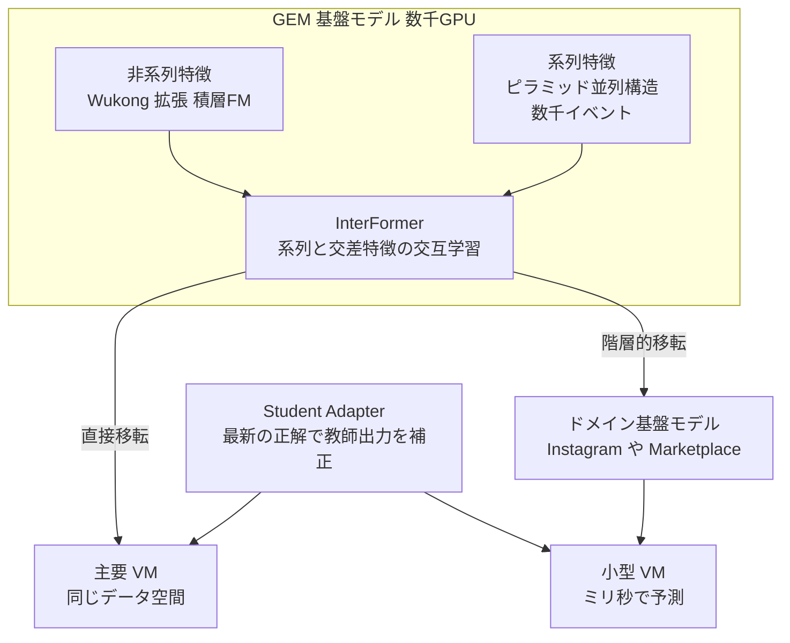

# Meta's Generative Ads Model (GEM): The Central Brain Accelerating Ads Recommendation AI Innovation

- **Source**: Engineering at Meta（Huayu Li, Xiaoyi Liu, Jade Nie, Ellie Wen, Chunzhi Yang, Jiyan Yang, Nancy Yu, Habiya Beg, Gil Arditi, Neeraj Bhatia）
- **Date**: 2025-11-10
- **Link**: <https://engineering.fb.com/2025/11/10/ml-applications/metas-generative-ads-model-gem-the-central-brain-accelerating-ads-recommendation-ai-innovation/>
- **補助資料**: ByteByteGo 解説（2025-12-17）<https://blog.bytebytego.com/p/how-meta-built-a-new-ai-powered-ads>（二次）
- **Type**: Technical Article（企業エンジニアリングブログ）
- **証拠の質**: **一次資料（自社申告）**。成果数値は四半期のビジネス報告で、A/B の詳細条件や統計は非公開
- **蒸留の種別**: **知識蒸留だが LLM 蒸留ではない**。教師 GEM は「LLM に着想を得た」推薦用基盤モデル（テキスト LLM ではない）。数百の垂直モデル（VM）へ蒸留・表現学習・パラメータ共有で知識移転

## Overview

GEM は Meta の広告推薦のための **最大規模の基盤モデル** で、LLM と同程度の規模で数千 GPU を使って学習します。GEM 自体は配信せず、**「中央の頭脳」として数百のユーザー向け垂直モデル（VM）に知識を移す教師** として機能します。

- **成果**: 2025 年初めの導入以降、Q2 に **Instagram 広告のコンバージョン +5%、Facebook Feed +3%**。
- **効率**: 従来のランキングモデル比、同じデータ・計算で **4 倍効率的** に広告性能を伸ばす。
- **蒸留**: 知識移転の技術群が **標準的な知識蒸留の 2 倍の効果**（指標の定義は非公開）。

## Key Technical Content

### Architecture / Design



### 知識移転の 3 技術

1. **知識蒸留 + Student Adapter**: 教師（GEM / FM）と生徒（VM）の間の「古い教師信号」と「ドメインのずれ」を、最新の正解データで教師出力を補正する軽量アダプタで解消。
2. **表現学習**: 意味的に揃った特徴を生成し、推論時の追加コストなしで教師→生徒の移転を助ける。
3. **パラメータ共有**: VM が FM の部品を選択的に再利用し、小型・低レイテンシの VM でも FM 級の表現を得る。

### 学習基盤

| 項目 | 値 |
|---|---|
| 実効学習 FLOPS | 23 倍 |
| モデル FLOPS 利用率（MFU） | 1.43 倍 |
| 使用 GPU | 16 倍 |
| ジョブ起動時間 | 5 分の 1 |
| PyTorch 2.0 のコンパイル時間 | 7 分の 1（キャッシュ） |
| 軽量版モデル | 実験の半数超を担う |

その他: HSDP（密パラメータ）、2 次元の疎並列（埋め込み表）、可変長系列用の独自カーネル、FP8 活性化、NCCLX、継続的オンライン学習。

## Figures & Tables

### ブログの画像


（ブログに図のキャプションはありません）

### ビジネス成果

| 指標 | 結果 | 時期 |
|---|---|---|
| Instagram 広告コンバージョン | +5% | 2025 Q2 |
| Facebook Feed 広告コンバージョン | +3% | 2025 Q2 |
| データ・計算あたりの広告性能向上の効率 | 4 倍（前世代比） | |
| データ・計算追加あたりの性能向上 | Q3 のアーキテクチャ改善で 2 倍 | 2025 Q3 |
| 知識移転の効果 | 標準 KD の 2 倍 | |

```
広告コンバージョン改善（2025 Q2, 自社申告）
Instagram     |██████████ +5%
Facebook Feed |██████ +3%
```

### LLM 蒸留との比較

| 観点 | Meta GEM | 本クラスタの LLM 蒸留（Walmart 等） |
|---|---|---|
| 教師 | 推薦用基盤モデル（ID・系列・交差特徴） | テキスト LLM（7B〜14B） |
| 生徒 | 数百の垂直モデル | BERT / SLM |
| 移転方法 | KD + Student Adapter + 表現学習 + パラメータ共有 | ソフトラベル / スコア差 / CoT |
| 鮮度の扱い | 継続的オンライン学習 + Adapter | 定期的な再ラベル付け |
| 公開数値 | 事業 KPI（CV +5%） | A/B の CTR / CVR |

## Practical Takeaways

1. **「1 つの巨大な教師 → 多数の小型生徒」** は、LLM でなくても推薦・広告で最も大きな成果を出している構図。
2. **教師が古くなる問題** は、最新データで教師出力を補正するアダプタで扱える。
3. **階層的な蒸留**（基盤 → ドメイン FM → VM）は、多くの面（surface）を持つ事業で有効。

## Notes

- **「LLM 蒸留」の事例としては数えない** ことを推奨します（教師はテキスト LLM ではない）。ただし「大規模教師 → 本番小型モデル」のビジネス価値を示す最大級の一次事例です。
- 将来計画: テキスト・画像・音声・動画を含むエコシステム全体からの学習、オーガニックと広告の統一ランキング、推論時スケーリング、エージェント型の広告運用自動化。
