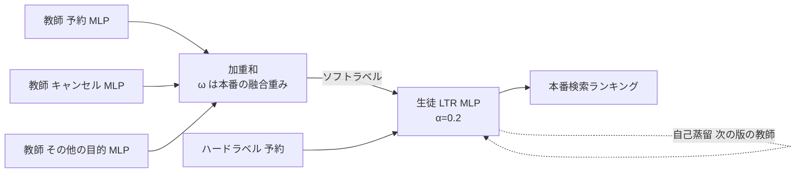

# Multi-objective Learning to Rank by Model Distillation

- **Link**: <https://arxiv.org/abs/2407.07181v1>（HTML: <https://arxiv.org/html/2407.07181v1>）
- **Authors**: Jie Tang, Huiji Gao, Liwei He, Sanjeev Katariya（Airbnb, San Francisco）
- **Year**: 2024（arXiv 2024-07-09）
- **Venue**: KDD 2024（30th ACM SIGKDD, Barcelona）, DOI 10.1145/3637528.3671597
- **Type**: Academic Paper
- **証拠の質**: **一次資料**（企業著者の査読付き論文。3 週間の A/B テスト）
- **蒸留の種別**: **知識蒸留だが LLM 蒸留ではない**。教師・生徒ともに MLP。clustering 段階で「LLM 蒸留の代表例」としていたが、**本 run で訂正** する

## Abstract

> 原文の逐語転載は引用上限を超えるため要約で示します。

The paper proposes a distillation-based ranking method for multi-objective search ranking at Airbnb. It reports gains on the primary objective (booking), keeps secondary objectives within constraints, and improves model stability. It also shows that self-distillation can simplify the system and that non-differentiable business objectives can be injected through soft-labels.

## Abstract (Japanese Translation)

Airbnb の多目的な検索ランキングのために、蒸留に基づくランキング手法を提案します。主目的（予約）を改善しつつ副目的（キャンセル、ホストの拒否など）を制約内に保ち、モデルの安定性も高めます。さらに、自己蒸留でシステムを簡素化できること、微分できない業務目的をソフトラベル経由で注入できることを示します。

## Overview

- **教師**: 目的ごとに事前学習した MLP（予約、キャンセル等）。多タスク系と共同学習し、学習中は固定。
- **生徒**: 本番の LTR モデル（MLP）。教師群の加重和をソフトラベルとして学習。
- **成果**: オフライン NDCG +1.1%、A/B（3 週間）で **予約 CVR +0.37%（p=0.02）**、副目的は中立、**配信レイテンシ −1.6%**。学習例は 5 億 → 3.6 億、調整すべき損失重みは K 個以上 → 1 個。

## Problem

- 主目的（予約）と副目的（キャンセル、ホスト拒否、長期成長）のバランス。
- 重みの調整コストが高い、目的ごとのデータの偏り、微分できない業務ルールを入れにくい。

## Proposed Method

目的ごとのコスト:

$$
C_k(X)=\sum_i \mathrm{loss}\left(f(\theta,X_i),L_{i,k}\right)
$$

簡略化した多目的の目的関数（主目的の教師も含める）:

$$
\min_{\theta}\ CE\left(f(\theta,X),L_1\right)+CE\left(f(\theta,X),\sum_{k=1}^{K}\omega_k f_k(\theta_k^*,X)\right)
$$

実用上の損失（ハード / ソフトラベルの重み付け）:

$$
\mathrm{Loss}=-\alpha\sum_i l_i\log f(\theta,X_i)-(1-\alpha)\sum_i \hat{l}_i\log f(\theta,X_i),\qquad \hat{l}_i=\sum_k\omega_k s_k,\quad \alpha=0.2
$$

- $f_k(\theta_k^*,X)$: 目的 $k$ の固定教師、$\omega_k$: 本番のスコア融合系から取った重み（非公開）、$s_k$: 教師スコア、$\alpha$: グリッドサーチで 0.2。

**自己蒸留**: 版 $V_n$ はハードラベル + 前版 $V_{n-1}$ のソフトラベルで学習し、初版以降は事前学習教師が不要。

**アドホック目的**: 最終スコアではなくソフトラベルをブーストして注入（高評価レビューのブーストを模擬。本番では未適用）。

## Algorithm (Pseudocode)

```
Algorithm: MO-LTR-MD
1. for k in 1..K: f_k ← train single-objective MLP teacher (frozen)
2. soft_i ← Σ_k ω_k f_k(X_i)                        // ω は本番の融合重み
3. student f ← minimize -α Σ l_i log f - (1-α) Σ soft_i log f   (α = 0.2)
4. (self-distillation) V_n ← train with hard + soft from V_{n-1}
5. (ad-hoc) soft_i ← boost(soft_i) for business rule
```

## Architecture / Process Flow



## Figures & Tables

論文の図は HTML 版で画像として取得できなかったため、キャプションで示します。

- **Figure 1**: モデル学習のグラフ
- **Figure 2**: ソフトラベルによるモデル間の知識移転
- **Figure 3**: 自己蒸留
- **Figure 4**: MoE 層を用いた多目的 LTR

### 主な結果

| 指標 | 結果 |
|---|---|
| オフライン NDCG（7 日, 多タスクベースライン比） | +1.1% |
| オンライン予約 CVR（3 週間） | +0.37%（p=0.02） |
| 副目的（オンライン） | 中立 |
| 配信レイテンシ | −1.6% |
| 学習例 | 3.6 億（提案）対 5 億（ベースライン） |
| 調整する損失重み | 1（提案）対 K 個以上 |
| 配信時のスコア融合重み | 0（提案）対 K |

### Table 2: 再現性（irreproducibility）

| モデル | 変化率（Kendall's τ） | PD |
|---|---|---|
| ベースライン | 77% | 0.407 |
| MO-LTR-MD | 36% | 0.363 |
| 改善 | 53% | 11% |

### Table 3: アドホックなブースト

| 方法 | NDCG の変化 |
|---|---|
| スコアを直接ブースト | −0.5% |
| ソフトラベルにブーストを注入 | −0.1% |

### 自己蒸留

- V1 のオフライン NDCG は再学習した V0 とほぼ同じ。A/B は全指標で中立。

### 「蒸留」の分類

| 観点 | 本論文 | LLM 蒸留（例: Walmart） |
|---|---|---|
| 教師 | 目的別 MLP | 7B LLM |
| 目的 | 多目的の統合・簡素化 | 推論コスト削減と品質移転 |
| モデルサイズの縮小 | 主目的ではない（サイズの記載なし） | 60 倍以上 |
| 本番成果 | 予約 +0.37%、レイテンシ −1.6% | ATC +1.2% |

## Experiments & Evaluation

- 多タスク学習ベースラインと比較。主目的の改善、副目的の制約維持、安定性向上を確認。

## Practical Takeaways

1. **蒸留は「多目的の重み調整を学習に吸収する」道具** としても使える。配信時のスコア融合を不要にでき、レイテンシも下がる。
2. **業務ルールはソフトラベルに注入** した方が、スコアを直接いじるより NDCG の損失が小さい。
3. LinkedIn（02）の「関連度教師 + エンゲージメント教師 → 1 生徒」と同じ発想で、教師を LLM に置き換えれば LLM 多教師蒸留になる。

## Notes

- **H1（定量成果は検索・推薦に集中）の根拠として使う際は、「LLM 蒸留ではない」ことを明記する必要があります。**
- 限界: $\omega_k$ 非公開、$\alpha$ はグリッドサーチ、自己蒸留は 2 回のみ、アドホック目的は模擬、1 社のみの結果。
