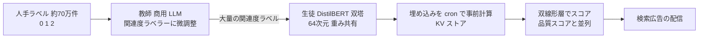
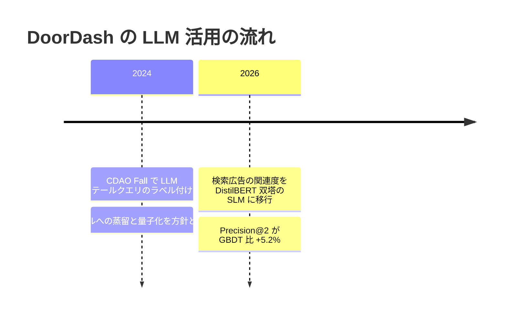

# Small Language Models to Serve More Relevant DoorDash Search Ads

- **Company/Organization**: DoorDash
- **Industry**: フードデリバリー・EC（検索連動のスポンサー広告）
- **Date**: 2026（ZenML の表記）
- **Link（一次）**: <https://careersatdoordash.com/blog/small-language-models-to-serve-more-relevant-doordash-search-ads/> — **WebFetch・curl とも 403 で本文を取得できませんでした**
- **Link（取得できた二次資料）**: ZenML LLMOps Database「Small Language Models for Real-Time Ad Relevance Prediction」<https://www.zenml.io/llmops-database/small-language-models-for-real-time-ad-relevance-prediction>
- **関連（一次・講演資料）**: CDAO Fall 2024 DoorDash スライド <https://cdao-fall.coriniumintelligence.com/hubfs/1124-24%20-%20CDAO%20Fall%20Ops/Final%20Presentations/CDAO%20Fall%202024%20DoorDash.pdf?hsLang=en>
- **Type**: Business Case
- **証拠の質**: **二次報道（ZenML による要約）**。数値は一次資料で未確認
- **蒸留の種別**: **真の蒸留（ラベル蒸留）**。人手ラベルで微調整した LLM が大量の関連度ラベルを付け、DistilBERT 双塔の生徒を学習

## Overview

DoorDash の検索広告は、再現率重視のキーワード検索のため、無関係なスポンサー商品が出る問題がありました（例: 「salt」の検索で塩味のポテトチップスが出る）。そこで、**LLM をオフラインのラベラー（教師）、DistilBERT 双塔をオンラインの生徒** とする構成に移行しました。

## Problem & Context

- キーワード検索は再現率重視で、関連度の低い広告が混ざる。
- 広告配信は厳しいレイテンシ要件を持つ（数値は非公開）。
- 既存の関連度モデルは勾配ブースティング木（GBDT）。

## Solution

- **教師**: 非公開の商用 LLM を、人手ラベル **約 70 万件**（0 / 1 / 2 の 3 段階）で関連度ラベラーに微調整。精度は 3 クラスで 86%、2 クラスで約 91%。
- **生徒（SLM）**: DistilBERT ベースの双塔（クエリ塔と商品塔で重み共有）、CLS プーリング、**64 次元** への線形射影。
- **配信**: 埋め込みはオフラインの cron で事前計算し KV ストアに保存。オンラインはキャッシュした埋め込みに双線形層を掛けるだけで、品質スコアリングと並列に動くため **追加レイテンシはほぼゼロ**。

## Results & Impact

| 指標 | 値 | 出典 |
|---|---|---|
| 教師 LLM の精度 | 86%（3 クラス）/ 約 91%（2 クラス） | ZenML 要約 |
| 生徒の検証精度 | 97% | ZenML 要約 |
| オンライン A/B: Precision@2 | 既存 GBDT 比 **+5.2%（相対）** | ZenML 要約 |
| NDCG@10 | 指標として使用（値は非公開） | ZenML 要約 |
| CTR・広告収益 | 非公開 | — |
| コスト | 非公開 | — |

> 生徒の検証精度 97% が教師の 86〜91% を上回っていますが、これは **教師ラベルに対する一致率** である可能性が高く、人手ラベルに対する精度とは比較できません（一次資料で要確認）。

## Figures & Tables

### CDAO Fall 2024 スライド（一次, PDF から抽出）の要点

| スライドの記述 | 内容 |
|---|---|
| 関連度モデル | エンゲージメント信号 + 人手ラベルで学習 |
| LLM の活用 | テールクエリへのラベル付け。「人手注釈は LLM で大幅に拡張できる」 |
| 商品知識グラフ | LLM 支援の注釈でコールドスタートを解決、属性抽出 LLM を微調整 |
| 今後の方針 | 「Distilling and quantizing LLM models to student models for online inference」 |

### 時系列

## Lessons Learned

1. **LLM はラベラーに限定し、配信は双塔 + 事前計算** にすると追加レイテンシがほぼゼロになる。
2. **人手ラベル 70 万件規模** を最初に用意し、教師 LLM を微調整してからラベルを増幅する。
3. 広告では「関連度」と「品質（入札・CTR 予測）」を並列で計算する設計が有効。

## Notes

- 一次ブログの本文を取得できなかったため、本レポートの数値は **二次（ZenML）** です。引用する場合は一次資料での確認を推奨します。
- 2024 年の講演で示した「蒸留・量子化」の方針が、2026 年に検索広告で実装された流れと読めます。
- **（2026-10-22 追記）一次資料の再取得を試みたが失敗**: 公式 URL（careersatdoordash.com/blog/…）は再度 403、別形式の URL（`careersatdoordash.com/?p=16312`）も 403、プロキシ経由（r.jina.ai）は Cloudflare の人間確認ページで本文なし、web.archive.org は本環境から到達不可。したがって証拠の質は **二次のまま**。ただし再検索で、同内容を独立に要約した 2 件目の二次資料（検索結果の要約）が、ZenML と同じ数値（人手ラベル 70 万件、DistilBERT 双塔・64 次元、検証精度 97%、Precision@2 +5.2%）と、ラベル体系（0 = 無関連を除外し 2 = 高関連を上位枠に）、比較したバックボーン（DistilBERT / DeBERTa / RoBERTa / ALBERT / TinyBERT / E5）を伝えており、数値の一貫性は確認できた。DoorDash エンジニアの LinkedIn 投稿も「フロンティアモデルから始め、規模化のため SLM に移行した」と述べている。
