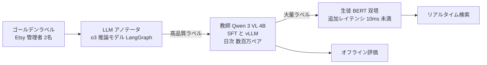

# How Etsy Uses LLMs to Improve Search Relevance

- **Source**: Etsy Code as Craft
- **Date**: 2026-01-16（2026-02-24 更新）
- **Link（一次）**: <https://www.etsy.com/codeascraft/how-etsy-uses-llms-to-improve-search-relevance> — **WebFetch・curl とも 403 で本文を取得できませんでした**
- **取得できた資料**:
  - ZenML LLMOps Database「Semantic Relevance Evaluation and Enhancement Framework for E-commerce Search」<https://www.zenml.io/llmops-database/semantic-relevance-evaluation-and-enhancement-framework-for-e-commerce-search>（二次）
  - 転載・要約サイト <https://cluster-site.onrender.com/posts/how-etsy-uses-llms-to-improve-search-relevance/>（冒頭の抜粋のみ。二次）
- **Type**: Technical Article
- **証拠の質**: **二次報道**（一次ブログの本文は未確認）
- **蒸留の種別**: **3 段カスケードの蒸留**（推論 LLM のアノテータ → 4B VLM 教師 → BERT 双塔生徒）

## Overview

Etsy の検索モデルは、クリック・カート追加・購入などのエンゲージメント信号を関連度の代理指標にしてきましたが、「人気の出品がクエリに最も合っていなくてもクリックされる」という偏りがありました。そこで **意味的な関連度** をエンゲージメントの補完として導入し、LLM で駆動する「Semantic Relevance Evaluation and Enhancement Framework」を構築しました。

## Key Technical Content

### Architecture / Design



### Implementation Steps

1. **3 段階の関連度**: Relevant / Partially Relevant / Irrelevant。
2. **ゴールデンラベル**: Etsy の管理者 2 名による人手ラベル（件数は非公開）。
3. **LLM アノテータ**: o3（推論モデル）を LangGraph で動かし、高品質な判定を作る（ZenML による特定。Etsy の原文では名称を明記していないとの指摘あり）。
4. **教師**: Qwen 3 VL 4B をアノテータ出力で SFT し、vLLM で毎日数百万件の query-listing ペアをラベル付け。
5. **生徒**: 教師から蒸留した BERT 系の双塔モデル。検索に **10ms 未満** の追加レイテンシで組み込む。
6. **用途**: オフライン評価（対照群と処置群で関連度を別々に計算）とリアルタイム検索の両方。

### Key Formulas / Metrics

| 指標 | 値 | 文脈 |
|---|---|---|
| 完全に関連する出品の割合 | 58%（2025 年 8 月）→ 62%（2025 年 10 月） | +4pt（ZenML 要約） |
| 生徒の追加レイテンシ | 10ms 未満 | ZenML 要約 |
| モデル比較 | Macro F1 と クラス別 F1 | 値は非公開 |
| A/B のエンゲージメント | 関連度が上がってもエンゲージメントが下がることが多い、との指摘 | 数値は非公開 |

## Figures & Tables

### 3 段カスケードの比較

| 段 | モデル | 精度 | 速度・コスト | 役割 |
|---|---|---|---|---|
| アノテータ | o3（推論 LLM） | 最高 | 最も遅く高価 | 高品質ラベルの生成 |
| 教師 | Qwen 3 VL 4B（SFT） | 中 | 日次で数百万件 | 大量ラベル付け |
| 生徒 | BERT 双塔 | 低〜中 | 10ms 未満 | 本番配信 |

```
完全に関連する出品の割合
2025-08 |█████████████████████████████ 58%
2025-10 |███████████████████████████████ 62%
```

## Practical Takeaways

1. **3 段カスケード**: 高価な推論 LLM は「教師の教師」に限定し、中型の自社ホスト VLM で量をこなし、BERT で配信する。商用 API の利用量を抑えられる。
2. **画像を含む出品には VLM 教師**: Qwen 3 VL のような視覚言語モデルを教師にしている点が特徴。
3. **関連度とエンゲージメントのずれ** を前提に、関連度を独立した評価軸として監視する。

## Notes

- 一次資料の本文を取得できなかったため、モデル名・数値は **二次（ZenML）** に依存します。
- **（2026-10-22 追記）一次資料の再取得を試みたが失敗**: 公式 URL は再度 403、プロキシ経由（r.jina.ai）も 403、web.archive.org は本環境から到達不可。転載候補として見つかった scour.ing・thenote.app はいずれも要約のみで本文を含まない（thenote.app の要約は「フレームワークは全面展開済みで、完全に関連する出品の割合が増加した」と記す）。再検索の要約では、Etsy 原文が **アノテータのモデル名を明記していない**（o3 は ZenML の特定）こと、原文に「数百万件の query-listing ペアを日次でラベル付け」「追加レイテンシ 10ms 未満」の記述があることが確認できた。証拠の質は **二次のまま**。
- **（2026-10-22 訂正）** 本文中の「o3（推論 LLM）」は ZenML の記述によるもので、Etsy の原文では確認できていない。モデル名を引用する際は「ZenML によれば o3」と限定すること。
- 商用 API（o3）を教師側に使う構成は、利用規約上「競合モデルの開発」に当たらない用途（自社の関連度モデル）として運用されていると考えられますが、規約の解釈は C8 で扱います。
