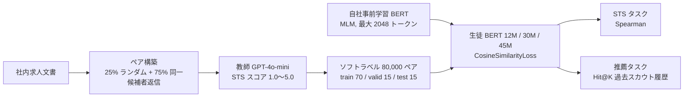

# 人材領域特化の LLM 教師付き長文 BERT 埋め込みモデルの構築（ビズリーチ）

- **Link**: <https://www.anlp.jp/proceedings/annual_meeting/2026/pdf_dir/C7-6.pdf>（言語処理学会第 32 回年次大会 発表論文集 C7-6, pp. 3167–3171）
- **Authors**: 原 龍昊, 長谷川 崇, Dat P.T. Nguyen（株式会社ビズリーチ）
- **Year**: 2026（2026 年 3 月発行）
- **Venue**: 言語処理学会第 32 回年次大会（NLP2026）。査読なし（"published without peer review", CC BY 4.0）
- **Type**: Academic Paper（国内事業会社の社内事例）
- **証拠の質**: **一次資料**（企業著者の学会発表。オフライン評価のみ。本番 A/B・レイテンシ・コストの数値はなし）
- **蒸留の種別**: **真の蒸留（ラベル蒸留 / 黒箱蒸留）**。商用 LLM（GPT-4o-mini）が付けた意味的類似度スコアを教師信号に、自社事前学習の軽量 BERT を Sentence-BERT 方式で学習
- **取得経緯（2026-10-22 追記）**: gather 段階では anlp.jp への接続が拒否され未検証だったが、本日 PDF を取得し本文を確認した

## Abstract

> 原文は日本語。要旨を英語に要約して示す。

Large language models give accurate text understanding but are costly and slow for bulk document processing, and sending data to external APIs raises security concerns. The authors build a lightweight, fast, long-text BERT embedding model specialized for job matching by knowledge distillation with an LLM teacher: an LLM assigns semantic similarity scores to pairs of in-house job-posting documents, and the resulting large soft-labeled dataset is used to fine-tune a long-context BERT. The proposed models (12M / 30M / 45M) achieve the best overall score, substantially outperform open-source Japanese embedding models, and match or exceed the OpenAI Embedding API.

## Abstract (Japanese Translation)

> 原文（概要）の要点。

大規模言語モデル（LLM）は高精度なテキスト理解を実現する一方、大量の文書処理では推論コストと応答速度が課題となり、外部 API 利用時にはデータ送信に伴うセキュリティ懸念も生じる。本研究では、LLM を教師とした知識蒸留により、求人マッチングの機会創出に特化した高性能かつ軽量な BERT 埋め込みモデルを構築する手法を提案する。企業内で蓄積された求人文書のテキストペアに LLM で意味的類似度スコアを付与し、生成された大規模ソフトラベルデータセットで長文処理に特化した BERT を訓練する。評価実験の結果、提案モデルは総合性能で最高値を達成し、OSS 埋め込みモデルを大幅に上回り、OpenAI Embedding API と同等以上の性能を示した。

## Overview

本クラスタで **唯一確認できた日本企業（事業会社）の検索・推薦向け LLM 蒸留の一次資料** です。構図は海外事例と同じ「LLM をオフラインの採点者にし、本番は小型 BERT で配信」ですが、次の点が特徴です。

1. **教師は商用 API（GPT-4o-mini）**: 海外の主要事例（Walmart / Taobao / Meituan 等）が開放モデルを自社微調整するのに対し、本研究はコスト・速度を理由に GPT-4o-mini のプロンプト採点をそのまま教師信号にしている。
2. **生徒は 12M / 30M / 45M の超軽量 BERT**: 社内データ + Wikipedia 日本語で MLM 事前学習した自社モデル（最大入力長 2,048 トークン、SudachiPy で分かち書き）。
3. **動機にセキュリティを明記**: 推論コストだけでなく「外部 API へのデータ送信に伴うセキュリティ懸念」を蒸留の理由に挙げており、C5（企業内業務）の論点と重なる。
4. **評価はオフラインのみ**: 本番 A/B・レイテンシ・金額の数値は報告されていない。

## Problem

- 求人文書・レジュメは日々大量に蓄積され、数百〜数千文字の長文。意味的類似度を効率よく計算する必要がある。
- 推薦システムの新規ユーザ・新規求人（コールドスタート）では、行動ログがないためテキスト内容の特徴量が重要。
- TF-IDF / LDA は文脈を捉えられず、汎用 BERT は人材業界の専門用語に弱い。
- LLM は精度が高いが、大量処理ではコストと速度、外部 API ではセキュリティが課題。

## Proposed Method

**LLM 教師付き STS（意味的類似度）データセットによる Sentence-BERT 学習**

- 手順:
  1. **ペア構築（サンプリング戦略）**: 25% は完全ランダム（低類似ペアで識別力を確保）、75% は「同一候補者が返信した複数の求人」を組み合わせた高類似候補ペア。
  2. **LLM ラベリング**: OpenAI API（GPT-4o-mini）に職務内容・必要スキル・業務範囲の観点で 1.0〜5.0 のスコアを `[[rating]]` 形式で出力させる。個人属性（年齢・性別・学歴）は入力せず、行動データ（スカウト送信・返信・応募）も使わない。API はデータを学習に使わない設定。
  3. **BERT ファインチューニング**: スコアを 0〜1 に正規化し、SentenceTransformer の **CosineSimilarityLoss** で学習。
- 既存手法との違い: 人手の STS ラベルが不可能な規模（80,000 ペア）を LLM で代替。ドメイン特化の事前学習済み BERT を基盤にする。

**Key Formulas**:

Sentence-BERT の CosineSimilarityLoss（論文中では名称のみ。式は一般形）:

$$
\mathcal{L}=\frac{1}{N}\sum_{i=1}^{N}\left(\cos\left(u_i, v_i\right)-\hat{s}_i\right)^2,\qquad \hat{s}_i=\frac{s_i-1.0}{5.0-1.0}
$$

- $u_i, v_i$: 求人文書ペアの埋め込み、$s_i\in[1.0,5.0]$: LLM が付与した STS スコア、$\hat{s}_i\in[0,1]$: 正規化後のスコア。

**Features**:

- 生徒は Transformer 層数の異なる 12M / 30M / 45M の 3 サイズ（埋め込み次元 256 / 512 / 576）。
- 教師ラベルの妥当性検証: 4 区間から 5 件ずつ計 20 件を人材業界のアノテータ 3 名が採点。人手平均と LLM スコアの **Pearson 相関 0.932、MAE 0.387**。

## Algorithm (Pseudocode)

```
Algorithm: BizReach LLM-teacher STS distillation
Input : 社内求人文書集合 J
Output: 軽量 BERT 埋め込みモデル f (12M / 30M / 45M)

1. P ← sample_pairs(J)            // 25% ランダム + 75% 同一候補者返信ベース, |P| = 80,000
2. for each (a, b) in P:
       s ← GPT-4o-mini(prompt, a, b) // 1.0〜5.0 の STS スコア
       ŝ ← (s - 1.0) / 4.0           // 0〜1 に正規化
3. split P into train 70% / valid 15% / test 15%
4. f ← pretrained_BERT(MLM on 社内テキスト + Wikipedia-ja, max_len 2048)
5. f ← finetune(f, train, loss = CosineSimilarityLoss)
6. evaluate: Spearman(cos(f(a), f(b)), ŝ) on test; Hit@K on 過去スカウト履歴
```

## Architecture / Process Flow



## Figures & Tables

### 図 1: 提案手法の概要図（論文より再構成）

教師 LLM（API）→ 求人文書ペアの意味的類似度データ生成 → 生徒（ドメイン特化 BERT）への知識転移、という 3 段構成。

### 図 2: STS スコアリングプロンプト（要約）

| 区間 | 基準 |
|---|---|
| 1.0〜2.0 | 類似性がほとんどない（業種や業務内容が大きく異なる） |
| 2.0〜3.0 | 一部に共通するスキル・業務があるが全体としては別職種 |
| 3.0〜4.0 | 主な業務内容やスキルに明確な重なり（中程度） |
| 4.0〜5.0 | 表現の違いを除けば職務内容・スキル・業務範囲はほぼ同じ |

出力形式は `[[4.3]]` のようにスコアのみ。

### 表 1: 各モデルの評価結果（論文の表 1 を転記）

| モデル | 埋め込み次元 | STS タスク | 推薦タスク | Avg. |
|---|---|---|---|---|
| （提案）BERT-45M-job-sts | 576 | 91.66 | 46.09 | **68.88** |
| （提案）BERT-30M-job-sts | 512 | **91.67** | 44.24 | 67.95 |
| OpenAI text-embedding-3-large（3048 次元） | 3048 | 85.70 | **51.46** | 68.58 |
| （提案）BERT-12M-job-sts | 256 | 90.41 | 40.03 | 65.22 |
| OpenAI text-embedding-3-large（512 次元） | 512 | 84.38 | 49.04 | 66.71 |
| OpenAI text-embedding-3-large（256 次元） | 256 | 81.74 | 45.47 | 63.60 |
| cl-nagoya/ruri-small（68M） | 768 | 71.26 | 13.81 | 42.54 |
| pkshatech/GLuCoSE-base-ja-v2（133M） | 768 | 61.38 | 26.48 | 43.93 |

> 論文の表記は「3048」次元。各タスク指標を 0〜100 に正規化して平均したものが Avg.。

```
総合スコア Avg.
BERT-45M（提案）     |██████████████████████████████████ 68.88
OpenAI-3-large 3048  |██████████████████████████████████ 68.58
BERT-30M（提案）     |██████████████████████████████████ 67.95
OpenAI-3-large 512   |█████████████████████████████████ 66.71
BERT-12M（提案）     |████████████████████████████████ 65.22
OpenAI-3-large 256   |███████████████████████████████ 63.60
GLuCoSE-base-ja-v2   |█████████████████████ 43.93
ruri-small           |█████████████████████ 42.54
```

### 手法比較（本クラスタの他事例との対比）

| 観点 | ビズリーチ（本論文） | LinkedIn（02） | Walmart（01） |
|---|---|---|---|
| 用途 | 求人文書の類似度・候補者推薦 | 求人・人物検索 | EC 検索関連度 |
| 教師 | GPT-4o-mini（商用 API、プロンプト採点） | 8B oracle / 1.7B 教師（自社微調整） | Mistral-7B（自社微調整） |
| 生徒 | 12M〜45M BERT（双塔） | 0.6B → 375M SLM | BERT-Base 110M（交差） |
| 教師ラベル数 | 80,000 ペア | 数千万件/日 | 1.7 億件 |
| 本番 A/B | なし | NDCG@10 +7.73%、DAU +1.2% 超 | ATC/visitor +1.2% |

## Experiments & Evaluation

### Setup

- データ: 社内求人文書 80,000 ペア（70 / 15 / 15 分割）。
- STS タスク: モデルのコサイン類似度と LLM スコアの Spearman 順位相関（＝教師の再現度）。
- 推薦タスク: 求人とレジュメの埋め込み類似度で全候補者をランキングし、過去にスカウトが送られた候補者が上位 K 件に含まれる割合 Hit@K。
- 比較対象: cl-nagoya/ruri-small（68M）、pkshatech/GLuCoSE-base-ja-v2（133M）、OpenAI text-embedding-3-large（3048 / 512 / 256 次元）。

### Main Results

- 総合（Avg.）: **BERT-45M が 68.88 で最高**、OpenAI 3048 次元（68.58）を僅差で上回り、OSS モデルを 25pt 前後上回る。
- STS タスク: 提案モデルが 90〜92 で圧倒的（OpenAI 85.70）。ただしこれは **教師 LLM のスコアを正解にした指標** であり、教師の再現度を測っている点に注意。
- 推薦タスク: **OpenAI 3048 次元（51.46）が最高**で、提案モデル 45M は 46.09。汎用 API の方が求人と候補者の潜在的適合を捉える、と著者は解釈。

### Ablation Study

- モデルサイズ: 45M（68.88）> 30M（67.95）> 12M（65.22）で、容量が主要因。
- OpenAI 側の次元削減（3048 → 512 → 256）による低下は比較的小さく、次元圧縮に頑健。

## 蒸留のビジネス価値式への当てはめ

| 項 | 報告内容 |
|----|---------|
| $(C_{teacher}-C_{student})Q$ | 「軽量でローカル環境での高速推論が可能」「外部 API への依存を避けられる」と定性的に記述。数値は **非公開** |
| $C_{data}$ | GPT-4o-mini による 80,000 ペアの採点（金額は非公開） |
| $\Delta\text{Acc}$ | STS では教師再現度 91〜92、推薦では OpenAI 比 −5.4pt（45M） |
| ビジネス成果 | **なし（本番 A/B の記載なし）** |

## Practical Takeaways

1. **国内でも「LLM 採点 → 小型 BERT」の構図は成立する**。ただし本論文の教師は開放モデルの微調整ではなく商用 API のプロンプト採点で、海外主要事例とはコスト構造・規約面（C8）が異なる。
2. **教師ラベルの妥当性検証を小規模でも入れる**（20 件・3 名で Pearson 0.932）。
3. **STS の再現度と下流タスクは別物**: 教師をよく再現しても推薦 Hit@K では汎用 API に劣る。評価は下流タスクで行うべき。
4. **サンプリング戦略が肝**: ランダムだけでは高類似ペアが極端に少ないため、行動ログ（同一候補者の返信）由来の候補ペアを 75% 混ぜている。

## Limitations（著者の記述および本レポートの評価）

- 本番 A/B・レイテンシ・コストの数値がない（著者は「実務的価値の高さを示唆」と述べるにとどまる）。
- STS テストの正解が教師 LLM のスコアであり、教師の誤りがそのまま評価に入る。
- 人手検証が 20 件と小規模。
- 査読なしの年次大会発表。

## Notes

- clustering（C4・C7）で「国内事業会社の検索・推薦向け LLM 蒸留の唯一の手がかり」とされていた資料。本日の取得で **一次資料として確認** できた。
- 教師が GPT-4o-mini である点は、OpenAI の利用規約（出力を用いた競合モデル開発の制限）との関係で C8 の検討対象になる。著者は「データが学習に使われない設定」とプライバシー面のみ言及しており、規約面の記述はない。
- 同著者らは NLP2024 で「人材業界固有の表現を考慮した求人票のマルチラベル分類」を発表しており、ドメイン特化 BERT の系譜上にある。
