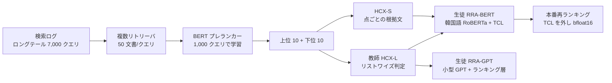

# RRADistill: Distilling LLMs' Passage Ranking Ability for Long-Tail Queries Document Re-Ranking on a Search Engine（NAVER）

- **Link**: <https://arxiv.org/abs/2410.18097>（HTML: <https://arxiv.org/html/2410.18097v3>、ACL Anthology: 2024.emnlp-industry.46）
- **Authors**: Nayoung Choi（Emory University / NAVER）, Youngjune Lee, Gyu-Hwung Cho, Haeyu Jeong, Jungmin Kong, Saehun Kim, Keunchan Park, Sarah Cho, Inchang Jeong, Gyohee Nam, Sunghoon Han, Wonil Yang, Jaeho Choi（NAVER Corporation）
- **Year**: 2024（arXiv 2024-10-23、v3）
- **Venue**: EMNLP 2024 Industry Track
- **Type**: Academic Paper（企業の本番導入報告）
- **証拠の質**: **一次資料**（企業著者の査読付き論文。オフライン評価・人手評価・7 日間の A/B テストを記載）
- **蒸留の種別**: **真の蒸留（ラベル蒸留 + 推論文の利用）**。自社 LLM HyperCLOVA X Large（HCX-L）のリストワイズ判定をラベルに、1B 未満のエンコーダ / デコーダ生徒を学習
- **2026-10-22 追記**: 前回 pass では未収集。Apple の App Store 論文（19 番）が比較対象として引用していることから辿った

## Abstract

> 要旨の要約（原文は arXiv 参照）。

LLMs excel at relevance ranking but are too slow for search engines. The authors propose RRADistill (Re-Ranking Ability Distillation): an efficient label generation pipeline in which an LLM list-wise labels long-tail query documents, plus two small-model training methods, an encoder with a Term Control Layer (TCL) and a decoder with a ranking layer. Experiments and A/B testing on a Korean search platform validate the approach for long-tail queries.

## Abstract (Japanese Translation)

LLM は関連度ランキングに優れるが、推論が遅く検索エンジンではそのまま使えない。本論文は、LLM がロングテールクエリの文書をリストワイズにラベル付けする効率的なラベル生成パイプラインと、小型モデル（sLLM）向けの 2 つの学習法 — 用語制御層（TCL）を持つエンコーダ法と、ランキング層を持つデコーダ法 — からなる RRADistill を提案する。韓国の検索プラットフォームでの実験と A/B テストにより、ロングテールクエリでの有効性を検証した。

## Overview

NAVER 検索の **ロングテールクエリ向け再ランキング** に、自社 LLM（HyperCLOVA X）のランキング能力を蒸留した事例です。本クラスタの他事例と比べ、**オンライン効果が大きい（CTR +5.63%、滞在時間 +7.97%）** のが特徴で、理由は「ロングテールに限定」「ベースラインがリストワイズ LLM 判定なしの従来ランカー」の 2 点と読めます。

1. **教師**: HCX-L（HyperCLOVA X Large、パラメータ数非公開）がクエリごとに上位 10 + 下位 10 文書をリストワイズに判定。HCX-S が点ごとの根拠文を生成。
2. **生徒**: RRA-BERT（社内事前学習の小型韓国語 RoBERTa）と RRA-GPT（小型 GPT）。いずれも **1B 未満**。
3. **効率化**: 学習時だけ使う TCL を推論時に外し推論時間 −5.58%。bfloat16 で性能 99.8% を維持し QPS +18%。

## Problem

- ロングテールクエリは行動ログが乏しく、既存ランカーの精度が低い。
- LLM は精度が高いが推論が遅く、検索の再ランキング段に載せられない。
- 人手ラベルはコストが高く、ロングテールの多様性を覆えない。

## Proposed Method

**RRADistill = ラベル生成パイプライン + 2 種の生徒学習法**

- ラベル生成:
  1. NAVER の検索ログからロングテールクエリ **7,000 件** を抽出。
  2. 複数のリトリーバで各クエリ **50 文書** を取得し、1,000 クエリで学習した BERT プレランカーで並べ替え。
  3. 上位 10 件と下位 10 件（計 20 件）を HCX-L に渡しリストワイズにラベル付け。HCX-L が出力から **省いた文書はハードネガティブ** とみなす。
  4. HCX-S で点ごとの推論文（根拠）を生成。
- エンコーダ法（RRA-BERT）: **Term Control Layer（TCL）** でクエリ語の重要度を制御しつつ学習。推論時は TCL を外せる。
- デコーダ法（RRA-GPT）: 小型 GPT の上にランキング層を置き、生成ではなくスコアを出す。
- 既存手法との違い: ポイントワイズ採点ではなく **リストワイズ判定を小型モデルに移す**。「省略 = ハードネガティブ」の扱いでラベル効率を上げる。

## Algorithm (Pseudocode)

```
Algorithm: RRADistill label generation and student training
Input : 検索ログ L, リトリーバ群 R, プレランカー P, 教師 HCX-L, 根拠生成 HCX-S
Output: 生徒 RRA-BERT / RRA-GPT

1. Q ← sample_long_tail_queries(L, n = 7000)
2. for each q in Q:
       D ← retrieve(R, q, k = 50); D ← rerank(P, D)
       C ← top10(D) ∪ bottom10(D)                       // 20 件
       ranked ← HCX-L.listwise_rank(q, C)
       hard_neg ← C \ ranked                            // 教師が省いた文書
       reasons ← HCX-S.pointwise_reason(q, C)
3. train RRA-BERT with TCL on (q, ranked, hard_neg, reasons)
   train RRA-GPT with ranking layer on same data
4. deploy RRA-BERT without TCL, bfloat16
```

## Architecture / Process Flow



## Figures & Tables

### Table: オフライン評価（NAVER テストセット 700 クエリ・約 20 文書/クエリ）

| モデル | nDCG@5 | nDCG@10 |
|---|---|---|
| BM25 | 0.427 | 0.520 |
| MonoT5（large） | 0.650 | 0.759 |
| **RRA-BERT** | **0.655** | **0.776** |
| RRA-GPT | 0.620 | 0.735 |

> MS MARCO では RRA-BERT が nDCG@5 0.543 / nDCG@10 0.607。教師 HCX-L zero-shot の NAVER テストセット上のスコアは報告されていない。

### Table: オンライン A/B テスト（7 日間、NAVER 検索、RRA-BERT）

| 指標 | 変化 |
|---|---|
| CTR | **+5.63%** |
| 上位 1 位文書のクリック | +5.9% |
| 滞在時間（dwell time） | **+7.97%** |

### Table: 人手評価（2,000 クエリ、1〜5 段階）

| 指標 | 変化 |
|---|---|
| 平均スコア | +1.41% |
| 上位文書のスコア | +6.95% |

### 配信効率

| 項目 | 値 |
|---|---|
| TCL を推論時に除去 | 推論時間 −5.58% |
| bfloat16 | 性能 99.8% 維持、QPS +18%（採用） |
| fp8 | 性能 99% 維持、QPS +18% |
| 学習収束 | 最良 RRA-GPT 約 5,667 ステップ（次点 約 11,333） |

> 絶対レイテンシ（ms）は非公開（論文の図は比率のみ）。

```
オンライン改善率（NAVER, 7 日）
dwell time |████████████████████████████████ +7.97%
top-1 click|████████████████████████ +5.9%
CTR        |██████████████████████ +5.63%
```

### 手法比較

| 観点 | NAVER RRADistill | Tencent DisRanker（07） | Walmart（01） |
|---|---|---|---|
| 検索の種類 | Web 検索（韓国語）ロングテール | Web 検索（中国語） | EC 検索 tail |
| 教師 | 自社 LLM HCX-L（サイズ非公開） | Mistral-7B 微調整 | Mistral-7B 微調整 |
| 教師の判定形式 | リストワイズ（20 件） | ポイントワイズ | ポイントワイズ（ソフト） |
| 生徒 | 1B 未満 RoBERTa / GPT | 6 層 BERT 0.1B | BERT-Base 110M |
| ラベル規模 | 7,000 クエリ × 20 文書 | 4,681 万ペア | 1.7 億ペア |
| オンライン | CTR +5.63%、滞在 +7.97% | UserCTR +0.58%、滞在 +1.2% | ATC/visitor +1.2% |

## Experiments & Evaluation

### Setup

- 学習クエリ 7,000 件（10% を評価に保持）、NAVER テストセット 700 クエリ、MS MARCO でも検証。
- 指標: nDCG@5 / @10、A/B は CTR・上位 1 位クリック・滞在時間、人手評価は 1〜5 段階。
- ハードウェア: A100 1 枚でベンチマーク。

### Main Results

- RRA-BERT は MonoT5-large を nDCG@10 で +0.017 上回る（0.776 対 0.759）。
- A/B では CTR +5.63%、滞在時間 +7.97%。ロングテール限定のため、全体トラフィックへの寄与は論文に記載なし。

### Ablation Study

- TCL は学習時のみ有効で、推論時に外しても性能を保ちつつ 5.58% 高速化。
- デコーダ生徒（RRA-GPT）はエンコーダ生徒より低い（nDCG@10 0.735 対 0.776）。

## 蒸留のビジネス価値式への当てはめ

| 項 | 報告内容 |
|----|---------|
| $(C_{teacher}-C_{student})Q$ | 生徒 1B 未満。絶対レイテンシ・金額は **非公開**（bf16 で QPS +18% のみ） |
| $C_{data}$ | 7,000 クエリ × 20 文書の LLM 判定 + HCX-S の根拠生成（コスト非公開） |
| $\Delta\text{Acc}$ | 教師とのオフライン差は **報告なし** |
| ビジネス成果 | CTR +5.63%、滞在時間 +7.97%（ロングテール） |

## Practical Takeaways

1. **リストワイズ判定を蒸留する** と、ポイントワイズ採点より少ないクエリ数（7,000 件）で本番効果が出る。
2. **教師が省いた文書をハードネガティブにする** ラベル効率化は再利用しやすい。
3. 学習専用の補助層（TCL）は推論時に外せる設計にしておく。
4. ロングテール限定の導入は Walmart と同じ戦略で、効果が大きく出やすい。

## Limitations

- 教師・生徒のパラメータ数、絶対レイテンシ、A/B のトラフィック比率が非公開。
- 教師との精度差（蒸留で失った精度）が示されていない。
- 自社 LLM（HyperCLOVA X）前提のため、開放モデルで再現できるかは不明。

## Notes

- Apple の App Store 論文（19 番）は本論文を「大きな LLM の意味理解を小さな言語モデルへ蒸留する研究」として引用し、自らの手法（LLM ラベルでランカーを増強）と区別している。
- 韓国企業の事例だが、日本語と同じく英語以外の言語で LLM 蒸留が本番効果を出した例として、国内事例の空白を考える際の参照点になる。
