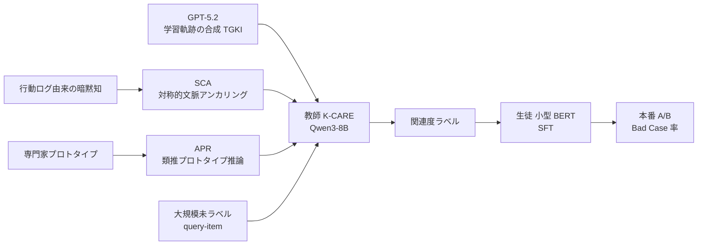

# K-CARE: Knowledge-driven Symmetrical Contextual Anchoring and Analogical Prototype Reasoning for E-commerce Relevance（JD.com）

- **Link**: <https://arxiv.org/abs/2604.25683>（HTML: <https://arxiv.org/html/2604.25683v1>）
- **Authors**: Chen Yifei, Tian Zhixing, Wang Chenyang, Cheng Ziguang（JD.COM, Beijing）
- **Year**: 2026（arXiv 2026-04-28, v1）
- **Venue**: arXiv preprint（査読付き venue の記載なし）
- **Type**: Academic Paper（企業の本番 A/B 報告）
- **証拠の質**: **一次資料**（企業著者のプレプリント。オフライン評価と本番 A/B を記載。ただし査読なし、A/B のトラフィック比率・期間は非公開）
- **蒸留の種別**: **真の蒸留（ラベル蒸留）**。Qwen3-8B ベースの K-CARE 教師が大規模未ラベルデータに関連度ラベルを付け、小型 BERT 生徒を通常の教師あり学習で訓練
- **2026-10-22 追記**: 前回 pass では未収集。gather 段階で「JD と推定」した LREF（arXiv 2503.09223）とは別の、JD.COM 所属が明記された論文

## Abstract

> 要旨の要約（原文は arXiv 参照）。

LLM-based relevance models for e-commerce search still fail on "corner cases." The authors argue that the main bottleneck is the LLM's knowledge boundary rather than its reasoning path. K-CARE adds two components: Symmetrical Contextual Anchoring (SCA), which injects behavior-derived implicit knowledge, and Analogical Prototype Reasoning (APR), which uses expert-curated prototypes. Offline evaluations and online A/B tests on a leading e-commerce platform show that K-CARE outperforms state-of-the-art baselines.

## Abstract (Japanese Translation)

EC 検索向けの LLM 関連度モデルは「コーナーケース」でなお失敗する。著者らは、主なボトルネックは推論経路ではなく LLM の知識境界にあると主張する。K-CARE は、行動ログ由来の暗黙知を注入する **対称的文脈アンカリング（SCA）** と、専門家が整備したプロトタイプを用いる **類推プロトタイプ推論（APR）** の 2 要素を加える。大手 EC プラットフォームでのオフライン評価と本番 A/B テストで、最先端ベースラインを上回ることを示した。

## Overview

JD.com の EC 検索関連度で、**「教師 LLM の知識を強化してから BERT に蒸留する」** 事例です。本クラスタの Taobao（04）・Meituan（05）・AliExpress（06）が「推論（CoT）をどう生徒に移すか」を競うのに対し、本論文は **教師側の知識境界**（行動ログ由来の暗黙知、専門家のプロトタイプ）を主題にし、蒸留自体は標準的な教師ありファインチューニングで済ませています。

- **教師**: Qwen3-8B で K-CARE を構築。学習軌跡（TGKI）の合成には **GPT-5.2** を「高容量の教師」として使用（蒸留の教師ではない）。
- **生徒**: 小型 BERT（サイズ非公開）。教師が付けた大規模ラベルで SFT。教師比で **推論レイテンシを 1 桁削減**。
- **本番**: 上位 10 件の Bad Case 率が **12.10% → 11.3%（相対 −5.87%）**。

## Problem

- LLM 関連度モデルは一般的な事例では高精度だが、商品知識や業務ルールが要る「コーナーケース」で誤る。
- CoT を長くしても、モデルが知らない知識は補えない（知識境界の問題）。
- 本番はレイテンシ制約が厳しく、LLM を直接配信できない。

## Proposed Method

**K-CARE = SCA + APR（教師の強化）→ BERT への蒸留**

- **SCA（Symmetrical Contextual Anchoring）**: クエリ側・商品側の双方に、ユーザ行動（クリック・購買など）から導いた暗黙知の文脈を対称的に付与し、LLM の判断を「アンカー」する。
- **APR（Analogical Prototype Reasoning）**: 専門家が整備した判定プロトタイプ（典型例）を参照し、類推で関連度を判定する。
- **TGKI**: GPT-5.2 で学習軌跡を合成して Qwen3-8B を学習。
- **蒸留**: K-CARE 教師が大規模未ラベルデータにラベルを付け、小型 BERT を SFT。
- 既存手法との違い: SFT / GRPO だけの LLM より、知識注入（SCA + APR）で Macro F1 を +1.4〜1.6pt 改善。

## Algorithm (Pseudocode)

```
Algorithm: K-CARE teacher construction and distillation
Input : 人手ラベル H, 行動ログ B, 専門家プロトタイプ集合 P, 未ラベル U
Output: 本番 BERT 生徒 s

1. traj ← GPT-5.2.synthesize_trajectories(H)         // TGKI
2. T ← train(Qwen3-8B, traj, SCA(B), APR(P))         // 教師 K-CARE
3. for each (q, i) in U: y[q, i] ← T(q, i)            // 大規模ラベル付け
4. s ← SFT(BERT_small, {(q, i, y[q, i])})
5. deploy s; A/B vs production baseline on Bad Case Rate
```

## Architecture / Process Flow



## Figures & Tables

### Table: 教師のオフライン評価

| モデル | Macro F1 | Weighted F1 | Accuracy |
|---|---|---|---|
| LLM SFT | 80.97% | — | 86.95% |
| LLM GRPO | 81.18% | — | 87.17% |
| **K-CARE（SCA + APR）** | **82.58%** | 87.99% | **88.05%** |

Bad クラス: precision 90.68%、recall 91.51%、F1 91.09%。**蒸留後の BERT 生徒のオフライン指標は報告されていない**。

### Table 4: オンライン A/B（上位 10 件の Bad Case 率、固定 10,000 クエリを 3 並列スロットで評価）

| スロット | Bad Case 率 |
|---|---|
| Base1 | 12.11% |
| Base2 | 12.09% |
| **Test（K-CARE 蒸留 BERT）** | **11.39%** |

> 本文は「12.10% → 11.3%、相対 −5.87%」と記述し、表の 11.39% と一致しない（論文内の不整合）。トラフィック比率・期間は非公開。

```
Bad Case 率（上位 10 件）
Base1 |████████████████████████ 12.11%
Base2 |████████████████████████ 12.09%
Test  |██████████████████████ 11.39%
```

### 手法比較（EC 関連度の LLM → BERT 蒸留）

| 観点 | JD K-CARE | Taobao MKD（04） | Meituan CRSD（05） | AliExpress LRKD（06） |
|---|---|---|---|---|
| 教師 | Qwen3-8B + 知識注入 | Qwen2-7B + CoT | Qwen3-8B + GRPO | Qwen3-14B + 多視点 CoT |
| 教師の教師 | GPT-5.2（軌跡合成） | Qwen2-72B / Llama3-70B | — | — |
| 生徒 | 小型 BERT（非公開） | 101M | 6 層 BERT | 168M |
| 蒸留の工夫 | なし（ラベル SFT） | スコア分布 + CoT タグ | 推論の自己蒸留 | 潜在推論ベクトル |
| オンライン | Bad Case 率 −5.87%（相対） | CTR +0.17%、Goodrate +0.89% | CTR +0.91%、CVR +1.06% | RPM +1.42% |
| 査読 | なし（arXiv） | WWW 2025 | WWW 2026 | WWW 2026 |

## Experiments & Evaluation

### Setup

- 教師の評価は Macro F1 / Weighted F1 / Accuracy と Bad クラスの P/R/F1。
- A/B は固定 10,000 クエリを 3 スロット（Base1, Base2, Test）で並列実行し Bad Case 率を比較。

### Main Results

- 教師: SCA + APR で Macro F1 82.58%（SFT 比 +1.61pt、GRPO 比 +1.40pt）。
- 本番: Bad Case 率 12.10% → 11.3%（相対 −5.87%）。

### Ablation Study

- SCA / APR 個別の寄与は論文の表に記載（本レポートでは教師の最終値のみ転記）。
- 生徒側のアブレーションはなし。

## 蒸留のビジネス価値式への当てはめ

| 項 | 報告内容 |
|----|---------|
| $(C_{teacher}-C_{student})Q$ | 「教師比で推論レイテンシを 1 桁削減」のみ。絶対値・金額は **非公開** |
| $C_{data}$ | GPT-5.2 での軌跡合成 + 教師による大規模ラベル付け（件数・金額は非公開） |
| $\Delta\text{Acc}$ | **生徒のオフライン指標が未報告** のため算出不能 |
| ビジネス成果 | Bad Case 率 −5.87%（相対）。CTR・GMV は非公開 |

## Practical Takeaways

1. **教師の弱点が「知識」なら、蒸留法より教師の知識注入に投資する**。行動ログ由来の文脈と専門家プロトタイプが有効。
2. 商用 API（GPT-5.2）は「教師の教師」（軌跡合成）に限定し、本番教師は Qwen3-8B という役割分担は、本クラスタの共通パターン（H5）と一致する。
3. 本番指標として **Bad Case 率** を使う評価法は Meituan（05）・CORE と共通で、EC 関連度の標準指標になりつつある。

## Limitations

- 査読なし。生徒のサイズ・オフライン性能・A/B のトラフィック比率と期間が非公開。
- 本文と表で A/B の数値が不一致（11.3% 対 11.39%）。
- CTR・CVR・GMV などのビジネス指標はなく、品質指標のみ。

## Notes

- gather 段階で「所属が JD と推定される」とした LREF（arXiv 2503.09223）とは別論文。本論文は所属が JD.COM と明記されている。
- GPT-5.2 を教師の教師に使っている点は、C8（利用規約）の観点で Etsy（o3）と同じ論点を持つ。
