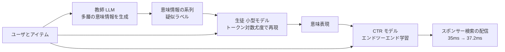

# Balancing Efficiency and Effectiveness: An LLM-Infused Approach for Optimized CTR Prediction（Meituan MSD）

- **Link**: <https://arxiv.org/abs/2412.06860>（HTML: <https://arxiv.org/html/2412.06860>）
- **Authors**: Guoxiao Zhang, Yi Wei, Yadong Zhang, Qiang Liu（Meituan, Beijing）, Huajian Feng（Hunan University）
- **Year**: 2025（arXiv v1 2024-12-09, v2 2025-03-04）
- **Venue**: WWW 2025（ジャーナル参照欄の記載）
- **Type**: Academic Paper（企業の本番 A/B 報告）
- **証拠の質**: **一次資料**（企業著者の論文。オフライン AUC と 10 日間の本番 A/B を記載。教師 LLM の名称・サイズは非公開）
- **蒸留の種別**: **真の蒸留（系列出力の蒸留）**。LLM 教師が生成したユーザ・アイテムの意味情報（トークン系列）を、小型生徒が対数尤度損失で再現し、CTR モデルに注入
- **2026-10-22 追記**: 前回 pass では未収集。CyberAgent の CTR 蒸留事例を探した検索で発見

## Abstract

> 要旨の要約（原文は arXiv 参照）。

The paper proposes MSD (Multi-level Deep Semantic Information Infused CTR model via Distillation). It uses an LLM's world knowledge to extract multi-level semantic information about users and items, then distills that information into a smaller, more efficient model so the whole CTR system can be trained and served end-to-end. Online A/B tests on the Meituan sponsored-search system show gains in CTR and CPM over baselines.

## Abstract (Japanese Translation)

本論文は MSD（蒸留による多層深層意味情報注入 CTR モデル）を提案する。LLM の世界知識を使ってユーザとアイテムに関する多層の意味情報を抽出し、それを小型で効率的なモデルへ蒸留することで、CTR システム全体をエンドツーエンドで学習・配信できるようにする。Meituan のスポンサー検索システムでの本番 A/B テストで、ベースラインに対し CTR と CPM の改善を示した。

## Overview

本クラスタでは「関連度の蒸留」が中心でしたが、本論文は **CTR 予測（広告）への LLM 蒸留** の本番事例です。関連度の事例（04〜06）が LLM の判定ラベルを移すのに対し、MSD は **LLM が生成したユーザ・アイテムの意味記述（系列）を小型生徒に再現させ、その表現を CTR モデルに注入** します。オンライン効果は **CTR +2.12%、CPM +2.59%** と、関連度事例（+0.2〜1.4%）より大きく、追加レイテンシは **35ms → 37.2ms** に収まっています。

## Problem

- 従来の CTR モデルは ID・属性の協調信号は捉えるが、テキストの意味は捉えにくい。
- LLM は世界知識と意味理解を持つが、推論コストが高く CTR 配信に載せられない。
- LLM をオフラインの特徴量生成器にすると、学習と配信がエンドツーエンドにならない。

## Proposed Method

**MSD: 多層意味情報の抽出 → 小型生徒への蒸留 → CTR モデルへの注入**

- 手順:
  1. 教師 LLM $T$ が、ユーザとアイテムの多層（例: 嗜好・カテゴリ・属性）の意味情報をテキストとして生成する。プロンプトには ChatGPT で人手選別した参照出力を使う。
  2. 小型生徒 $S$ が教師の出力トークン系列をトークン単位の対数尤度損失で再現するよう学習する（式 1）。
  3. 生徒の表現を CTR モデルに注入し、全体をエンドツーエンドで学習・配信する。
- 既存手法との違い: LLM の出力を静的特徴量にせず、生徒を通して CTR モデルと共に学習できる。

**Key Formulas**:

生徒の系列蒸留損失（論文の式 1 の一般形）:

$$
\mathcal{L}_{KD}=-\sum_{t=1}^{|y|}\log p_S\left(y_t\mid y_{<t}, x\right),\qquad y=T(x)
$$

- $x$: ユーザ・アイテムの入力、$y$: 教師 LLM が生成した意味情報の系列、$p_S$: 生徒の出力分布。

## Algorithm (Pseudocode)

```
Algorithm: MSD training and serving
Input : ユーザ・アイテム集合 X, 教師 LLM T, CTR モデル f, クリックログ C
Output: 配信用 (S, f)

1. for each x in X: y[x] ← T(prompt, x)           // 多層意味情報を生成
2. S ← argmin Σ_x -log p_S(y[x] | x)               // 系列蒸留
3. h[x] ← S.encode(x)                              // 生徒の表現
4. f ← train_CTR(f, C, features ∪ h)              // エンドツーエンド
5. serve: f(x, h[x])  // 教師 LLM はオンラインに不要
```

## Architecture / Process Flow



## Figures & Tables

### Table: データセット

| データセット | ユーザ | アイテム | インタラクション |
|---|---|---|---|
| KDD Cup 2012（ユーザ 10% をサンプリング） | 2,202,355 | 288,794 | 13,624,635 |
| Meituan | 152,287,209 | 160,837,520 | 2,304,146,513 |

### Table 2: オフライン AUC（最良ベースライン PRINT との比較）

| データセット | MSD | PRINT | 差（論文の表記） |
|---|---|---|---|
| KDD Cup 2012 | 0.7871 | 0.7846 | +0.25% |
| Meituan | **0.7087** | 0.7024 | +0.63% |

### Table: オンライン A/B（Meituan スポンサー検索、2024-10-20〜10-30 の約 10 日間）

| 指標 | 変化 |
|---|---|
| CTR | **+2.12%** |
| CPM | **+2.59%** |
| 推論時間 | 35ms（ベースライン）→ 37.2ms（MSD） |

> トラフィック比率は非公開。

```
オンライン改善率（Meituan スポンサー検索）
CPM |██████████████████████████ +2.59%
CTR |█████████████████████ +2.12%
```

### 手法比較（広告 CTR への LLM 蒸留）

| 観点 | Meituan MSD | Alibaba ELEC（gather 掲載） | Meta GEM（10） |
|---|---|---|---|
| 教師 | LLM（名称非公開） | gte-Qwen2-7B-instruct を注入した gain network | 広告基盤モデル（非 LLM） |
| 生徒 | 小型モデル（名称非公開） | 表形式入力のみの vanilla network | 数百の垂直モデル |
| 蒸留対象 | 意味情報の系列 | スコア + 表現 | KD + Adapter + 共有 |
| オンライン | CTR +2.12%、CPM +2.59% | **なし（オフラインのみ）** | Instagram CV +5% |
| 追加レイテンシ | +2.2ms | 0.087〜0.116 s/サンプル（V100、オフライン計測） | 非公開 |

## Experiments & Evaluation

### Setup

- 公開データ KDD Cup 2012 と Meituan の実データ。
- ベースライン: PRINT ほか（論文の表 2）。
- 本番 A/B は 2024-10-20〜10-30。

### Main Results

- オフライン AUC は Meituan で +0.63%（0.7024 → 0.7087）。
- 本番で CTR +2.12%、CPM +2.59%、推論時間の増加は +2.2ms。

### Ablation Study

- 表 3 で全体モデル（0.7087）に対し構成要素を外した変種を比較（個別値は本レポートでは省略）。

## 蒸留のビジネス価値式への当てはめ

| 項 | 報告内容 |
|----|---------|
| $(C_{teacher}-C_{student})Q$ | 教師 LLM をオンラインから除去。生徒込みで 35 → 37.2ms（+2.2ms） |
| $C_{data}$ | 教師 LLM によるユーザ・アイテムの意味情報生成（件数・金額は非公開） |
| $\Delta\text{Acc}$ | 教師を直接使った上限値は **報告なし** |
| ビジネス成果 | CTR +2.12%、CPM +2.59%（広告収益に直結） |

## Practical Takeaways

1. **CTR では「ラベル」ではなく「意味記述」を蒸留する** 設計が有効。関連度の蒸留とは移すものが異なる。
2. 追加レイテンシ +2.2ms で CPM +2.59% なら、広告では投資対効果が明確。
3. 教師 LLM の名称・サイズを伏せる論文は多く、再現性より本番効果の報告が優先されている。

## Limitations

- 教師 LLM・生徒の名称とサイズ、蒸留データ量、A/B のトラフィック比率が非公開。
- オフライン AUC の改善幅は小さく（+0.63%）、オンラインの +2% 超との関係は論文で十分に説明されていない。

## Notes

- 同じ Meituan の 05 番（関連度の CRSD）とは別チーム・別課題。Meituan は関連度と CTR の両方で LLM 蒸留を本番化していることになる。
- 類似の LLM × CTR 研究（ELEC: Alibaba, SIGIR 2025 / LLaCTR）はオフライン評価のみで、本番 A/B を公開しているのは本論文が中心。
