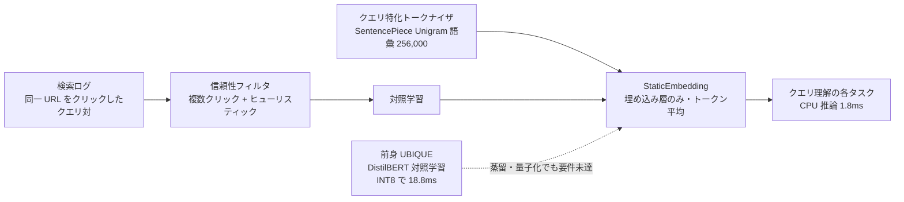

# StaticEmbedding を用いた高速な検索クエリ埋め込み（LINEヤフー）

- **Source**: LINEヤフー Tech Blog（著者: 平子 潤, 自然言語処理エンジニア）
- **Date**: 2025-08-04（URL スラッグ `20250804a` より）
- **Link**: <https://techblog.lycorp.co.jp/ja/20250804a>
- **関連（一次）**: 前身モデル UBIQUE は NAACL 2025 Industry Track に採択（社内 API「Azuki」で提供）
- **Type**: Technical Article
- **証拠の質**: **一次資料**（企業の公式技術ブログ。オフライン評価とレイテンシのみ。本番 A/B はなし）
- **蒸留の種別**: **LLM 蒸留ではない**。Transformer（DistilBERT 系 UBIQUE）の蒸留・量子化は「CPU で要件速度に届かなかった」ため見送り、クリックログの対照学習で静的埋め込みを直接学習
- **2026-10-22 追記**: 国内事例の空白を埋めるために収集。「蒸留を試みたが採用しなかった」国内事例として記録する

## Overview

Yahoo! 検索のクエリ理解（サジェスト・補完・スペル訂正・クエリ分類・属性抽出）で使う **クエリ埋め込みモデルを、Transformer から「埋め込み層だけ」の StaticEmbedding に置き換えた** 事例です。本クラスタの主題（LLM 教師 → 小型生徒）とは異なり、**蒸留・量子化を試しても CPU の速度要件に届かなかった** ため、教師を使わずクリックログの対照学習で学ぶ設計を選んでいます。「蒸留が最適解ではなかった」国内事例として重要です。

## Key Technical Content

### Architecture / Design



- **前身 UBIQUE**: DistilBERT ベースのクエリ埋め込み。同一クリック URL に至ったクエリ対で対照学習。
- **課題**: コスト削減のため CPU 推論が必須の場面で、Transformer は蒸留・量子化を施しても速度要件を満たせなかった。
- **StaticEmbedding**: Transformer 層を全て除去し、テキストの埋め込みをトークンの静的埋め込みの平均で求める。
- **トークナイザ**: 検索ログから SentencePiece（Unigram LM）で構築。語彙 256,000（一般的な単言語モデルより大幅に多い）。

### Implementation Steps

1. **学習データ**: 同一 URL をクリックしたクエリ対を抽出し、複数クリック信号とヒューリスティックで雑音を除去（件数は非公開）。
2. **トークナイザ構築**: 検索ログからクエリ特化の語彙を学習。
3. **対照学習**: クエリ対が近づくよう静的埋め込みを学習（教師モデルは使わない）。
4. **評価**: 社内の日本語クエリ理解ベンチマーク（同義クエリ検索 MRR、クエリ推薦 NDCG@10、クエリ分類 Macro-F1）と公開 Shopping Queries データセットの短文リランキング NDCG。
5. **レイテンシ計測**: CPU で UBIQUE（INT8）と比較。

### Key Formulas / Metrics

| モデル | 同義 | 推薦 | 分類 | リランキング | 平均 |
|---|---|---|---|---|---|
| Ruri v3 | 75.8 | 78.1 | 60.0 | 89.5 | 75.9 |
| fastText | 22.9 | 84.8 | 61.5 | 87.7 | 64.2 |
| UBIQUE（DistilBERT） | **91.4** | 91.2 | **67.8** | **90.5** | **85.2** |
| クエリ特化 StaticEmbedding | 86.9 | **91.6** | 62.1 | 90.4 | 82.8 |

- StaticEmbedding は Ruri v3 を平均 +6.9pt 上回り、UBIQUE の **97% 以上** の性能を維持。
- CPU レイテンシ: UBIQUE（INT8）**18.8ms** → StaticEmbedding **1.8ms**（10 倍以上高速）。

トークナイザのアブレーション:

| トークナイザ | 語彙 | 平均 |
|---|---|---|
| Sarashina | 102,400 | 80.1 |
| クエリ特化 | 102,400 | 82.3 |
| クエリ特化 | 256,000 | **82.8** |

## Figures & Tables

### ベンチマーク平均とレイテンシ

```
平均スコア（社内ベンチマーク）        CPU レイテンシ
UBIQUE          |█████████████████ 85.2   18.8ms |██████████████████
StaticEmbedding |████████████████ 82.8     1.8ms |██
Ruri v3         |███████████████ 75.9
fastText        |████████████ 64.2
```

### 定性分析（ブログの図より）

- 多義語「ワンピース」の t-SNE: StaticEmbedding は漫画・衣服・曖昧の 3 意図を分離。Ruri v3 は曖昧意図と衣服が混在。
- 表層の近さ（Levenshtein）別の同義クエリ検索: StaticEmbedding は表層類似度に依らず安定。fastText は表層が異なる同義対をほとんど取れない。

### 本クラスタの LLM 蒸留事例との位置づけ

| 観点 | LINEヤフー StaticEmbedding | ビズリーチ（14） | LinkedIn（02） |
|---|---|---|---|
| 教師 | **なし**（蒸留は試行のみ） | GPT-4o-mini | 8B / 1.7B |
| 生徒 | 静的埋め込み（埋め込み層のみ） | 12〜45M BERT | 0.6B → 375M |
| 学習信号 | クリックログの対照学習 | LLM の STS スコア | LLM の関連度ラベル |
| 配信 | CPU 1.8ms | 非公開 | GPU 22,000 items/s |
| 本番 A/B | なし | なし | NDCG@10 +7.73% |

## Practical Takeaways

1. **CPU 配信・ミリ秒以下の要件では、蒸留した Transformer でも遅い** ことがある。教師を使わない静的モデル + 大語彙トークナイザが現実解になり得る。
2. **行動ログ（クリック）が十分にあれば LLM 教師は不要**。LLM 蒸留が効くのは、Walmart / Pinterest のように行動ログが薄い領域（ロングテール・新規言語）。
3. 日本語クエリでは、トークナイザの語彙設計が性能に直結する（同じ語彙数でクエリ特化が自然文トークナイザを +2.2pt 上回る）。

## Notes

- 本記事は **LLM 蒸留ではない** が、「蒸留を試して採用しなかった」理由（CPU 速度要件）を明記した国内一次資料として、国内空白（H4）を評価するうえで参照価値がある。
- 同社の別記事「Moegi」（2026-10-15, <https://techblog.lycorp.co.jp/ja/20261015a>）は、サービス特化の事前学習 BERT（110M）を社内共有する取り組みで、gpt-oss-120b / gpt-5.6-sol との精度・推論コスト比較（コスト 27〜1,740 倍）を載せているが、**蒸留は行っていない**（gather 側に記載）。
