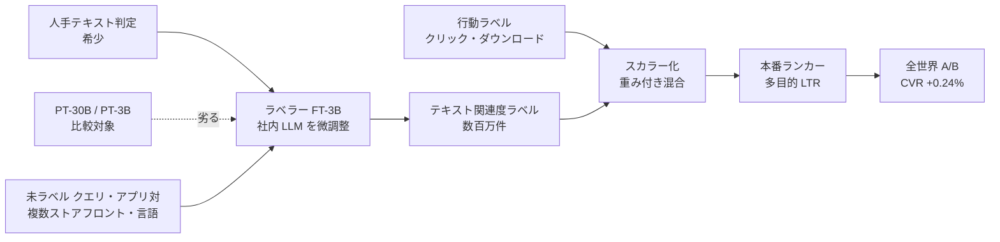

# Scaling Search Relevance: Augmenting App Store Ranking with LLM-Generated Judgments（Apple）

- **Link**: <https://arxiv.org/abs/2602.23234>（HTML: <https://arxiv.org/html/2602.23234v5>）
- **Authors**: Evangelia Christakopoulou, Vivekkumar Patel, Hemanth Velaga, Sandip Gaikwad, Sean Suchter, Venkat Sundaranatha（Apple, Cupertino / Seattle）
- **Year**: 2026（arXiv v1 2026-02-26, v5 2026-06-07）
- **Venue**: arXiv preprint（査読付き venue の記載なし）
- **Type**: Academic Paper（企業の本番 A/B 報告）
- **証拠の質**: **一次資料**（企業著者のプレプリント。オフライン NDCG と全世界トラフィックでの A/B を記載。期間・トラフィック量は非公開）
- **蒸留の種別**: **ラベル蒸留に相当するが、著者は「蒸留」と呼ばない**。微調整した 3B LLM（FT-3B）が数百万件のテキスト関連度ラベルを生成し、本番の多目的 LTR ランカーの学習データに加える。RRADistill（15）を「小型言語モデルへの蒸留」と位置づけて自らと区別している
- **2026-10-22 追記**: 前回 pass では未収集。Amazon Science を対象にした検索で発見

## Abstract

> 要旨の要約（原文は arXiv 参照）。

App Store search ranking must balance behavioral relevance (clicks, downloads) with textual relevance (semantic fit between query and result). Expert textual labels are scarce, so the authors generate millions of textual relevance labels with an in-house LLM fine-tuned on human judgments; the fine-tuned 3B model significantly outperforms a much larger pretrained model. Adding these labels to the production ranker improves NDCG on both behavioral and textual relevance offline, and a worldwide A/B test shows a statistically significant +0.24% increase in conversion rate, with the largest gains on tail queries.

## Abstract (Japanese Translation)

App Store の検索ランキングは、行動的関連度（クリック・ダウンロード）とテキスト的関連度（クエリと結果の意味的適合）を両立する必要がある。専門家によるテキストラベルは希少なため、人手判定で微調整した社内 LLM で数百万件のテキスト関連度ラベルを生成した。微調整した 3B モデルは、はるかに大きい事前学習モデルを大幅に上回った。これらのラベルを本番ランカーに加えると、オフラインで行動・テキスト両方の NDCG が改善し、全世界の A/B テストで統計的に有意な **コンバージョン率 +0.24%** を得た。効果はテールクエリで最大だった。

## Overview

Apple の App Store 検索で、**微調整した 3B LLM をラベラーにして本番ランカーを増強** した事例です。構図は Pinterest（03）・Walmart（01）の「LLM ラベル → 小型ランカー」と同じですが、著者は蒸留という語を自らの手法に使わず、「LLM を人手判定の force multiplier（増幅器）として使う」と説明しています。本クラスタでは、**「LLM ラベリング」と「蒸留」の境界が呼称次第である** ことを示す例として扱います。

- **ラベラー**: 社内 LLM を人手判定で微調整した **FT-3B**。事前学習 30B（PT-30B）より大幅に高精度（F1 0.800 対 0.382）。
- **ランカー**: 行動ラベルとテキストラベルをスカラー化（重み付きデータ混合）で統合する多目的 LTR。
- **本番**: 全世界 A/B で **CVR +0.24%**（有意）、ストアフロントの 89% で本番を上回る。

## Problem

- 行動信号（クリック・ダウンロード）は人気バイアスを持ち、テキスト的関連度を反映しない。
- 専門家のテキスト関連度ラベルは希少で、多数のストアフロント・言語を覆えない。
- 汎用の大型 LLM をそのままラベラーにしても、ドメインの判定基準に合わない。

## Proposed Method

**微調整 LLM ラベラー + 多目的 LTR へのラベル増強**

- 手順:
  1. 人手判定でラベラー候補を微調整（FT-3B）。PT-30B / PT-3B と比較し FT-3B を採用。
  2. FT-3B で複数ストアフロント・言語の **数百万件** のクエリ・アプリ対にテキスト関連度ラベルを付与。
  3. 行動ラベルとテキストラベルを重み付きで混合（スカラー化）し、本番ランカーを学習。
- 既存手法との違い: 小型言語モデルへの蒸留（RRADistill）ではなく、既存の LTR ランカーの **学習データ側** を LLM で拡張する。

## Algorithm (Pseudocode)

```
Algorithm: LLM-augmented App Store ranker
Input : 人手テキスト判定 H, 行動ログ B, 未ラベルのクエリ・アプリ対 U
Output: 本番ランカー f

1. FT-3B ← finetune(PT-3B, H)
2. for each (q, a) in U: t[q, a] ← FT-3B(q, a)          // 数百万件
3. D ← scalarize(B, {t})                                 // 重み付きデータ混合
4. f ← train_LTR(D)                                       // 多目的 LTR
5. A/B worldwide: CVR +0.24%
```

## Architecture / Process Flow



## Figures & Tables

### Table 1: ラベラーの精度（人手判定との一致）

| モデル | Precision | Recall | F1 |
|---|---|---|---|
| **FT-3B（微調整）** | **0.802** | **0.798** | **0.800** |
| PT-30B（事前学習のみ） | 0.424 | 0.402 | 0.382 |
| PT-3B（事前学習のみ） | 0.300 | 0.309 | 0.287 |

### Table 2: ランカーのオフライン NDCG（本番 → LLM 増強）

| 指標 | 本番 | LLM 増強 |
|---|---|---|
| テキスト NDCG@1 | 0.867 | 0.868 |
| テキスト NDCG@3 | 0.803 | 0.805 |
| テキスト NDCG@7 | 0.760 | 0.761 |
| 行動 NDCG@1 | 0.646 | 0.652 |
| 行動 NDCG@3 | 0.479 | 0.484 |
| 行動 NDCG@7 | 0.403 | 0.407 |

### オンライン A/B

| 項目 | 値 |
|---|---|
| コンバージョン率 | **+0.24%**（統計的に有意、全世界トラフィック） |
| 本番を上回ったストアフロントの割合 | 89% |
| 効果が最大の領域 | テールクエリ |
| 期間・トラフィック量 | 非公開 |

```
ラベラー F1
FT-3B  |████████████████████████████████ 0.800
PT-30B |███████████████ 0.382
PT-3B  |███████████ 0.287
```

### 手法比較（LLM ラベル → 本番ランカー）

| 観点 | Apple App Store | Pinterest（03） | Walmart（01） |
|---|---|---|---|
| ラベラー / 教師 | FT-3B（社内、微調整） | Llama-3-8B（微調整） | Mistral-7B（微調整） |
| 生徒 / ランカー | 多目的 LTR（既存） | 特徴量 FFN | BERT-Base 交差 |
| ラベル規模 | 数百万件 | 3,000 万件 | 1.7 億件 |
| 著者の呼称 | 「ラベル生成・増強」 | 「蒸留」 | 「蒸留」 |
| オンライン | CVR +0.24% | fulfillment 非 US +2.0% | ATC/visitor +1.2% |

## Experiments & Evaluation

### Setup

- ラベラー評価は人手判定との P / R / F1。
- ランカー評価はテキスト・行動それぞれの NDCG@1/3/7。
- A/B は全世界トラフィック、ストアフロント別に集計。

### Main Results

- FT-3B は PT-30B を F1 で +0.418 上回る。「微調整した小型 LLM > 大型の事前学習 LLM」は Tencent（07）・Meituan（05）の知見と一致。
- ランカーのオフライン NDCG 改善は +0.001〜+0.006 と小さいが、A/B では CVR +0.24% が有意。

### Ablation Study

- ラベラーのサイズ・微調整の有無（Table 1）以外のアブレーションは本レポートでは省略。

## 蒸留のビジネス価値式への当てはめ

| 項 | 報告内容 |
|----|---------|
| $(C_{teacher}-C_{student})Q$ | ランカーは既存の LTR のため、配信コストは実質不変（数値は非公開） |
| $C_{data}$ | FT-3B による数百万件のラベル付け（金額は非公開） |
| $\Delta\text{Acc}$ | ラベラーの人手一致 F1 0.800（ランカーの教師比は概念上存在しない） |
| ビジネス成果 | CVR +0.24%（全世界）、テールで最大 |

## Practical Takeaways

1. **「蒸留」と呼ぶかどうかは著者次第**。LLM ラベル → 小型ランカーの構図は本クラスタの主流と同じであり、調査時は呼称でなく構図で分類すべき。
2. **ラベラーは大型 LLM より微調整した小型 LLM**（3B 微調整 > 30B 事前学習）。
3. **オフライン NDCG の微差でも本番 CVR で有意差** が出る。評価はオンラインまで回すべき。

## Limitations

- 査読なし。A/B の期間・トラフィック量、ラベル件数の正確な値、ランカーの構成が非公開。
- 社内 LLM 前提で、開放モデルでの再現可能性は不明。

## Notes

- RRADistill（15）を「大型 LLM の意味理解を小型言語モデルへ蒸留する」研究として引用し、自らの手法（ラベル増強）と対比している。
- 本クラスタで Google / YouTube が「蒸留ではない」として除外されたのと同様、Apple も **蒸留の看板を掲げない** 大手の例。ただし構図は Walmart・Pinterest と同じであり、比較表では「△（LLM ラベリング、著者は蒸留と呼ばない）」と表記する。
