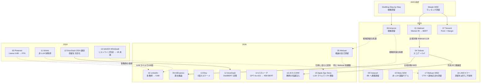

# C4 検索・推薦・広告・EC における LLM 蒸留 — Detailed Reports

## Parameters

- **Resources analyzed**: 19（2026-10-22 追記: 初回 13 件に 14〜19 の 6 件を追加）
- **Resource types**: Academic Paper（14）/ Technical Article（4）/ Business Case（1）
- **Generated on**: 2026-10-21（2026-10-22 に追記・訂正・数値の再検証）
- **Input source**: gather 出力（`research/runs/llm_distillation/gather/20261021/search_recsys/resources-search-recsys.md`）
- **選定方針**: 本番の定量成果（A/B テスト・レイテンシ・教師と生徒のサイズ）を一次資料で示しているものを優先。clustering で代表例とされたが LLM 蒸留ではなかった事例（Airbnb, Meta GEM）は、訂正のために含めた
- **取得できなかった一次資料**: Etsy・DoorDash の公式ブログ、Pinterest の Medium 記事、Instacart の tech.instacart.com（いずれも 403）。代わりに取得できた同内容のページ・二次資料を使い、各レポートに明記した
- **2026-10-22 の追記内容**: (1) 国内事例としてビズリーチ（NLP2026, 一次）と LINEヤフー（技術ブログ, 一次・LLM 蒸留ではない）を追加、(2) NAVER（EMNLP 2024 Industry）、JD.com（arXiv 2026）、Meituan の CTR 蒸留 MSD（WWW 2025）、Apple App Store（arXiv 2026）を追加、(3) Etsy・DoorDash の一次ブログを再取得したが再び 403（archive.org・プロキシも不可）で二次のまま、(4) 01〜07 の主要数値を arXiv 本文で再検証し、論文に明記のない「算出値」（AliExpress 約 350 倍、Tencent 教師比 −0.026、Taobao 約 3,200 倍）をそのように明記した

## Report List

### Academic Papers

| # | Title | Year | Venue | Summary | Report |
|---|-------|------|-------|---------|--------|
| 1 | Knowledge Distillation for Enhancing Walmart E-commerce Search Relevance Using LLMs | 2025 | WWW 2025 Companion | Mistral-7B → BERT-Base、LLM ラベル 1.7 億件、拡張 Margin-MSE。ATC/visitor +1.2% | [Details](01-walmart-search-relevance-kd.md) |
| 2 | Semantic Search At LinkedIn | 2026 | arXiv | 8B oracle・1.7B 教師 → 0.6B（375M）SLM。本番 NDCG@10 +7.73%、DAU +1.2% 超、75 倍超のスループット | [Details](02-linkedin-semantic-search-multi-teacher.md) |
| 3 | Improving Pinterest Search Relevance Using LLMs | 2024 | CIKM 2024 IRS WS | Llama-3-8B → 特徴量 FFN。nDCG@20 +2.18%、非 US fulfillment +2.0%、45 以上の言語 | [Details](03-pinterest-search-relevance-llm.md) |
| 4 | Explainable LLM-driven Multi-dimensional Distillation for E-Commerce Relevance Learning | 2025 | WWW 2025 | 70B 級 → Qwen2-7B → 101M の 2 段蒸留（スコア分布 + CoT）。CTR +0.17%、全トラフィック稼働 | [Details](04-taobao-ellm-multidim-distillation.md) |
| 5 | From Reasoning LLMs to BERT: A Two-Stage Distillation Framework for Search Relevance | 2026 | WWW 2026 | Qwen3-8B（CPT+SFT+GRPO）→ 6 層 BERT（CRSD）。広告 CTR +0.91%、CVR +1.06% | [Details](05-meituan-reasoning-llm-to-bert.md) |
| 6 | Thinking Broad, Acting Fast: Latent Reasoning Distillation | 2026 | WWW 2026 | Qwen3-14B の多視点 CoT → 168M BERT の潜在推論。RPM +1.42% | [Details](06-aliexpress-latent-reasoning-distillation.md) |
| 7 | Best Practices for Distilling LLMs into BERT for Web Search Ranking | 2025 | COLING 2025 Industry | Mistral-7B → 6 層 BERT、100ms → 10ms。滞在時間 +1.2% | [Details](07-tencent-disranker-web-search.md) |
| 8 | Rationale-Guided Distillation for E-Commerce Relevance Classification | 2025 | COLING 2025 Industry | Mixtral 8x7B の根拠 → 110M BERT。7B と ROC-AUC 差 1% 未満・50 倍高速（オフラインのみ） | [Details](08-amazon-rationale-guided-distillation.md) |
| 9 | Multi-objective Learning to Rank by Model Distillation | 2024 | KDD 2024 | **非 LLM**（MLP 教師群 → MLP 生徒）。予約 CVR +0.37%、レイテンシ −1.6% | [Details](11-airbnb-multi-objective-ltr-distillation.md) |
| 10 | 人材領域特化の LLM 教師付き長文 BERT 埋め込みモデルの構築（ビズリーチ）（2026-10-22 追記） | 2026 | 言語処理学会 NLP2026（査読なし） | **国内唯一の一次資料**。GPT-4o-mini の STS スコア 8 万ペア → 12M / 30M / 45M BERT。総合 68.88 で OpenAI Embedding API（68.58）と同等。本番 A/B なし | [Details](14-bizreach-llm-teacher-job-embedding.md) |
| 11 | RRADistill: Distilling LLMs' Passage Ranking Ability for Long-Tail Queries（NAVER）（2026-10-22 追記） | 2024 | EMNLP 2024 Industry | HyperCLOVA X Large のリストワイズ判定 → 1B 未満 RoBERTa / GPT。A/B 7 日で CTR +5.63%、滞在時間 +7.97% | [Details](15-naver-rradistill-long-tail-reranking.md) |
| 12 | K-CARE（JD.com）（2026-10-22 追記） | 2026 | arXiv（査読なし） | Qwen3-8B + 知識注入の教師 → 小型 BERT。本番 Bad Case 率 12.10% → 11.3%（相対 −5.87%） | [Details](16-jd-kcare-relevance-distillation.md) |
| 13 | Balancing Efficiency and Effectiveness: An LLM-Infused Approach for Optimized CTR Prediction（Meituan MSD）（2026-10-22 追記） | 2025 | WWW 2025 | LLM の意味記述を小型生徒へ系列蒸留し CTR モデルに注入。スポンサー検索で CTR +2.12%、CPM +2.59%、35 → 37.2ms | [Details](17-meituan-msd-llm-infused-ctr.md) |
| 14 | Scaling Search Relevance: Augmenting App Store Ranking with LLM-Generated Judgments（Apple）（2026-10-22 追記） | 2026 | arXiv（査読なし） | 微調整 3B LLM が数百万件のラベルを生成し本番 LTR を増強。全世界 A/B で CVR +0.24%。**著者は「蒸留」と呼ばない** | [Details](19-apple-app-store-llm-judgments.md) |

### Technical Articles

| # | Title | Source | Date | Report |
|---|-------|--------|------|--------|
| 1 | Building The Intent Engine: How Instacart is Revamping Query Understanding with LLMs | Instacart | 2025-11-21 | [Details](09-instacart-intent-engine.md) |
| 2 | Meta's Generative Ads Model (GEM) | Engineering at Meta | 2025-11-10 | [Details](10-meta-gem-ads-foundation-model.md) |
| 3 | How Etsy Uses LLMs to Improve Search Relevance（一次は 403。二次資料で作成。2026-10-22 に再取得を試みたが再び 403） | Etsy Code as Craft / ZenML | 2026-01-16 | [Details](13-etsy-semantic-relevance-cascade.md) |
| 4 | StaticEmbedding を用いた高速な検索クエリ埋め込み（LINEヤフー）（2026-10-22 追記。**LLM 蒸留ではない**: 蒸留・量子化では CPU 要件に届かず、静的埋め込みを採用） | LINEヤフー Tech Blog | 2025-08-04 | [Details](18-ly-static-embedding-query.md) |

### Business Cases

| # | Title | Company | Date | Report |
|---|-------|---------|------|--------|
| 1 | Small Language Models to Serve More Relevant DoorDash Search Ads（一次は 403。二次資料で作成。2026-10-22 に別 URL・プロキシ経由で再取得を試みたが失敗） | DoorDash | 2026 | [Details](12-doordash-slm-ad-relevance.md) |

## Cross-Resource Insights

### 系譜と関係



### 共通テーマ

1. **「LLM はオフライン、配信は小型」という役割分担が標準化** — 13 件中（2026-10-22 追記後の 19 件でも同様）、LLM を直接オンライン配信しているのは Instacart（8B, ロングテール 2% のみ）だけです。他はすべて BERT 級（0.1B〜0.6B）か特徴量モデルで配信しています。
2. **教師は 7B〜14B の開放モデルをドメイン微調整** — Mistral-7B（Walmart, Tencent）、Llama-3-8B（Pinterest）、Qwen2-7B（Taobao）、Qwen3-8B（Meituan）、Qwen3-14B（AliExpress）、8B（LinkedIn）。より大きなモデルや商用 API は「教師の教師」・アノテータ・根拠生成に限って使われています（Taobao の Qwen2-72B / LLama3-70B、Etsy の o3、Amazon の Bedrock 経由の Mixtral 8x7B、Instacart の非公開フロンティア LLM）。
3. **汎用の巨大 LLM のプロンプト利用は教師として弱い** — Tencent では GPT-4 のプロンプト利用が BERT-Base を下回り（nDCG@5 0.825 対 0.834）、Meituan では DeepSeek-R1 few-shot（Macro F1 0.47）がドメイン微調整 8B（0.72）に大差で負けます。
4. **2025–2026 年は「推論（CoT）の蒸留」が主戦場** — Taobao（根拠語の BIO タグ）、Amazon（根拠生成の補助タスク）、Meituan（推論つき入力との自己蒸留）、AliExpress（潜在推論ベクトル）と、推論時に CoT を生成せずに推論能力を BERT に埋め込む工夫が競われています。
5. **効果はロングテール・非英語圏・少量データで大きい** — Walmart（tail クエリに限定導入）、Taobao（ロングテール Goodrate +1.96% 対 全体 +0.89%）、Pinterest（非 US fulfillment +2.0% 対 US +0.7%）、Amazon（1 万件以下で最大の効果）。
6. **データ量が最大のレバー** — LinkedIn の 40 倍データ（NDCG@10 +6.4pt）、Walmart の 1.7 億件、Taobao の疑似ラベル除去で ROC −2.8pt。LLM 蒸留の価値の多くは「ラベルの量産」にあります。
7. **（2026-10-22 追記）国内の一次資料はビズリーチ 1 件、しかも商用 API 教師・オフラインのみ** — 海外主要事例が開放モデルを微調整して教師にするのに対し、ビズリーチは GPT-4o-mini のプロンプト採点（8 万ペア）を教師信号にし、本番 A/B は報告していません。LINEヤフーは「蒸留・量子化でも CPU 要件に届かず」静的埋め込みを選んでおり、国内では **LLM 蒸留が本番で効いた一次事例はまだ確認できません**。
8. **（2026-10-22 追記）効果が大きい事例はロングテール限定か CTR 直結** — NAVER（ロングテール再ランキング: CTR +5.63%、滞在 +7.97%）と Meituan MSD（スポンサー検索 CTR: CTR +2.12%、CPM +2.59%）は、関連度の全体導入事例（+0.2〜1.4%）より大きい効果を報告しています。
9. **（2026-10-22 追記）「蒸留」と呼ぶかは著者次第** — Apple（App Store）は微調整 3B LLM のラベルで本番ランカーを増強し CVR +0.24% を得ていますが、自らを蒸留と呼ばず、NAVER の RRADistill を「蒸留」として対比しています。構図は Walmart・Pinterest と同じであり、本クラスタでは呼称でなく構図（LLM 教師の出力 → 小型モデル）で分類します。

### 仮説の検証結果

| # | 仮説 | 判定 | 根拠 |
|---|------|------|------|
| H1 | 定量成果が公開された本番事例は検索・推薦に集中 | **支持** | 本番 A/B の数値を一次資料で公開した LLM 蒸留事例が 8 社（Walmart, Pinterest, Taobao, Meituan, AliExpress, Tencent, LinkedIn, Instacart）。ただし **Airbnb と Meta GEM は LLM 蒸留ではない** ため、clustering の代表例リストは修正が必要。（2026-10-22 追記）NAVER（CTR +5.63%）、JD.com（Bad Case 率 −5.87% 相対）、Meituan MSD（CTR +2.12%）、Apple（CVR +0.24%、蒸留とは自称しない）が加わり、一次資料で本番数値を公開した事例は **11〜12 社** に増えた |
| H2 | ベンダー数値は集計値で顧客別成果は非公開 | **間接的に支持** | 本クラスタの事例はすべて自社構築で、クラウドの蒸留サービスを使った本番事例は 0 件。Amazon RGD が Bedrock の Mixtral を根拠生成に使った程度 |
| H3 | 「90% コスト削減」の多くは蒸留ではなく fine-tuning | **部分的に支持** | Instacart は「教師出力での SFT」= 黒箱蒸留だが、生徒は 8B で小型化は限定的。YouTube の「95% 超のコスト削減」は蒸留ではなく小型モデル + 事前計算。**コスト削減の金額を公開した事例は 0 件** |
| H4 | 国内は公開モデル型が中心で事業会社の社内事例は少ない | **支持（強い空白）** | 日本企業の検索・推薦での LLM 蒸留の一次資料は 0 件。唯一の手がかり（ビズリーチの学会発表）も取得できず。日本語 EC（ESCI-JP）での有効性は Amazon・AliExpress の論文で間接的に示される。（2026-10-22 訂正）ビズリーチの NLP2026 論文を取得し **国内一次資料 1 件** を確認（オフラインのみ、教師は GPT-4o-mini）。LINEヤフーは蒸留を試行したが不採用（CPU 要件）。メルカリ・ZOZO・楽天・リクルート・DeNA・CyberAgent は再検索でも該当なし。「強い空白」の判定は維持 |
| H5 | 商用 API の教師利用は規約で制約される | **支持（行動として）** | 一次論文の 7 社のうち 6 社は主教師が開放モデル（Mistral / Llama / Qwen）と明記。LinkedIn もエンゲージメント教師は開放モデルベースと明記。商用 API は「教師の教師」やアノテータに限定されている。（2026-10-22 追記）追加分でも JD.com（GPT-5.2 は軌跡合成のみ、本番教師は Qwen3-8B）、NAVER（自社 LLM）、Apple（社内 LLM）は同傾向。**例外はビズリーチ**で、GPT-4o-mini の出力を直接の教師信号にしている（規約面の記述はなし） |
| H6 | 推論蒸留で Agent・tool calling が増加 | **本クラスタでは対象外** | 本クラスタでは tool calling の事例はなし。ただし「推論（CoT）蒸留」の増加は明確に確認（2025–2026 年の 4 件） |

### 蒸留のビジネス価値式から見た報告の偏り

$$
\text{価値}\approx\underbrace{(C_{teacher}-C_{student})Q}_{\text{推論コスト削減}}-\underbrace{(C_{data}+C_{train})}_{\text{初期投資}}-\underbrace{\Delta\text{Acc}\cdot V_{err}}_{\text{精度低下の損失}}
$$

| 項 | 公開している事例数（13 件中） | 具体例 |
|----|-----------------------------|--------|
| 推論コスト削減（レイテンシ・速度） | 6 | Tencent 100→10ms、Taobao 約 3,200 倍、AliExpress 約 350 倍、Amazon 50 倍、LinkedIn 75 倍超、Instacart 700→300ms |
| 推論コスト削減（金額） | **0** | — |
| 初期投資（学習時間） | 3 | LinkedIn 45→5 時間未満、Taobao 10 時間、Meta GEM の学習基盤 |
| 精度（教師比） | 9 | Walmart は生徒が上回る、Meituan 98.6%、LinkedIn −3.5%、AliExpress −11pt |
| ビジネス KPI | 10 | CTR / CVR / RPM / ATC / DAU / CV |

> （2026-10-22 追記）追加 6 件を含めても傾向は同じ。レイテンシ・速度の公開は Meituan MSD（35 → 37.2ms）、LINEヤフー（18.8 → 1.8ms）、NAVER（QPS +18%）、JD（「1 桁削減」のみ）で計 10 件、金額の公開は **引き続き 0 件**、ビジネス KPI の公開は NAVER・JD・Meituan MSD・Apple が加わり 14 件。
>
> 業界は「精度 → ビジネス KPI」は積極的に公開しますが、**金額ベースのコスト削減は 1 社も公開していません**。蒸留の動機は「LLM の品質を配信可能にすること」で、「既存の LLM 配信を安くすること」ではない点が、C2（ベンダーの訴求）や C5（業務利用）と異なります。

## Comparison Table

| 企業 | 用途 | 教師 | 生徒 | 蒸留方式 | 蒸留データ | オンライン成果 | レイテンシ・効率 | 証拠の質 | 真の LLM 蒸留か |
|------|------|------|------|---------|-----------|--------------|----------------|---------|---------------|
| Walmart | EC 検索関連度（tail） | Mistral-7B | BERT-Base 約 110M | 拡張 Margin-MSE | 1.7 億件 | ATC/visitor +1.2%、離脱 −0.6% | 非公開（事前計算 + TensorRT） | 一次 | ○ |
| LinkedIn | 求人・人物検索 | 8B oracle、1.7B 教師 ×2 | 0.6B → 375M SLM | 多教師 KL + 剪定 | 数千万件/日の採点 | NDCG@10 +7.73%、DAU +1.2% 超 | 290 → 22,000 items/s/GPU | 一次 | ○ |
| Pinterest | Pin 検索関連度 | Llama-3-8B | 特徴量 FFN | 5 段階ソフトラベル | 3,000 万件 | nDCG@20 +2.18%、非 US fulfillment +2.0% | 非公開 | 一次 | ○ |
| Taobao | 検索広告の関連度 | Qwen2-7B（70B 級の CoT で SFT） | 101M（ColBERT 型） | KL + CoT タグ | 3,000 万件 | CTR +0.17%、Goodrate +0.89% | 生徒は教師の約 3,200 倍速 | 一次 | ○ |
| Meituan | 検索広告の関連度 | Qwen3-8B（CPT+SFT+GRPO） | 6 層 BERT | CRSD（自己蒸留） | 268 万件 | CTR +0.91%、CVR +1.06%、GTV +0.40% | 非公開 | 一次 | ○ |
| AliExpress | 検索広告の関連度 | Qwen3-14B（多視点 CoT） | BERT 168M + 抽出器 | 潜在推論の L2 整列 | 非公開 | RPM +1.42%、CTR +0.48% | 約 350 倍速 | 一次 | ○ |
| Tencent | Web 検索ランキング | Mistral-7B（CPT+SFT） | 6 層 BERT 0.1B | Point + Margin MSE | 4,681 万件 | 滞在時間 +1.2%、UserCTR +0.58% | 100ms → 10ms | 一次 | ○ |
| Amazon | EC 関連度分類 | Mixtral 8x7B（根拠） | BERT-base 110M | 根拠生成の補助タスク | 各地域 10 万件 | **なし（オフラインのみ）** | 7B 比 50 倍速 | 一次 | ○ |
| Instacart | クエリ理解 | 非公開のフロンティア LLM | Llama-3-8B（LoRA） | 黒箱（教師出力で SFT） | 非公開 | ロングテールの不満 −50% | 700 → 300ms | 一次（自社ブログ） | △（生徒が 8B） |
| Etsy | EC 検索関連度 | （ZenML によれば o3）→ Qwen 3 VL 4B | BERT 双塔 | 3 段カスケード | 日次 数百万件 | 完全関連の割合 58→62% | +10ms 未満 | 二次（2026-10-22 再取得も 403） | ○ |
| DoorDash | 検索広告の関連度 | 非公開 LLM（人手 70 万件で微調整） | DistilBERT 双塔 64 次元 | ラベル蒸留 | 非公開 | Precision@2 +5.2% | 追加ほぼゼロ | 二次（2026-10-22 再取得も 403） | ○ |
| NAVER（2026-10-22 追記） | Web 検索ロングテール再ランキング | HyperCLOVA X Large（自社） | 1B 未満 RoBERTa / GPT | リストワイズ判定のラベル蒸留 + TCL | 7,000 クエリ × 20 文書 | **CTR +5.63%、滞在時間 +7.97%**（7 日） | QPS +18%（bf16）、絶対値非公開 | 一次（EMNLP 2024 Industry） | ○ |
| JD.com（2026-10-22 追記） | EC 検索関連度 | Qwen3-8B + SCA/APR（GPT-5.2 は軌跡合成） | 小型 BERT（非公開） | ラベル蒸留（SFT） | 非公開 | Bad Case 率 12.10 → 11.3%（相対 −5.87%） | 「1 桁削減」 | 一次（arXiv, 査読なし） | ○ |
| Meituan MSD（2026-10-22 追記） | スポンサー検索の CTR | LLM（名称非公開） | 小型生徒 → CTR モデル | 意味記述の系列蒸留 | 非公開 | **CTR +2.12%、CPM +2.59%**（10 日） | 35 → 37.2ms | 一次（WWW 2025） | ○ |
| ビズリーチ（2026-10-22 追記） | 求人文書の類似度・候補者推薦 | **GPT-4o-mini（商用 API）** | 12M / 30M / 45M BERT 双塔 | STS スコアのラベル蒸留 | 8 万ペア | **なし（オフラインのみ）**。総合 68.88 対 OpenAI 68.58 | 非公開 | 一次（NLP2026, 査読なし） | ○ |
| Apple App Store（2026-10-22 追記） | アプリ検索ランキング | 微調整 3B 社内 LLM（ラベラー） | 多目的 LTR（既存ランカー） | ラベル増強（著者は蒸留と呼ばない） | 数百万件 | CVR +0.24%（全世界、有意） | 不変（既存ランカー） | 一次（arXiv, 査読なし） | △（LLM ラベリング） |
| LINEヤフー（2026-10-22 追記） | 検索クエリ埋め込み | **なし**（Transformer の蒸留・量子化は試行のみ） | StaticEmbedding（埋め込み層のみ） | 対照学習（クリックログ） | 非公開 | **なし（オフラインのみ）**。UBIQUE の 97% 超 | 18.8 → 1.8ms（CPU） | 一次（技術ブログ） | **×（非 LLM・蒸留不採用）** |
| Airbnb | 宿泊検索ランキング | 目的別 MLP | MLP | ソフトラベル多教師 | 3.6 億例 | 予約 CVR +0.37% | レイテンシ −1.6% | 一次 | **×（非 LLM）** |
| Meta GEM | 広告推薦 | 広告基盤モデル | 数百の垂直モデル | KD + Adapter + 表現・パラメータ共有 | 非公開 | Instagram CV +5%、FB Feed +3% | 学習 FLOPS 23 倍 | 一次（自社ブログ） | **×（非 LLM）** |

> **「真の LLM 蒸留か」列の読み方（2026-10-22 追記）**: ○ = LLM（7B 級以上、または商用 API）の出力を教師信号にして小型モデルを学習した事例。△ = 構図は同じだが生徒が 8B と大きい（Instacart）か、著者が蒸留と呼ばない（Apple）。× = 教師が LLM ではない（Airbnb の MLP、Meta GEM の広告基盤モデル）か、蒸留を採用しなかった（LINEヤフー）。× の 3 件は clustering で「LLM 蒸留の代表例」や「国内候補」とされたため、訂正のために残している。
>
> 一次資料で本番 A/B の数値を公開した **LLM 蒸留（○）** は 11 件（Walmart, LinkedIn, Pinterest, Taobao, Meituan CRSD, AliExpress, Tencent, NAVER, JD.com, Meituan MSD。Amazon RGD とビズリーチはオフラインのみ）、△ を含めると 13 件。

```
オンライン改善率の比較（各社の主要 KPI, 一次資料のみ。2026-10-22 追記分を含む）
LinkedIn   NDCG@10   |████████████████████████████████████████ +7.73%
NAVER      dwell     |█████████████████████████████████████████ +7.97%  ※ロングテール限定
NAVER      CTR       |█████████████████████████████ +5.63%  ※ロングテール限定
JD.com     BadCase   |██████████████████████████████ −5.87%（相対）
Meituan    CTR(MSD)  |███████████ +2.12%
Pinterest  fulfil非US|██████████ +2.0%
AliExpress RPM       |███████ +1.42%
Walmart    ATC/vis   |██████ +1.2%
Tencent    dwell     |██████ +1.2%
Meituan    CVR(CRSD) |█████ +1.06%
Taobao     Goodrate  |████ +0.89%
Airbnb     booking   |██ +0.37%   ※非LLM
Apple      CVR       |█ +0.24%    ※LLM ラベリング（蒸留と自称せず）
```

## Further Investigation Candidates

### 本 run で見つかったが詳細化していない資料

| 資料 | 理由 |
|------|------|
| [Knowledge Distillation for Efficient and Effective Relevance Search on E-commerce](https://ceur-ws.org/Vol-3843/paper_16.pdf)（Walmart, SIGIR eCom'24） | 01 の前身。BERT-base を「LLM」と呼ぶため、LLM 蒸留の定義の線引きの例として有用 |
| [CORE](https://arxiv.org/abs/2607.24417)（2026） | LLM を BERT へ蒸留し bad case 率 −15.94%。順序関連度の蒸留 |
| [LREF](https://arxiv.org/abs/2503.09223) / [Graph-GRPO](https://arxiv.org/abs/2605.31003) | EC 関連度 LLM の本番 A/B。蒸留部分の詳細は本文確認が必要 |
| [SLMRec](https://arxiv.org/abs/2405.17890)（ICLR 2025）/ [DLLM2Rec](https://arxiv.org/abs/2405.00338) | 推薦向け LLM 蒸留の学術的基盤（本番事例ではない） |
| [eugeneyan: Improving Recommendation Systems & Search in the Age of LLMs](https://eugeneyan.com/writing/recsys-llm/) | Bing（GPT-4 → Mistral-7B）、Indeed（GPT-4 → GPT-3.5 → 軽量分類器, 応募率 +4.13%）、Yelp、Amazon Music、Best Buy の事例を集約。各社の一次資料を追うべき |
| [LinkedIn: The Training Infrastructure Behind AI-Powered Job Search](https://www.linkedin.com/blog/engineering/infrastructure/the-training-infrastructure-behind-ai-powered-job-search-eight-x-faster-multi-teacher-distillation) | 蒸留の「学習コスト」側の数少ない定量資料 |

### 未取得・今後の調査が必要なもの

- **国内事例**: ビズリーチ「人材領域特化の LLM 教師付き長文 BERT 埋め込みモデルの構築」（言語処理学会 2026, C7-6）— 接続不可。再取得を推奨。メルカリ・LINEヤフー・楽天・ZOZO・リクルートの技術ブログと学会発表（WebSearch の上限到達で十分に探せなかった）。
  - **（2026-10-22 追記）** ビズリーチ C7-6 は PDF を取得し 14 番として詳細化した。LINEヤフーは技術ブログ 2 本（StaticEmbedding = 18 番、Moegi = gather に記載）を確認したが、いずれも LLM 蒸留ではない。メルカリ（engineering.mercari.com / speakerdeck）、ZOZO（techblog.zozo.com、JSAI2026 参加報告を含む）、楽天、リクルート、DeNA、CyberAgent（広告 CTR）、Yahoo! 広告を再検索したが、検索・推薦・広告向けの LLM 蒸留事例は **ヒットなし**。NLP2026 では P1-4「Matryoshka 表現学習を考慮した埋め込みモデル蒸留」（DTEN）など埋め込み蒸留の発表があるが、検索・推薦の事業会社事例ではないため未収集。
- **一次ブログの本文**: Etsy、DoorDash、Pinterest（Medium）。403 のため数値は二次資料に依存。
  - **（2026-10-22 追記）** Etsy・DoorDash は公式 URL・別形式 URL・プロキシ（r.jina.ai）・転載サイト（scour.ing / thenote.app）を試したが本文は得られず、web.archive.org は本環境から到達不可。二次のまま。
- **（2026-10-22 追記）主要プレイヤーの追加探索結果**: Amazon Science には検索・広告の LLM 蒸留 × 本番 A/B の論文は見つからず（「Performance-guided LLM knowledge distillation for efficient text classification at scale」は分類タスク）。Kuaishou の OneSearch-V2（arXiv 2603.24422, 自己蒸留で item CTR +3.98%）は教師と生徒が同一重みの生成検索で、LLM → 小型の蒸留ではないため gather にのみ記載。Alibaba の ELEC（SIGIR 2025, gte-Qwen2-7B-instruct → 表形式 CTR モデル）はオフラインのみ。Spotify・Zalando・Booking・Expedia・Shopee・Baidu・Xiaohongshu は 1 回の検索ではヒットなし。
- **（2026-10-22 追記）特許**: Google Patents を対象にした検索で、LLM 教師 × 検索関連度の蒸留に特化した特許は見つからなかった。見つかった US12333254B2（Genesys Cloud, NLP モデルの蒸留で層の削除順列を評価）と WO2025123815A1（Huawei Cloud, LLM → SLM の知識転移に分布外フィードバックを使う）は検索・推薦に言及しない（gather に記載）。
- **Indeed の eBadMatch**（eugeneyan 経由）: LLM → GPT-3.5 → 軽量分類器の多段蒸留で、オンラインで応募率 +4.13%。一次資料の確認が必要。
- **Bing の GPT-4 → Mistral-7B**（eugeneyan 経由）: Web 推薦の品質指標を公開。一次資料の確認が必要。
- **特許**: LLM 教師 × 検索関連度の蒸留に特化した特許は未発見（Google EP4298566A1、Microsoft US12307750B2 は LLM に限定されない）。
