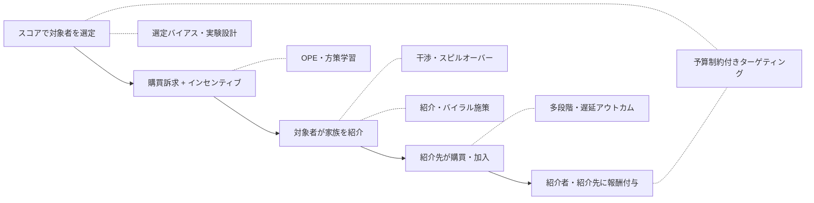
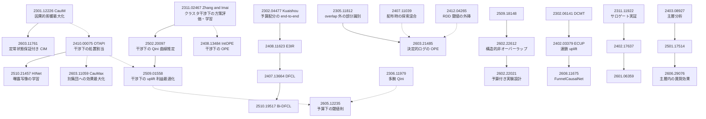
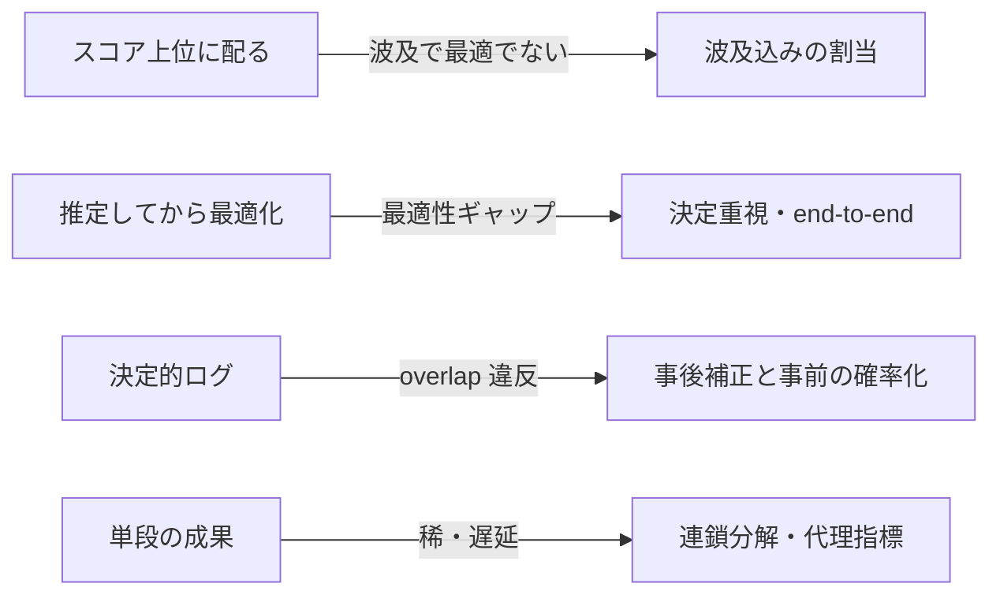

# 紹介インセンティブ施策のターゲティングに類似する課題 — リソース収集結果

施策の対象者を選んで購買訴求し、その人が家族などを紹介して紹介先が購買・加入したら、紹介者・被紹介者のいずれか（または双方）にインセンティブを付与する。インセンティブのコストから全員には配れず、スコアで対象を選んでいる。この構図を因果推論・オフポリシー評価（OPE）の観点で一般化し、類似課題を扱う論文を集めた。訴求チャネル（メール・手紙など）、成果の種類（購買・プラン加入など）、報酬の種類（クーポンなど）、報酬の受け手には特定せず、構造の似た問題を対象にしている。

## 収集パラメータ

- **対象リソース**: 学術論文（arXiv）
- **対象期間**: 2023-01 – 2026-10（arXiv の初回投稿日で判定）
- **言語**: 英語
- **収集日**: 2026-11-16
- **入力元**: ユーザーキーワード（課題記述から 6 つの観点に分解）

## 課題の分解と観点

課題を構成要素に分け、それぞれに対応する研究領域を観点（領域）として設定した。



| 領域 | 課題のどこに当たるか | 主なキーワード |
|------|--------------------|----------------|
| 紹介・バイラル施策 | 紹介を起点に効果が広がる構造そのもの | causal influence maximization, seeding, referral reward mechanism, invitation recommendation |
| 干渉・スピルオーバー | 対象者への処置が家族（未処置者）の成果に効く | network / clustered interference, exposure mapping, spillover HTE, policy learning under interference |
| 予算制約付きターゲティング | コストのため上位スコアだけに配る | budget-constrained uplift, coupon allocation, MCKP, decision-focused learning, Qini at budget |
| OPE・方策学習 | 新しい選定方策を配る前に過去ログで評価する | off-policy evaluation, deterministic logging, DR estimator, constrained policy learning |
| 選定バイアス・実験設計 | 過去のスコア選定がデータを偏らせる | regression discontinuity, data fusion of RCT and logs, adaptive experiments, performative prediction |
| 多段階・遅延アウトカム | 「紹介 → 紹介先の成約」という稀で遅い連鎖成果 | funnel / chained uplift, principal stratification, mediation, surrogate index, zero-inflated uplift |

## 収集サマリ

同じ論文が複数の領域で見つかった場合は、表の上の領域（下表の並び順で先の領域）に寄せて 1 行にまとめ、「関連領域」列に他の領域を書いた。

| 領域 | 各領域で掲載 | 重複を除いた件数（主領域） |
|------|-------------|--------------------------|
| 紹介・バイラル施策 | 30 | 30 |
| 干渉・スピルオーバー | 38 | 32 |
| 予算制約付きターゲティング | 39 | 37 |
| OPE・方策学習 | 38 | 29 |
| 選定バイアス・実験設計 | 40 | 29 |
| 多段階・遅延アウトカム | 31 | 25 |
| **合計** | **216** | **182** |

```
紹介・バイラル施策　　　　|██████████████████████████████ 30
干渉・スピルオーバー　　　|████████████████████████████████ 32
予算制約付きターゲティング|█████████████████████████████████████ 37
OPE・方策学習　　　　　|█████████████████████████████ 29
選定バイアス・実験設計　　|█████████████████████████████ 29
多段階・遅延アウトカム　　|█████████████████████████ 25
```

## URL検証結果

| 項目 | 件数 |
|------|------|
| 収集（領域ごとの合計） | 219 |
| 検証済み | 218 |
| 不一致で除外 | 1 |
| アクセス不可で除外 | 0 |
| 検証済みだが関連が弱く除外 | 2 |
| 領域間の重複 | 34 |
| **掲載（重複除去後）** | **182** |

- 検索結果に出た arXiv ID だけを候補にし、全件の `arxiv.org/abs/<id>` を取得してタイトルと初回投稿日（v1）を照合した。
- 不一致の 1 件は 2407.00699。検索結果ではインセンティブ配分の論文とされていたが、実際のタイトルは別の論文（オフライン強化学習）だった。
- 関連が弱いとして外したのは 2502.16156（因果的意思決定のレビュー。干渉への言及なし）と 2410.09027（A/B テストの分散削減）。
- 改題が 2 件ある。2301.12226 は v1 題を併記した。2412.04265 は現行題「Bounds on Extrapolated Treatment Effects in Regression Discontinuity Designs」で掲載した（旧題「On Extrapolation of Treatment Effects in Multiple-Cutoff RDD」）。
- 2402.03379（ECUP）は著者が arXiv 上で撤回している（Venue 欄に明記）。
- 2303.01049 は CIKM 2019 の論文だが、arXiv への初回投稿が 2023 年のため含めた。

## 年次分布

全体（重複除去後）:

```
2026 |█████████████████████ 42
2025 |██████████████████████ 43
2024 |████████████████████████████ 57
2023 |████████████████████ 40
```

2026 年は 10 月までの 10 か月分。月あたりでは 2026 年（約 4.2 本/月）が 2024 年（約 4.8 本/月）に迫り、2025 年（約 3.6 本/月）を上回る。

領域別（主領域で集計）:

| 領域 | 2023 | 2024 | 2025 | 2026 |
|------|------|------|------|------|
| 紹介・バイラル施策 | 7 | 10 | 6 | 7 |
| 干渉・スピルオーバー | 6 | 9 | 11 | 6 |
| 予算制約付きターゲティング | 5 | 11 | 9 | 12 |
| OPE・方策学習 | 9 | 13 | 4 | 3 |
| 選定バイアス・実験設計 | 8 | 8 | 7 | 6 |
| 多段階・遅延アウトカム | 5 | 6 | 6 | 8 |

## リソース関係図

複数の領域にまたがる論文と、主要な系譜を示す。矢印は「拡張・発展」、点線は「同じ問題を別の方法で扱う」。



## 全体の傾向



- **uplift 上位に配る方策は、波及があると最適でない**: 2410.00075（OTAPI, EJOR）が明示し、2509.01558・2502.20097（Booking.com 系）が Zhang & Imai（2311.02467）のクラスタ干渉の推定量を uplift の学習と評価に持ち込んでいる。世帯をクラスタと見なせば、家族紹介の構図にもっとも直接に対応する。
- **「推定 → 最適化」の二段階から決定重視学習へ**: 予算制約付き配分は MCKP/ラグランジュ双対の二段階が主流だったが、2302.04477 → 2408.11623 → 2407.13664 → 2510.19517 と end-to-end 化が進み、Meituan では本番稼働している。2505.13092 と 2601.05597 は、推定精度が高くても配分が良いとは限らないことを理論側から示す。
- **スコア選定の決定的ログへの対処が 2025〜2026 年に急増**: 部分識別（2305.11812）、決定的ログ下の OPE（2603.21485, ICLR 2026）、RDD による閾値付近の推定と外挿（2303.11721, 2407.14365, 2412.04265）が事後補正の側。配布時に探索を混ぜる設計（2407.11039, 2605.15108）が事前の側。小規模ホールドアウトと大規模ログを結合する研究（2509.18148 → 2602.22612 → 2602.22021）も配車業界で続いている。
- **稀で遅い連鎖成果は「段階の積」と「代理指標」で扱う**: 全空間 CVR から連鎖 uplift への流れ（2302.06141 → 2402.03379 → 2608.11675）と、Netflix/Kallus 系のサロゲートインデックス（2311.11922 ほか）が厚い。主層分析（「紹介する人」層での効果、2606.29076）や媒介分析も 2026 年に揃いつつある。
- **紹介報酬の設計は arXiv では主にメカニズム設計（cs.GT）**: 2302.08135、2405.14293 などは誘因両立性や Sybil 耐性（自作自演の紹介）を扱う。送り手と受け手のどちらに報酬を出すかの実証研究は Management Science などの arXiv 外の雑誌が中心で、今回は拾えていない。

全体として、本課題の 4 つの難しさ（波及、予算、スコア選定ログ、連鎖成果）はそれぞれ別の研究群で個別に深まっている。一方で、これらを同時に扱う研究はまだ少ない。もっとも近いのは干渉と予算を同時に扱う 2509.01558・2410.00075・2603.11059 で、ここに連鎖成果のモデル化（2608.11675 など）や決定的ログの補正（2603.21485 など）を組み合わせる部分は空白に近い。実務的には、まず世帯をクラスタとした干渉下の uplift と、ホールドアウトによる探索の確保から着手するのが文献上もっとも裏付けが厚い。

### 本課題に特に近い論文

| 論点 | 論文 | 理由 |
|------|------|------|
| 世帯内の波及を考慮した送付方策 | [2311.02467](https://arxiv.org/abs/2311.02467), [2509.01558](https://arxiv.org/abs/2509.01558) | クラスタ（世帯）内干渉下の方策学習と、それを uplift の利益最適化に転用したもの |
| 波及込みの評価指標 | [2502.20097](https://arxiv.org/abs/2502.20097) | 干渉があると通常の Qini 曲線が偏ることを補正する |
| 紹介者に配って家族の成果を最大化 | [2603.11059](https://arxiv.org/abs/2603.11059), [2410.00075](https://arxiv.org/abs/2410.00075) | 介入する集団と効果を測る集団が異なる設定、予算付きの波及込み割当 |
| 予算内での配布者選定 | [2407.13664](https://arxiv.org/abs/2407.13664), [2605.12235](https://arxiv.org/abs/2605.12235), [2306.11979](https://arxiv.org/abs/2306.11979) | 決定重視学習、閾値則の最適性、予算水準ごとの価値評価 |
| スコア選定ログからの評価 | [2603.21485](https://arxiv.org/abs/2603.21485), [2305.11812](https://arxiv.org/abs/2305.11812), [2407.11039](https://arxiv.org/abs/2407.11039) | 決定的ログの OPE、overlap 外の部分識別、配布時の探索混合 |
| 紹介 → 成約の連鎖成果 | [2608.11675](https://arxiv.org/abs/2608.11675), [2606.29076](https://arxiv.org/abs/2606.29076), [2402.17637](https://arxiv.org/abs/2402.17637) | 段階の積への分解、紹介する人の層での効果、代理指標の構成 |
| 招待の推薦と報酬設計 | [2508.13517](https://arxiv.org/abs/2508.13517), [2405.14293](https://arxiv.org/abs/2405.14293) | 招待・受諾の予測（Tencent の本番 A/B）、予算付き紹介報酬と不正紹介対策 |

---

## 学術論文

領域は重複時の主領域。並びは領域ごと、その中で新しい順。

| # | 領域 | タイトル | 著者 | 年 | Venue | 概要 | 関連性 | 関連領域 |
|---|------|---------|------|-----|-------|------|--------|----------|
| 1 | 紹介・バイラル施策 | [Optimizing Marketing Budgets for Social Influence: A Generalized Fractional Incentives Framework](https://arxiv.org/abs/2610.25823) | Abhishek K. Umrawal et al. | 2026 | arXiv | 反応度とネットワーク効果が異なるユーザーへ、限られた販促予算を連続量で配分する Budgeted Generalized Fractional IM を定式化し、近似保証付き貪欲法を提案する。 | クーポン額を人ごとに変えて配分する予算最適化 | — |
| 2 | 紹介・バイラル施策 | [Learning to target with network interference](https://arxiv.org/abs/2605.27794) | Xiaomeng Wang et al. | 2026 | arXiv | スピルオーバーがある環境で、疎な線形干渉モデルの下で対象者を逐次選ぶバンディットを扱い、干渉構造の事前知識の量に応じた regret 上界とアルゴリズムを示す。 | 紹介波及を考慮した逐次的な対象者選択 | 干渉・スピルオーバー |
| 3 | 紹介・バイラル施策 | [Probabilistic Mechanism Design in Diffusion Auctions](https://arxiv.org/abs/2605.17221) | Xinlun Zhang et al. | 2026 | arXiv | 招待で参加者が広がるネットワーク上のオークションに確率的メカニズム PDM を提案し、誘因両立性・非負収益・近似効率を同時に満たす。Sybil 耐性版と多ユニット版にも拡張する。 | 招待者への報酬配分メカニズムの設計 | — |
| 4 | 紹介・バイラル施策 | [Causal Influence Maximization with Steady-State Guarantees](https://arxiv.org/abs/2603.11761) | Renjie Cao et al. | 2026 | arXiv | 到達数ではなく定常状態の因果的厚生を目的に seed を選ぶ。ログ化された拡散データから形状制約付きの曝露-反応関数を学習し、厚生推定誤差を抑えて最適化する。 | 因果効果ベースで紹介起点ユーザーを選ぶ | 干渉・スピルオーバー |
| 5 | 紹介・バイラル施策 | [Identifying the Group to Intervene on to Maximize Effect Under Cross-Group Interference](https://arxiv.org/abs/2603.11059) | Xiaojing Du et al. | 2026 | ICDM 2026 | ある集団の一部に介入して別集団への効果を最大化する問題を Co2G 推定量として定式化する。観測ネットワークデータから識別し、GNN 推定と不確実性を考慮した選択法 CauMax を提案する。 | 紹介者に介入して家族（別集団）の購入を最大化 | 干渉・スピルオーバー |
| 6 | 紹介・バイラル施策 | [Optimal Design under Interference, Homophily, and Robustness Trade-offs](https://arxiv.org/abs/2601.17145) | Vydhourie Thiyageswaran et al. | 2026 | arXiv | 干渉とホモフィリーがあるネットワークで全体処置効果を推定する実験計画を、最悪ケース MSE の最小化として最適化する。クラスタ無作為化がかえって誤差を増やす場合を示す。 | 紹介施策の効果測定実験の設計 | — |
| 7 | 紹介・バイラル施策 | [Profit Maximization for Viral Marketing in Online Social Networks using Two Phase Diffusion Approach](https://arxiv.org/abs/2601.15726) | Poonam Sharma, Suman Banerjee | 2026 | arXiv | 選定コストと便益を持つユーザーから予算内で seed を選んで純利益を最大化する。予算を二段に分け、拡散を観測してから追加投入する方式で、一段階より約18〜40%改善する。 | インセンティブ費用を差し引いた利益での対象選定 | — |
| 8 | 紹介・バイラル施策 | [Identification and Estimation of Heterogeneous Interference Effects under Unknown Network](https://arxiv.org/abs/2510.10508) | Yuhua Zhang et al. | 2025 | arXiv | 干渉ネットワークが見えなくても、観測網とコミュニティ構造を共有すると仮定してグループ別の干渉効果を識別・推定する。 | 家族関係が一部しか見えない場合の波及効果推定 | — |
| 9 | 紹介・バイラル施策 | [Heterogeneous Influence Maximization in User Recommendation](https://arxiv.org/abs/2508.13517) | Hongru Hou et al. | 2025 | CIKM 2025 | Tencent ゲームの招待イベントで、招待・受諾の意思と拡散力を同時に考慮する HeteroIR/HeteroIM を提案し、オンライン A/B テストで 8.5% と 10% の改善を得た。 | 「誰に招待させるか」の推薦と拡散最大化 | — |
| 10 | 紹介・バイラル施策 | [Approximate Revenue Maximization for Diffusion Auctions](https://arxiv.org/abs/2507.14470) | Yifan Huang et al. | 2025 | arXiv | 仲介者経由でしか届かない買い手がいるネットワーク型オークションで、誘因両立的な留保価格ルールを導き、最大収益に対する 1−1/ρ 近似を示す。 | 紹介経由の販売で収益を最大化する価格設計 | — |
| 11 | 紹介・バイラル施策 | [Identifying Key Influencers using an Egocentric Network-based Randomized Design](https://arxiv.org/abs/2502.10170) | Zhibing He et al. | 2025 | arXiv | index 参加者だけを無作為に処置し、未処置の接触者への波及を測るエゴセントリック RCT で、波及の大きい参加者タイプを MCB 検定で特定する。 | 紹介効果の大きい送り手タイプの特定 | — |
| 12 | 紹介・バイラル施策 | [Offline Learning for Combinatorial Multi-armed Bandits](https://arxiv.org/abs/2501.19300) | Xutong Liu et al. | 2025 | arXiv | 組合せバンディットのオフライン学習枠組み Off-CMAB と悲観的推定 CLCB を提案し、ログデータからの影響最大化などで準最適性を保証する。 | 過去施策ログからの seed 選定 | — |
| 13 | 紹介・バイラル施策 | [Targeted incentives for social tipping in heterogeneous networked populations](https://arxiv.org/abs/2501.13623) | Dhruv Mittal et al. | 2025 | arXiv | 異質なエージェントのネットワークで、どの層にインセンティブを与えれば低コストで自己持続的な行動変化が起きるかを、ゲーム理論モデルで比較する。 | インセンティブ対象層の選び方 | — |
| 14 | 紹介・バイラル施策 | [Optimizing Treatment Allocation in the Presence of Interference](https://arxiv.org/abs/2410.00075) | Daan Caljon et al. | 2024 | EJOR（DOI 10.1016/j.ejor.2025.09.015） | ネットワーク上で予算内の処置対象を選ぶとき、ITE の順位付け（uplift）は最適でないと指摘し、ネットワーク因果推定器を IM アルゴリズムに組み込む OTAPI を提案する。 | uplift スコアと波及を統合した送付対象選定（最重要） | 干渉・スピルオーバー |
| 15 | 紹介・バイラル施策 | [Diffusion Mechanism Design in Tree-Structured Social Network](https://arxiv.org/abs/2407.21143) | Feiyang Yu | 2024 | arXiv | 木構造の市場で買い手に他者を招待させる固定価格の拡散メカニズムを提案し、個人合理性・誘因両立性と近似比を評価する。 | 招待報酬係数の設計 | — |
| 16 | 紹介・バイラル施策 | [Fractional Budget Allocation for Influence Maximization under General Marketing Strategies](https://arxiv.org/abs/2407.05669) | Akhil Bhimaraju et al. | 2024 | arXiv | 総割引予算の下で各ユーザーへ部分的な割引を配り、最終的な活性化数を最大化する。NP 困難性を示し、アフィン応答の場合は (1−1/e) 近似を与える。 | クーポン額の部分配分による拡散最大化 | — |
| 17 | 紹介・バイラル施策 | [Influence Maximization via Graph Neural Bandits](https://arxiv.org/abs/2406.12835) | Yuting Feng et al. | 2024 | KDD 2024 | ネットワーク構造がほぼ未知の多ラウンド拡散キャンペーンで、GCN を用いたニューラルバンディット IM-GNB により seed を選ぶ。 | 繰り返し施策で送付対象を適応的に選ぶ | — |
| 18 | 紹介・バイラル施策 | [Model-Based Inference and Experimental Design for Interference Using Partial Network Data](https://arxiv.org/abs/2406.11940) | Steven Wilkins Reeves et al. | 2024 | arXiv | 部分的なネットワークデータだけで干渉下の処置効果を推定・推論する構造因果モデルを提案し、同じ枠組みで分散を抑える割当てと拡散に最適な seed 選定も行う。 | 不完全な紹介関係データでの効果推定と seed 選択 | — |
| 19 | 紹介・バイラル施策 | [Sybil-Proof Mechanism for Information Propagation with Budgets](https://arxiv.org/abs/2405.14293) | Junjie Zheng et al. | 2024 | arXiv | 招待による情報伝播に限られた予算で報酬を配る PRDM を提案し、共有を促しつつ Sybil 攻撃（自作自演の招待）に耐える。 | 予算制約付き紹介報酬と不正紹介対策 | — |
| 20 | 紹介・バイラル施策 | [Cascade-based Randomization for Inferring Causal Effects under Diffusion Interference](https://arxiv.org/abs/2405.12340) | Zahra Fatemi et al. | 2024 | arXiv | 既知のカスケード seed から多ホップ近傍へ処置を広げて割り当てる実験計画で、クラスタ無作為化より推定誤差を下げる。 | 紹介連鎖がある施策の A/B 設計 | — |
| 21 | 紹介・バイラル施策 | [Uplift Modeling Under Limited Supervision](https://arxiv.org/abs/2403.19289) | George Panagopoulos et al. | 2024 | arXiv | EC の処置効果推定をグラフ上のノード回帰として GNN で解き、獲得関数で実験対象を選んで少ない実験予算でも精度を保つ。 | 少数の実験からグラフ uplift で送付対象を推定 | — |
| 22 | 紹介・バイラル施策 | [Graph Neural Network with Two Uplift Estimators for Label-Scarcity Individual Uplift Modeling](https://arxiv.org/abs/2403.06489) | Dingyuan Zhu et al. | 2024 | arXiv | ソーシャルグラフを使う GNN と二つの uplift 推定器で、処置群のラベルが少ない状況でも個人 uplift を推定する。 | 社会関係を使った送付スコアの uplift 推定 | — |
| 23 | 紹介・バイラル施策 | [Integrating Active Learning in Causal Inference with Interference: A Novel Approach in Online Experiments](https://arxiv.org/abs/2402.12710) | Hongtao Zhu et al. | 2024 | arXiv（conference paper） | 直接効果と波及効果をガウス過程でモデル化し、能動学習で実験割当てを逐次最適化する。Tencent ゲームのデータで検証している。 | 友人への波及効果を少ない実験で推定 | — |
| 24 | 紹介・バイラル施策 | [Multi-view Graph Convolution for Participant Recommendation](https://arxiv.org/abs/2311.12136) | Xiaolong Liu et al. | 2023 | IEEE BigData 2023 | 共同購入で開始者が招待すべき友人を推薦する MVPRec を提案し、開始者・参加者の二つのビューのグラフと社会グラフを統合して友人を順位付けする。 | 紹介先（家族・友人）の受諾予測 | — |
| 25 | 紹介・バイラル施策 | [Individualized Policy Evaluation and Learning under Clustered Network Interference](https://arxiv.org/abs/2311.02467) | Yi Zhang, Kosuke Imai | 2023 | arXiv | クラスタ内で干渉がある場合の個別化処置ルールを評価・学習する半パラメトリック手法で、効率的な推定量と regret 上界を与える。 | 世帯内の波及を考慮した送付ポリシー学習 | 干渉・スピルオーバー、OPE・方策学習 |
| 26 | 紹介・バイラル施策 | [Causal inference in network experiments: regression-based analysis and design-based properties](https://arxiv.org/abs/2309.07476) | Mengsi Gao, Peng Ding | 2023 | arXiv | 干渉パターンを反映した回帰と頑健標準誤差で、ネットワーク実験の直接効果と波及効果を推定できることを示す。 | 紹介施策実験の直接・波及効果の分析 | — |
| 27 | 紹介・バイラル施策 | [Seeding with Differentially Private Network Information](https://arxiv.org/abs/2305.16590) | Yuxin Liu et al. | 2023 | AAMAS 2023（予備版） | 接触の標本を使い、差分プライバシーを満たす seed 選定アルゴリズムを提案する。プライバシー要件を厳しくしても効果の低下は緩やかである。 | 家族関係データを保護しながら行う対象選定 | — |
| 28 | 紹介・バイラル施策 | [A Truthful Referral Auction Over Networks](https://arxiv.org/abs/2302.08135) | Youjia Zhang, Pingzhong Tang | 2023 | arXiv | 紹介でしか参加できないオークションで、虚偽報告・Sybil・結託に耐え、収益を増やした紹介者に報酬を与える TRDM を提案する。 | 紹介者報酬の誘因設計 | — |
| 29 | 紹介・バイラル施策 | [Collusion-proof And Sybil-proof Reward Mechanisms For Query Incentive Networks](https://arxiv.org/abs/2302.06061) | Youjia Zhang, Pingzhong Tang | 2023 | arXiv | 予算上限のある紹介連鎖の報酬配分では Sybil 耐性と結託耐性を厳密に両立できないことを示し、代替メカニズムを二つ提案する。 | 多段紹介の報酬分配と不正対策 | — |
| 30 | 紹介・バイラル施策 | [Unveiling Environmental Sensitivity of Individual Gains in Influence Maximization（v1 題: Causal Influence Maximization in Hypergraph）](https://arxiv.org/abs/2301.12226) | Xinyan Su et al. | 2023 | arXiv | 各ノードの個人利得（ITE）が近傍の活性化状態で変わる点を考慮した、因果ベースの IM 枠組み CauIM を提案する。 | uplift を重みにした seed 選択 | 干渉・スピルオーバー |
| 31 | 干渉・スピルオーバー | [CanniUplift: A Holistic Framework for Mitigating Seller and Incentive Cannibalization in E-commerce Uplift Modeling](https://arxiv.org/abs/2607.05242) | Zuwang He et al. | 2026 | KDD 2026 | EC のインセンティブ施策で、売り手間の需要移転や自然流入・他報酬によるカニバリゼーションを除いて uplift を推定する枠組み。オンライン展開で incremental GMV が 4.08% 改善したと報告。 | クーポンの見かけの増分と真の増分の分離（産業事例） | 多段階・遅延アウトカム |
| 32 | 干渉・スピルオーバー | [Treatment Effect Estimation with Differentiated Networked Effect on Graph Data](https://arxiv.org/abs/2605.24358) | Xiaofeng Lin, Han Bao, Hisashi Kashima | 2026 | KDD 2026 | 近傍ごとに重要度やスケールが異なる干渉を、2 種の attention と message amplifier でモデル化して ITE を推定する。 | 家族ごとに影響の強さが違う紹介効果の推定 | — |
| 33 | 干渉・スピルオーバー | [Adaptive Policy Learning Under Unknown Network Interference](https://arxiv.org/abs/2605.11191) | Aidan Gleich, Eric Laber, Alexander Volfovsky | 2026 | arXiv | 干渉ネットワークと個別の処置割当を同時に学ぶ Thompson sampling。加法的スピルオーバーの下でベイズ regret の上界と下界を示す。 | 未観測の家族関係下での適応的配布方策 | — |
| 34 | 干渉・スピルオーバー | [Evaluating Uplift Modeling under Structural Biases: Insights into Metric Stability and Model Robustness](https://arxiv.org/abs/2603.20775) | Yuxuan Yang, Dugang Liu, Yiyan Huang | 2026 | KDD 2026 | 半合成ベンチマークで、選択バイアス・スピルオーバー・未観測交絡などの下での uplift モデルと評価指標の頑健性を比較する。 | スピルオーバー下での uplift 評価指標の選択 | 選定バイアス・実験設計 |
| 35 | 干渉・スピルオーバー | [Decomposition of Spillover Effects Under Misspecification: Pseudo-true Estimands and a Local-Global Extension](https://arxiv.org/abs/2602.12023) | Yechan Park, Xiaodong Yang | 2026 | arXiv | 処置近傍割合などの曝露要約が誤特定でも、それが真の政策効果の最良近似（擬似真値）になることを示し、直接効果とスピルオーバーに分解する。 | 簡易な曝露定義で効果を推定する際の解釈 | — |
| 36 | 干渉・スピルオーバー | [Towards Reliable Social A/B Testing: Spillover-Contained Clustering with Robust Post-Experiment Analysis](https://arxiv.org/abs/2602.08569) | Xu Min et al. | 2026 | arXiv | Balanced Louvain でソーシャルグラフをクラスタ化してスピルオーバーを封じ込め、CUPAC で検出力を高める 2 段階 A/B テスト。Kuaishou のシェア施策で検証。 | 紹介施策の A/B テスト設計（産業事例） | — |
| 37 | 干渉・スピルオーバー | [Estimating Treatment Effects in Networks under Unknown Exposure Mappings](https://arxiv.org/abs/2510.21457) | Daan Caljon, Jente Van Belle, Wouter Verbeke | 2025 | arXiv | GNN の結果モデルとネットワーク考慮の敵対的学習を組み合わせた HINet で、曝露写像が未知でも異質な処置効果を推定する。 | 紹介経路の曝露定義が不明な場合の CATE | — |
| 38 | 干渉・スピルオーバー | [Foresighted Online Policy Optimization with Interference](https://arxiv.org/abs/2510.15273) | Liner Xiang, Jiayi Wang, Hengrui Cai | 2025 | arXiv | 現在の決定が将来の決定と報酬に与える影響を考慮する文脈付きバンディット FRONT を提案し、干渉下で sublinear regret を示す。 | 配布が後続ユーザーの反応に及ぶ逐次最適化 | — |
| 39 | 干渉・スピルオーバー | [Design-Based Bandits Under Network Interference: Trade-Off Between Regret and Statistical Inference](https://arxiv.org/abs/2510.07646) | Zichen Wang et al. | 2025 | NeurIPS 2025 | ネットワーク干渉下のバンディットで regret と推論精度のパレートフロンティアを示し、anytime-valid な信頼系列を持つ EXP3-N-CS を提案する。 | 配布最適化と効果検証の両立 | — |
| 40 | 干渉・スピルオーバー | [Direct Profit Estimation Using Uplift Modeling under Clustered Network Interference](https://arxiv.org/abs/2509.01558) | Bram van den Akker | 2025 | CONSEQUENCES Workshop @ RecSys 2025 | クラスタ内干渉を扱う AddIPW 推定量を微分可能な目的関数にして、勾配法で uplift モデルを学習する。 | 世帯内干渉を考慮した利益 uplift 学習 | 予算制約付きターゲティング、OPE・方策学習 |
| 41 | 干渉・スピルオーバー | [Causal Inference Under Network Interference](https://arxiv.org/abs/2508.06808) | Subhankar Bhadra, Michael Schweinberger | 2025 | arXiv | 直接スピルオーバーと伝染を含む干渉下の因果推論を、識別・推定・検定・実験/観察データの観点で概観するサーベイ。 | 干渉下因果推論の全体像（サーベイ） | — |
| 42 | 干渉・スピルオーバー | [Auto-Doubly Robust Estimation of Causal Effects on a Network](https://arxiv.org/abs/2506.23332) | Jizhou Liu, Dake Zhang, Eric J. Tchetgen Tchetgen | 2025 | arXiv | 単一の大規模ネットワーク上の観察研究で、直接効果とスピルオーバー効果を推定するネットワーク版 AIPW を提案し、漸近正規性を示す。 | 観察ログからの紹介者・被紹介者効果推定 | — |
| 43 | 干渉・スピルオーバー | [Estimating Causal Effects in Networks with Cluster-Based Bandits](https://arxiv.org/abs/2505.04200) | Ahmed Sayeed Faruk, Jason Sulskis, Elena Zheleva | 2025 | AAAI 2022 Workshop AI4BC | クラスタ単位のバンディットで、報酬最大化と総処置効果の推定を両立させる。 | 施策収益と効果測定のトレードオフ | — |
| 44 | 干渉・スピルオーバー | [Randomization Inference in Two-Sided Market Experiments](https://arxiv.org/abs/2504.06215) | Jizhou Liu, Azeem M. Shaikh, Panos Toulis | 2025 | arXiv | 二面市場実験の両側スピルオーバーについて、sharp null に対する有限標本で正しいランダム化検定と、weak null 向けの two-way 分散推定を提案する。 | 紹介者側・被紹介者側の二面的効果の検定 | — |
| 45 | 干渉・スピルオーバー | [Qini Curve Estimation under Clustered Network Interference](https://arxiv.org/abs/2502.20097) | Rickard Karlsson et al. | 2025 | arXiv | クラスタ内干渉下で Qini 曲線が偏ることを示し、実験デザインと 3 種の推定戦略を提案してマーケットプレイスシミュレータで評価する。 | スコア順ターゲティングの評価（Qini）補正 | 予算制約付きターゲティング、OPE・方策学習 |
| 46 | 干渉・スピルオーバー | [Two-Sided Prioritized Ranking: A Coherency-Preserving Design for Marketplace Experiments](https://arxiv.org/abs/2502.09806) | Mahyar Habibi, Zahra Khanalizadeh, Negar Ziaeian | 2025 | arXiv | ユーザーとアイテムを両方ランダム化し、ランキングの並べ替えで曝露量を変える二面市場実験デザイン。Expedia データで検証。 | 二面的干渉下の価格・インセンティブ実験 | — |
| 47 | 干渉・スピルオーバー | [Design-based causal inference in bipartite experiments](https://arxiv.org/abs/2501.09844) | Sizhu Lu et al. | 2025 | arXiv | 処置単位と結果単位が別の二部実験で、デザインベースの総処置効果推定量、その漸近正規性、保守的な分散推定を与える。 | 紹介者に処置し被紹介者で成果を測る構造 | — |
| 48 | 干渉・スピルオーバー | [Graph Disentangle Causal Model: Enhancing Causal Inference in Networked Observational Data](https://arxiv.org/abs/2412.03913) | Binbin Hu et al. | 2024 | WSDM 2025 | ネットワーク観察データで、特徴を調整用と交絡用の表現に分離し、グラフ集約で ITE を推定する（Ant Group 系）。 | ネットワーク情報を使う CATE 推定 | — |
| 49 | 干渉・スピルオーバー | [Heterogeneous Treatment Effects under Network Interference: A Nonparametric Approach Based on Node Connectivity](https://arxiv.org/abs/2410.11797) | Heejong Bong et al. | 2024 | arXiv | ノード単位の反事実平均を推定する二重頑健・ノンパラメトリックな KECENI を提案し、ネットワーク構造と効果の異質性を結び付ける。 | 結び付きの構造に応じた効果の異質性 | — |
| 50 | 干渉・スピルオーバー | [Linear Contextual Bandits with Interference](https://arxiv.org/abs/2409.15682) | Yang Xu, Wenbin Lu, Rui Song | 2024 | arXiv | 各ラウンドで複数ユニットが互いの報酬に影響する線形文脈付きバンディットを定式化し、sublinear regret のアルゴリズムを与える。 | 相互影響のあるユーザー群への逐次配布 | — |
| 51 | 干渉・スピルオーバー | [IntOPE: Off-Policy Evaluation in the Presence of Interference](https://arxiv.org/abs/2408.13484) | Yuqi Bai et al. | 2024 | arXiv | ソーシャルネットワーク上の干渉を考え、自身と近傍の行動に対する周辺化重要度重みを使う IntIPW で OPE を行う。 | 紹介の波及を含むクーポン方策のオフライン評価 | OPE・方策学習 |
| 52 | 干渉・スピルオーバー | [Causal Deepsets for Off-policy Evaluation under Spatial or Spatio-temporal Interferences](https://arxiv.org/abs/2407.17910) | Runpeng Dai et al. | 2024 | arXiv | mean-field 仮定を置換不変性に置き換え、deepset で干渉関数を学ぶ OPE（配車プラットフォーム系の著者）。 | 集合として受ける曝露を含む方策評価 | OPE・方策学習 |
| 53 | 干渉・スピルオーバー | [Doubly Robust Causal Effect Estimation under Networked Interference via Targeted Learning](https://arxiv.org/abs/2405.03342) | Weilin Chen et al. | 2024 | ICML 2024 | targeted learning の二重頑健条件を end-to-end の損失に変え、ニューラルネットで干渉下の因果効果を推定する（TNet）。 | 観察ログからの直接効果・波及効果推定 | — |
| 54 | 干渉・スピルオーバー | [Bipartite causal inference with interference, time series data, and a random network](https://arxiv.org/abs/2404.04775) | Zhaoyan Song, Georgia Papadogeorgou | 2024 | arXiv | 時間とともに変わる二部ネットワークで即時効果と持ち越し効果を定義し、マッチング・共変量バランス推定量を提案する。 | 時間差で起きる紹介購買の効果 | — |
| 55 | 干渉・スピルオーバー | [Graph Machine Learning based Doubly Robust Estimator for Network Causal Effects](https://arxiv.org/abs/2403.11332) | Seyedeh Baharan Khatami et al. | 2024 | AISTATS 2025 (PMLR 258) | グラフ機械学習と double ML を組み合わせ、単一の観察ネットワークから直接効果とピア効果を推定する。 | 紹介者効果と被紹介者効果の分離 | — |
| 56 | 干渉・スピルオーバー | [Exposure effects are not automatically useful for policymaking](https://arxiv.org/abs/2401.06264) | Eric Auerbach, Jonathan Auerbach, Max Tabord-Meehan | 2024 | arXiv（Invited Discussion Paper） | 誤特定された曝露効果は、強い干渉の仮定なしには政策評価に使えないと Sävje (2023) に反論する。 | 曝露効果を配布方針に使う際の注意 | — |
| 57 | 干渉・スピルオーバー | [Randomization Inference of Heterogeneous Treatment Effects under Network Interference](https://arxiv.org/abs/2308.00202) | Julius Owusu | 2023 | arXiv | 曝露写像の下で、データ依存の focal assignment 集合を使い、異質な処置効果のランダム化検定を構成する。 | 効果の異質性（ターゲティングの意義）の検定 | — |
| 58 | 干渉・スピルオーバー | [Estimating dynamic treatment regimes for ordinal outcomes with household interference: Application in household smoking cessation](https://arxiv.org/abs/2306.12865) | Cong Jiang, Mary Thompson, Michael Wallace | 2023 | arXiv | 同時傾向スコアによる重みで世帯内干渉を扱う WPOM/dWPOM を提案し、世帯の禁煙に向けた処置レジームを推定する。 | 家族単位の処置ルール推定 | — |
| 59 | 干渉・スピルオーバー | [Inferring Individual Direct Causal Effects Under Heterogeneous Peer Influence](https://arxiv.org/abs/2305.17479) | Shishir Adhikari, Elena Zheleva | 2023 | Mach. Learn. 114 (2025) | 異質なピア影響の下で、構造因果モデルと GNN 推定量を使い個別の直接効果を推定する。 | 紹介影響と本人への直接効果の分離 | — |
| 60 | 干渉・スピルオーバー | [Causal inference with misspecified network interference structure](https://arxiv.org/abs/2302.11322) | Bar Weinstein, Daniel Nevo | 2023 | arXiv | 誤ったネットワークを使うとバイアスが生じることを示し、複数ネットワークのうち 1 つが正しければ不偏になる推定量を提案する。 | 家族関係データが不完全な場合の頑健化 | — |
| 61 | 干渉・スピルオーバー | [Individualized Treatment Allocation in Sequential Network Games](https://arxiv.org/abs/2302.05747) | Toru Kitagawa, Guanyi Wang | 2023 | arXiv | 逐次ネットワークゲームの均衡厚生を最大化する個別割当を、変分近似と貪欲法で求め、厚生 regret の上界を与える。 | 相互作用を含む厚生最大化型の付与 | — |
| 62 | 干渉・スピルオーバー | [Revisiting the Effects of Maternal Education on Adolescents' Academic Performance: Doubly Robust Estimation in a Network-Based Observational Study](https://arxiv.org/abs/2302.00230) | Vanessa McNealis, Erica E. M. Moodie, Nema Dean | 2023 | arXiv | Add Health の交友ネットワークで、直接効果とピア経由効果の二重頑健推定量を提案・適用する。 | 観察データからの波及効果推定の手法 | — |
| 63 | 予算制約付きターゲティング | [A General Framework for Budgeted Threshold Incentives on Request](https://arxiv.org/abs/2609.29724) | Zhuolin Wu et al. | 2026 | arXiv | 配達プラットフォームで、ライダーへの閾値型インセンティブ（報酬段階）を予算内で設計するモジュール型の枠組み。類似ライダーの履歴から予測し、短いパイロットで較正する。 | 予算付きの段階的インセンティブ設計 | — |
| 64 | 予算制約付きターゲティング | [Chance-constrained selection of sequential intervention strategies from counterfactual estimates](https://arxiv.org/abs/2608.13209) | Minkyoung Kim, Beakcheol Jang | 2026 | arXiv | 反実仮想推定に基づき、多段の介入戦略を累積予算の下で選ぶ。平均コストではなく予算超過確率を抑える機会制約として定式化する。 | 予算超過リスクを考慮した施策選択 | — |
| 65 | 予算制約付きターゲティング | [From Prediction to Incrementality: Causal Optimization for Large-Scale Targeting and Recommendation](https://arxiv.org/abs/2608.10182) | Changshuai Wei et al. | 2026 | arXiv | Transformer による ITE 推定、ベイズ bandit による探索、LP による大域制約付き配分を組み合わせ、LinkedIn の A/B テストで LTV を 7.2% 改善した。 | 増分ベースの大規模ターゲティング | — |
| 66 | 予算制約付きターゲティング | [UpliftBench: Revealing Outcome-Regime and Objective Mismatch in Uplift Evaluation](https://arxiv.org/abs/2608.00915) | Binshuang Li | 2026 | arXiv | uplift ベンチマーク間で結論が食い違う主因は、推定器ではなく評価指標（AUUC/Qini など）の選び方にあると示す。12 推定器・7 データ族で検証している。 | スコアリング評価指標の選び方 | — |
| 67 | 予算制約付きターゲティング | [Multi-channel Uplift Policy Learning](https://arxiv.org/abs/2607.28182) | Changjian Liu et al. | 2026 | arXiv | 固定予算を複数チャネルへ分ける問題を、単体制約付きの uplift 問題として扱う ReAlloc を提案。Taobao の A/B テストで検証した。 | チャネル間の予算配分 | OPE・方策学習、選定バイアス・実験設計 |
| 68 | 予算制約付きターゲティング | [D³-Subsidy: Online and Sequential Driver Subsidy Decision-Making for Large-Scale Ride-Hailing Market](https://arxiv.org/abs/2605.20036) | Taijie Chen et al. | 2026 | arXiv | 拡散モデルで都市全体のドライバー補助金を計画し、補助率の上限（ラグランジュ乗数）を守りながら注文単位の補助へ落とし込む。 | 配車の補助金予算をオンラインで配分 | — |
| 69 | 予算制約付きターゲティング | [Optimal Policy Learning under Budget and Coverage Constraints](https://arxiv.org/abs/2605.12235) | Giovanni Cerulli | 2026 | arXiv | 予算と最低カバレッジの両制約がある方策学習はナップサック型の閾値則に帰着すると示す。greedy-Lagrangian 法がほぼ最適になる。 | 予算付き閾値ルールの理論 | OPE・方策学習 |
| 70 | 予算制約付きターゲティング | [Budget-Constrained Causal Bandits: Bridging Uplift Modeling and Sequential Decision-Making](https://arxiv.org/abs/2604.26169) | Abhirami Pillai | 2026 | arXiv | HTE 推定、Thompson Sampling による探索、予算ペーシングを同時に行うオンライン枠組み。履歴の乏しいコールドスタートの配分に向く。 | 新施策の立ち上げ期の予算配分 | OPE・方策学習 |
| 71 | 予算制約付きターゲティング | [A Large-Scale Empirical Comparison of Meta-Learners and Causal Forests for Heterogeneous Treatment Effect Estimation in Marketing Uplift Modeling](https://arxiv.org/abs/2604.06123) | Aman Singh | 2026 | arXiv | Criteo Uplift v2.1（約 1,400 万人）でメタ学習器と因果フォレストを比べた。上位 20% で増分コンバージョンの大半を得られた。 | 上位 k% に送る方策の実証 | 多段階・遅延アウトカム |
| 72 | 予算制約付きターゲティング | [VALOR: Value-Aware Revenue Uplift Modeling with Treatment-Gated Representation for B2B Sales](https://arxiv.org/abs/2604.02472) | Vamshi Guduguntla, Kavin Soni, Debanshu Das | 2026 | arXiv | 処置ゲート付きの表現と価値加重の focal 型損失で、高収益に反応するアカウントの順位付けを改善した。本番の A/B テストで増分収益が 2.7 倍。 | 価値で重み付けしたスコアの順位付け | 多段階・遅延アウトカム |
| 73 | 予算制約付きターゲティング | [Jointly Optimizing Debiased CTR and Uplift for Coupons Marketing: A Unified Causal Framework](https://arxiv.org/abs/2602.12972) | Siyun Yang et al. | 2026 | CIKM 2026 | 交絡要因とクーポン感応の信号を分離し、偏りを除いたベース CTR と、クーポン強度ごとの uplift 曲線を同時に推定する（UniMVT, Kuaishou）。 | クーポン額ごとの uplift 推定 | 多段階・遅延アウトカム |
| 74 | 予算制約付きターゲティング | [Good Allocations from Bad Estimates](https://arxiv.org/abs/2601.05597) | Sílvia Casacuberta, Moritz Hardt | 2026 | arXiv | 粗い処置効果推定でもほぼ最適なターゲティングは可能で、必要サンプル数を大きく減らせると示す。予算に柔軟性があればさらに減る。 | 少ない実験データでの配分 | — |
| 75 | 予算制約付きターゲティング | [Guardrailed Uplift Targeting: A Causal Optimization Playbook for Marketing Strategy](https://arxiv.org/abs/2512.19805) | Deepit Sapru | 2025 | arXiv | uplift 推定の後に、予算・収益・顧客体験のガードレール制約の下でオファーを割り当てる実務向けの手順。 | 制約付きのオファー配分の実務 | 選定バイアス・実験設計 |
| 76 | 予算制約付きターゲティング | [Bi-Level Decision-Focused Causal Learning for Large-Scale Marketing Optimization: Bridging Observational and Experimental Data](https://arxiv.org/abs/2510.19517) | Shuli Zhang et al. | 2025 | NeurIPS 2025 | RCT データで決定品質を不偏に推定し、観察データと二層最適化で組み合わせる Bi-DFCL。MCKP 型の配分に使い、Meituan で稼働している。 | 観察データと RCT を併用した決定重視学習 | — |
| 77 | 予算制約付きターゲティング | [We Have It Covered: A Resampling-based Method for Uplift Model Comparison](https://arxiv.org/abs/2509.04315) | Yang Liu, Chaoyu Yuan | 2025 | arXiv | 母集団の一部しか選べない状況で、uplift 曲線を不確実性付きで比べる二段サンプリング設計とリサンプリング法を提案する。 | 上位 k 選択の比較と信頼区間 | 選定バイアス・実験設計 |
| 78 | 予算制約付きターゲティング | [SACO: Sequence-Aware Constrained Optimization Framework for Coupon Distribution in E-commerce](https://arxiv.org/abs/2508.09198) | Li Kong et al. | 2025 | arXiv | 繰り返し来訪するユーザーとの逐次的な相互作用を causal Transformer で捉え、予算制約の下で長期収益を最大化するクーポン配布方策を学ぶ。 | 繰り返しのクーポン配布 | — |
| 79 | 予算制約付きターゲティング | [Deep Learning of Continuous and Structured Policies for Aggregated Heterogeneous Treatment Effects](https://arxiv.org/abs/2507.05511) | Jennifer Y. Zhang, Shuyang Du, Will Y. Zou | 2025 | arXiv | 多因子・連続の処置方策に HTE 推定を広げ、集約した処置効果で対象を順位付けする深層学習の枠組み。 | 複合施策の効果でスコア化 | — |
| 80 | 予算制約付きターゲティング | [Hidden Representation Clustering with Multi-Task Representation Learning towards Robust Online Budget Allocation](https://arxiv.org/abs/2506.00959) | Xiaohan Wang et al. | 2025 | arXiv | 予算配分を個人単位ではなくクラスタ単位で行い、ノイズの多い産業データでも頑健にする。Meituan の A/B テストで注文数と GMV が改善した。 | 予算配分の頑健化 | — |
| 81 | 予算制約付きターゲティング | [UDuo: Universal Dual Optimization Framework for Online Matching](https://arxiv.org/abs/2505.22243) | Bin Li et al. | 2025 | arXiv | ユーザー到着分布の変化を時系列で扱い、適応的なペーシングで予算制約付きのオンライン配分を解く双対最適化の枠組み。 | クーポン予算のオンライン配分（双対法） | — |
| 82 | 予算制約付きターゲティング | [Treatment Effect Estimation for Optimal Decision-Making](https://arxiv.org/abs/2505.13092) | Dennis Frauen et al. | 2025 | arXiv | DR-learner などの二段推定器は CATE 推定に強くても意思決定には弱いことを示し、推定誤差と決定性能を両立させる再ターゲット目的を提案する。 | 推定精度と配分性能の違い | — |
| 83 | 予算制約付きターゲティング | [MMCE: A Framework for Deep Monotonic Modeling of Multiple Causal Effects](https://arxiv.org/abs/2504.03753) | Juhua Chen et al. | 2025 | arXiv | 観察データから複数の処置効果を単調性付きで同時に推定し、RCT なしで評価する方法も示す。マーケティング配分で検証した。 | クーポン額への単調な反応のモデル化 | — |
| 84 | 予算制約付きターゲティング | [Uplift modeling with continuous treatments: A predict-then-optimize approach](https://arxiv.org/abs/2412.09232) | Simon De Vos et al. | 2024 | arXiv | 連続処置（用量）の効果を推定し、整数線形計画で資源制約付きの用量配分を解く。公平性制約も入れられる。 | クーポン額（連続値）の配分 | — |
| 85 | 予算制約付きターゲティング | [End-to-End Cost-Effective Incentive Recommendation under Budget Constraint with Uplift Modeling](https://arxiv.org/abs/2408.11623) | Zexu Sun et al. | 2024 | RecSys 2024 | 単調で滑らかな uplift 予測と、微分可能な ILP 配分層を同時に学習する E3IR。二段階法の最適性ギャップを縮める。 | 予算付きインセンティブを end-to-end で配分 | OPE・方策学習、選定バイアス・実験設計 |
| 86 | 予算制約付きターゲティング | [A Multi-class Ride-hailing Service Subsidy System Utilizing Deep Causal Networks](https://arxiv.org/abs/2408.02065) | Zhe Yu et al. | 2024 | arXiv | 補助を出す傾向と処置効果の関係をモデル化して交絡に対処する、配車の消費者補助システム（DiDi）。 | 選択バイアス下での補助の uplift | — |
| 87 | 予算制約付きターゲティング | [Practical Marketplace Optimization at Uber Using Causally-Informed Machine Learning](https://arxiv.org/abs/2407.19078) | Bobby Chen et al. | 2024 | KDD 2024 Workshop (CI&ML in Practice) | 因果深層学習で施策レバーの効果を推定し、都市・レバー間のインセンティブ予算配分を自動で最適化する Uber の本番システム。 | 施策種別ごとの予算配分 | — |
| 88 | 予算制約付きターゲティング | [Decision Focused Causal Learning for Direct Counterfactual Marketing Optimization](https://arxiv.org/abs/2407.13664) | Hao Zhou et al. | 2024 | KDD 2024 | 予算配分の決定損失で予測モデルを学習する DFCL。反実仮想、予算の不確実性、ソルバーの計算コストに対処し、Meituan で稼働している。 | 決定重視の予算配分学習 | — |
| 89 | 予算制約付きターゲティング | [Learning treatment effects while treating those in need](https://arxiv.org/abs/2407.07596) | Bryan Wilder, Pim Welle | 2024 | ACM EC 2025 | 限られた予算で必要度の高い人へ配ることと ATE の推定とを両立させる、ランダム化配分則の枠組み。 | 選抜配信と効果検証の両立 | 選定バイアス・実験設計 |
| 90 | 予算制約付きターゲティング | [Improve ROI with Causal Learning and Conformal Prediction](https://arxiv.org/abs/2407.01065) | Meng Ai et al. | 2024 | ICDE 2024 | 直接 ROI 予測に conformal prediction と MC dropout を加えた rDRP を提案。共変量シフトや少データでも頑健な ROI 順位付けを行う。 | コストあたり効果（ROI）でのスコア化 | — |
| 91 | 予算制約付きターゲティング | [Data-Driven Real-time Coupon Allocation in the Online Platform](https://arxiv.org/abs/2406.05987) | Jinglong Dai et al. | 2024 | arXiv | クーポン額ごとの CVR を等張回帰で単調化し、ラグランジュ双対法でリアルタイムにクーポン額を決める。予算は制御ループで管理する（Meituan）。 | リアルタイムのクーポン額決定 | — |
| 92 | 予算制約付きターゲティング | [Rankability-enhanced Revenue Uplift Modeling Framework for Online Marketing](https://arxiv.org/abs/2405.15301) | Bowei He et al. | 2024 | KDD 2024 | 裾の長い収益に合う損失、順位付けの誤差上界、リストワイズ損失で、収益 uplift の順位付け性能を高める（Tencent FiT）。 | 収益 uplift スコアの順位付け | 多段階・遅延アウトカム |
| 93 | 予算制約付きターゲティング | [Robust portfolio optimization model for electronic coupon allocation](https://arxiv.org/abs/2405.12865) | Yuki Uehara et al. | 2024 | AAAI-2024 Workshop (AI4OR) | 顧客セグメントごとのロバストポートフォリオ最適化で、予算下のクーポン配分を行う。MCKP や平均分散モデルより売上 uplift が大きかった。 | 推定の不確実性に頑健なクーポン配分 | — |
| 94 | 予算制約付きターゲティング | [Metalearners for Ranking Treatment Effects](https://arxiv.org/abs/2405.02183) | Toon Vanderschueren et al. | 2024 | arXiv | 予算制約下の配分は順位付けの問題だとして、ペアワイズとリストワイズの学習による順位付けメタ学習器を提案。Qini 曲線下の面積を直接最適化する。 | 上位 k 方策のための順位学習 | — |
| 95 | 予算制約付きターゲティング | [A predict-and-optimize approach to profit-driven churn prevention](https://arxiv.org/abs/2310.07047) | Nuria Gómez-Vargas et al. | 2023 | arXiv | 個人の CLV を使い、リテンション施策の対象選択を regret 最小化として学習する predict-and-optimize 法。 | 利益基準でのキャンペーン対象選定 | — |
| 96 | 予算制約付きターゲティング | [Uplift vs. predictive modeling: a theoretical analysis](https://arxiv.org/abs/2309.12036) | Théo Verhelst et al. | 2023 | arXiv | uplift モデルと予測モデルを理論的に比べ、コストと便益を含む利益指標を提案する。uplift 曲線がその指標に収束することを示す。 | 反応予測スコアと uplift スコアの選択 | — |
| 97 | 予算制約付きターゲティング | [Uplift Modeling: from Causal Inference to Personalization](https://arxiv.org/abs/2308.09066) | Felipe Moraes et al. | 2023 | arXiv | 因果推論の基礎から最新の uplift 手法、制約付き設定、本番運用の課題までをまとめたチュートリアル（Booking.com）。 | 全体を見渡すチュートリアル | — |
| 98 | 予算制約付きターゲティング | [Qini Curves for Multi-Armed Treatment Rules](https://arxiv.org/abs/2306.11979) | Erik Sverdrup et al. | 2023 | Journal of Computational and Graphical Statistics（掲載予定） | コストの異なる複数の処置がある場合に Qini 曲線を拡張し、予算水準ごとの最適配分とその価値の信頼区間を与える。 | 複数のインセンティブ案と予算の評価 | — |
| 99 | 予算制約付きターゲティング | [An End-to-End Framework for Marketing Effectiveness Optimization under Budget Constraint](https://arxiv.org/abs/2302.04477) | Ziang Yan et al. | 2023 | arXiv | ITE 推定と予算配分の二段階をやめ、予算制約下のマーケティング目標を直接最大化するよう学習する end-to-end 法（Kuaishou）。 | 予算付き配信を end-to-end で最適化 | — |
| 100 | OPE・方策学習 | [When Offline Evaluation Misleads: A Diagnostic Protocol for Reward and Policy Selection in Delayed-Feedback Contextual Bandits](https://arxiv.org/abs/2608.11560) | Sang Su Lee et al. | 2026 | KDD 2026 Workshop on End-to-End Customer Journey Optimization | 最終コンバージョンが数週間遅れて観測されるマーケティング用 contextual bandit で、代理報酬の選択と方策選択を誤らせるオフライン評価の落とし穴を診断するプロトコルを提案。 | 紹介後の購入・加入という遅延成果の代理指標選び | — |
| 101 | OPE・方策学習 | [Off-Policy Evaluation for Ranking Policies under Deterministic Logging Policies](https://arxiv.org/abs/2603.21485) | Koichi Tanaka et al. | 2026 | ICLR 2026 | 決定的なロギング方策では IPS が定義できない問題に対し、ユーザのクリック確率の確率性を利用する Click-based IPS/DR 推定量を提案。 | スコア閾値で決定的に配信したログからの OPE | 選定バイアス・実験設計 |
| 102 | OPE・方策学習 | [Off-Policy Learning with Limited Supply](https://arxiv.org/abs/2603.18702) | Koichi Tanaka et al. | 2026 | WWW 2026 | クーポン予算や在庫など供給制約がある contextual bandit で、貪欲な方策学習が非最適になることを示し、供給制約を考慮した OPL 手法を提案。 | 配布枚数（予算）制約付きクーポン方策の学習 | — |
| 103 | OPE・方策学習 | [Safely Exploring Novel Actions in Recommender Systems via Deployment-Efficient Policy Learning](https://arxiv.org/abs/2510.07635) | Haruka Kiyohara et al. | 2025 | arXiv | 高信頼 OPE に基づく Safe Off-Policy Policy Gradient を提案し、ログに無い新規行動を安全性保証付きで探索する展開効率的な方策学習を構築。 | 未配信層へ安全に施策を広げる段階的展開 | — |
| 104 | OPE・方策学習 | [Off-Policy Evaluation and Learning for Matching Markets](https://arxiv.org/abs/2507.13608) | Yudai Hayashi et al. | 2025 | RecSys 2025 | 双方の合意で成果が決まる相互推薦（求職・マッチング）向けに、多段報酬構造を活用した OPE/OPL 推定量を提案。 | 紹介者と被紹介者双方の反応で成果が決まる構造 | — |
| 105 | OPE・方策学習 | [Off-Policy Evaluation and Learning for the Future under Non-Stationarity](https://arxiv.org/abs/2506.20417) | Tatsuhiro Shimizu et al. | 2025 | arXiv | 分布が時間変化する環境で、過去ログから将来期間の方策価値を推定・最適化する F-OPE/F-OPL 問題と推定量を提案。 | キャンペーン時期ごとに変わる反応の下での評価 | — |
| 106 | OPE・方策学習 | [DOLCE: Decomposing Off-Policy Evaluation/Learning into Lagged and Current Effects](https://arxiv.org/abs/2505.00961) | Shu Tamano | 2025 | arXiv | ログに残るラグ文脈を使って重みを構成し、行動 overlap が崩れた場合でも OPE/OPL のバイアスを抑える手法を提案。 | 選抜配信による support 違反への対処 | — |
| 107 | OPE・方策学習 | [Predicting Long Term Sequential Policy Value Using Softer Surrogates](https://arxiv.org/abs/2412.20638) | Hyunji Nam et al. | 2024 | arXiv | 新規行動を含む方策の長期価値を、短期データと行動方策の長期履歴からソフトな代理変数と DR 推定で予測。 | 短期反応から長期 LTV を評価 | — |
| 108 | OPE・方策学習 | [CANDOR: Counterfactual ANnotated DOubly Robust Off-Policy Evaluation](https://arxiv.org/abs/2412.08052) | Aishwarya Mandyam et al. | 2024 | Conference on Health Inference and Learning (2026) | データのカバレッジ不足を専門家による反実仮想アノテーションで補い、アノテーション誤差に頑健な DR 型 OPE 推定量群を提案。 | 未処置層の反実仮想を外部情報で補う DR 評価 | — |
| 109 | OPE・方策学習 | [Bounds on Extrapolated Treatment Effects in Regression Discontinuity Designs](https://arxiv.org/abs/2412.04265) | Yuta Okamoto et al. | 2024 | arXiv | RD 設計でカットオフから離れた処置効果について、単調性・平滑性制約による部分識別の範囲を通常・複数カットオフ設計で導出。 | スコア閾値を動かした場合の効果の外挿 | 選定バイアス・実験設計 |
| 110 | OPE・方策学習 | [Optimizing Item-based Marketing Promotion Efficiency in C2C Marketplace with Dynamic Sequential Coupon Allocation Framework](https://arxiv.org/abs/2409.08609) | Jie Yang et al. | 2024 | ACM SIGKDD 3rd Workshop on End-to-End Customer Journey Optimization, 2024 | C2C マーケットプレイス（Mercari）で連続するプロモーションをまたいで売り手向けクーポン配分を最適化する動的逐次フレームワーク。 | 二者（売り手・買い手）を跨ぐクーポン施策 | — |
| 111 | OPE・方策学習 | [Effective Off-Policy Evaluation and Learning in Contextual Combinatorial Bandits](https://arxiv.org/abs/2408.11202) | Tatsuhiro Shimizu et al. | 2024 | RecSys 2024 | 行動空間の部分集合を選ぶ組合せ bandit 向けに、主効果と残差効果を分解した OPE/OPL 推定量を提案。 | 紹介者・被紹介者への報酬組合せの評価 | — |
| 112 | OPE・方策学習 | [Balancing Immediate Revenue and Future Off-Policy Evaluation in Coupon Allocation](https://arxiv.org/abs/2407.11039) | Naoki Nishimura et al. | 2024 | arXiv | 決定的なクーポン配布が将来の OPE を困難にする点に着目し、収益最大化方策とランダム探索の混合比を多目的最適化で決める。 | 選抜配信と将来評価のための探索の両立 | 選定バイアス・実験設計 |
| 113 | OPE・方策学習 | [Short-Long Policy Evaluation with Novel Actions](https://arxiv.org/abs/2407.03674) | Hyunji Alex Nam et al. | 2024 | arXiv | 新しい介入を含む方策の長期成果を、短期観測と過去の長期ログから迅速に推定する短期-長期方策評価法を提案。 | 新施策の長期効果を短期データで判断 | — |
| 114 | OPE・方策学習 | [DISCO: An End-to-End Bandit Framework for Personalised Discount Allocation](https://arxiv.org/abs/2406.06433) | Jason Shuo Zhang et al. | 2024 | ECML/PKDD 2024 | Thompson Sampling を整数計画に組み込み、予算などの運用制約下で個別割引コードを配分する contextual bandit 基盤（ASOS）。 | 制約付きクーポン配布の bandit 運用事例 | — |
| 115 | OPE・方策学習 | [Kernel Metric Learning for In-Sample Off-Policy Evaluation of Deterministic RL Policies](https://arxiv.org/abs/2405.18792) | Haanvid Lee et al. | 2024 | ICLR 2024 (spotlight) | 連続行動の決定的目標方策に対し、カーネル緩和の計量を MSE 最小化で学習する in-sample OPE を提案。 | 決定的方策の評価に必要な平滑化 | — |
| 116 | OPE・方策学習 | [Cross-Validated Off-Policy Evaluation](https://arxiv.org/abs/2405.15332) | Matej Cief et al. | 2024 | AAAI 2025 | OPE における推定量選択とハイパーパラメータ調整に交差検証が使えることを示し、実用的な手順を提案。 | 実務での OPE 推定量の選び方 | — |
| 117 | OPE・方策学習 | [Long-term Off-Policy Evaluation and Learning](https://arxiv.org/abs/2404.15691) | Yuta Saito et al. | 2024 | WWW 2024 | 長期報酬を短期報酬で説明できる代理効果と残差効果に分解する LOPE を提案し、強い代理仮定なしに長期方策価値を推定・学習。 | 紹介購入後の継続加入など長期成果の評価 | — |
| 118 | OPE・方策学習 | [POTEC: Off-Policy Learning for Large Action Spaces via Two-Stage Policy Decomposition](https://arxiv.org/abs/2402.06151) | Yuta Saito et al. | 2024 | arXiv | 行動空間をクラスタリングし、クラスタ選択は方策ベース、クラスタ内はリグレッションで学ぶ二段階 OPL を提案。 | 多数のクーポン種類・金額からの方策学習 | — |
| 119 | OPE・方策学習 | [Off-Policy Evaluation of Slate Bandit Policies via Optimizing Abstraction](https://arxiv.org/abs/2402.02171) | Haruka Kiyohara et al. | 2024 | WWW 2024 | スレート（多次元行動）の抽象化を最適化して重要度重みを計算する LIPS 推定量で、IPS の高分散と PI の線形仮定を緩和。 | メッセージ×報酬の組合せ施策の評価 | — |
| 120 | OPE・方策学習 | [Towards Assessing and Benchmarking Risk-Return Tradeoff of Off-Policy Evaluation](https://arxiv.org/abs/2311.18207) | Haruka Kiyohara et al. | 2023 | ICLR 2024 | OPE 推定量の評価指標として top-k 方策選択時のリスク・リターンを測る SharpeRatio@k を提案し、SCOPE-RL でベンチマーク。 | OPE 結果から A/B テスト候補を選ぶ基準 | — |
| 121 | OPE・方策学習 | [Inferring the Long-Term Causal Effects of Long-Term Treatments from Short-Term Experiments](https://arxiv.org/abs/2311.08527) | Allen Tran et al. | 2023 | ICML 2024 | 継続的に曝露される長期処置の長期効果を短期実験から推定するため、OPE（強化学習）的定式化で効率的な DR 推定量を構築。 | 継続的な紹介施策の長期効果推定 | 多段階・遅延アウトカム |
| 122 | OPE・方策学習 | [Off-Policy Evaluation for Large Action Spaces via Policy Convolution](https://arxiv.org/abs/2310.15433) | Noveen Sachdeva et al. | 2023 | arXiv | 行動埋め込みを使ってロギング方策と目標方策を畳み込み、大規模行動空間での OPE のバイアス・分散を調整する PC 推定量を提案。 | 多数の施策候補がある場合の評価 | — |
| 123 | OPE・方策学習 | [Positivity-free Policy Learning with Observational Data](https://arxiv.org/abs/2310.06969) | Pan Zhao et al. | 2023 | arXiv | 処置を直接割り当てる代わりに傾向スコアを増分的に調整する方策クラスを用い、positivity 仮定なしで観測データから方策学習を行う枠組みを提案。 | 一部層が常に非処置となるログからの方策学習 | — |
| 124 | OPE・方策学習 | [On the Opportunities and Challenges of Offline Reinforcement Learning for Recommender Systems](https://arxiv.org/abs/2308.11336) | Xiaocong Chen et al. | 2023 | arXiv | 推薦システムにおけるオフライン強化学習と OPE の手法・課題・展望を整理したサーベイ。 | ログからの施策評価・学習の全体像 | — |
| 125 | OPE・方策学習 | [Doubly Robust Estimator for Off-Policy Evaluation with Large Action Spaces](https://arxiv.org/abs/2308.03443) | Tatsuhiro Shimizu et al. | 2023 | arXiv | MIPS の「直接効果なし」仮定を緩めた Marginalized Doubly Robust（MDR）推定量を提案し、低分散・低バイアスを示す。 | 施策の埋め込みを使う DR 評価 | — |
| 126 | OPE・方策学習 | [Off-policy evaluation beyond overlap: partial identification through smoothness](https://arxiv.org/abs/2305.11812) | Samir Khan et al. | 2023 | ICML 2024 | overlap もモデルの正しさも仮定せず、条件付き平均の Lipschitz 平滑性の下で非重複領域の寄与を線形計画で上下から抑える部分識別 OPE を提案。 | 未配信スコア帯の方策価値を幅で評価 | 選定バイアス・実験設計 |
| 127 | OPE・方策学習 | [Learning Action Embeddings for Off-Policy Evaluation](https://arxiv.org/abs/2305.03954) | Matej Cief et al. | 2023 | arXiv | 報酬モデルの中間表現を行動埋め込みとして学習し MIPS に用いることで、大規模・探索不足の行動空間での OPE を改善。 | 探索不足な施策の評価分散削減 | — |
| 128 | OPE・方策学習 | [Model-based Constrained MDP for Budget Allocation in Sequential Incentive Marketing](https://arxiv.org/abs/2303.01049) | Shuai Xiao et al. | 2023 | CIKM 2019（arXiv 投稿は 2023） | 予算制約下の逐次インセンティブ配分を制約付き MDP として定式化し、ログデータからモデルベースで方策を学習。 | 予算付きインセンティブの逐次配分 | 選定バイアス・実験設計 |
| 129 | 選定バイアス・実験設計 | [When Can You Trust Offline Evaluation of Equal-Cost Top-k Allocation? A Controlled, Reproducible Benchmark and Practitioner's Guide](https://arxiv.org/abs/2608.12489) | Binshuang Li | 2026 | arXiv | 決定的な top-k ターゲティング規則に対する 6 種のオフライン推定量を合成・半合成データでベンチマークし、ロギングと対象行動のオーバーラップ不足が最大のリスクで、政策単位の分割が再利用バイアスを除くことを示す。 | スコア上位 k 人配布ログでの新政策評価の信頼性判断 | — |
| 130 | 選定バイアス・実験設計 | [Logging Policy Design for Off-Policy Evaluation](https://arxiv.org/abs/2605.15108) | Connor Douglas, Joel Persson, Foster Provost | 2026 | arXiv | 将来のオフポリシー評価を正確にするためのロギング政策の設計枠組みを提案し、目的政策・報酬分布の既知/未知/部分既知それぞれで最適設計を導出する。 | 配布時にどう確率化しておくべきかの設計指針 | — |
| 131 | 選定バイアス・実験設計 | [Feasible Fusion: Constrained Joint Estimation under Structural Non-Overlap](https://arxiv.org/abs/2602.22612) | Yuxi Du et al. | 2026 | arXiv | 観測政策下で一部の共変量×処置の組が全く現れない構造的非オーバーラップに対し、実験のモーメント条件を制約として観測リスクを最小化する結合推定を提案（配車データで検証）。 | 決定的ターゲティングログ＋小規模 RCT の融合 | — |
| 132 | 選定バイアス・実験設計 | [Budgeted Active Experimentation for Treatment Effect Estimation from Observational and Randomized Data](https://arxiv.org/abs/2602.22021) | Jiacan Gao et al. | 2026 | arXiv | 過去のほぼ決定的なターゲティング政策で生じた観測データを事前情報とし、固定予算の RCT でどのユニットを実験するかを能動的に選ぶ手法を提案する。 | 限られたクーポン予算でのランダム化対象の選定 | — |
| 133 | 選定バイアス・実験設計 | [Performative Learning Theory](https://arxiv.org/abs/2602.04402) | Julian Rodemann et al. | 2026 | ICML 2026 | 予測がサンプル・母集団・両方に影響する場合に統計的学習理論を拡張し汎化誤差界を示し、データを変えるモデルほどそこから学べる量が減るトレードオフを示す。 | 選定モデルが自らの学習データを変えるループの理論 | — |
| 134 | 選定バイアス・実験設計 | [When Predictions Shape Reality: A Socio-Technical Synthesis of Performative Predictions in Machine Learning](https://arxiv.org/abs/2601.04447) | Gal Fybish, Teo Susnjak | 2026 | arXiv | 展開されたモデルが予測対象の結果を変える performative prediction の文献を体系的にレビューし、メカニズム・リスク・対策と実務向け評価マトリクスを提示する。 | フィードバックループ全体像のサーベイ | — |
| 135 | 選定バイアス・実験設計 | [Breaking Determinism: Stochastic Modeling for Reliable Off-Policy Evaluation in Ad Auctions](https://arxiv.org/abs/2512.03354) | Hongseon Yeom et al. | 2025 | arXiv | 決定的な勝者総取り広告オークションのログに対し、入札ランドスケープモデルで傾向スコアを近似して OPE を可能にし、オンライン A/B 結果との整合を示す。 | 決定的配布ログに疑似傾向スコアを与える発想 | — |
| 136 | 選定バイアス・実験設計 | [Augmenting Limited and Biased RCTs through Pseudo-Sample Matching-Based Observational Data Fusion Method](https://arxiv.org/abs/2509.18148) | Kairong Han et al. | 2025 | CIKM 2025 | トラフィックのごく一部しかない偏った RCT から疑似サンプルを生成し観測データとマッチングして拡張する融合手法で、配車の割引価格でオンライン利益改善を報告する。 | 小さなホールドアウト RCT と大規模配布ログの融合 | — |
| 137 | 選定バイアス・実験設計 | [Effect Identification and Unit Categorization in the Multi-Score Regression Discontinuity Design with Application to LED Manufacturing](https://arxiv.org/abs/2508.15692) | Philipp Alexander Schwarz et al. | 2025 | arXiv | 複数スコアがそれぞれ閾値を超えるかで処置が決まる多スコア RDD で、ユニットの反応型を分類し効果識別条件を示し、ML 調整付き推定量と組み合わせて検証する。 | 複数スコア閾値による配布判定からの効果推定 | — |
| 138 | 選定バイアス・実験設計 | [Efficient Statistical Estimation for Sequential Adaptive Experiments with Implications for Adaptive Designs](https://arxiv.org/abs/2508.09135) | Wenxin Zhang, Mark van der Laan | 2025 | arXiv | 適応実験から ATE 等を推定する適応デザイン尤度ベースの TMLE を導入し、共変量依存の Neyman 型割付で推定量分散を下げるデザインを提案する。 | 逐次キャンペーンでの割付確率設計と推定 | — |
| 139 | 選定バイアス・実験設計 | [Bridging Prediction and Intervention Problems in Social Systems](https://arxiv.org/abs/2507.05216) | Lydia T. Liu et al. | 2025 | arXiv | 自動意思決定システムを孤立した予測課題ではなく社会システムへの政策介入として捉えるべきと論じ、RDD による展開効果評価などの研究方向を整理する。 | スコア選定を「介入」として評価する視点 | — |
| 140 | 選定バイアス・実験設計 | [Conditional Average Treatment Effect Estimation Under Hidden Confounders](https://arxiv.org/abs/2506.12304) | Ahmed Aloui et al. | 2025 | arXiv | 大規模観測データと結果のみを持つ小規模 RCT を組み合わせ、疑似交絡生成器で両者を整合させて隠れ交絡下の CATE を推定する。 | 交絡を含む配布ログを小 RCT で補正 | — |
| 141 | 選定バイアス・実験設計 | [Exploiting Similarities in A/B Testing with Off-Policy Estimation](https://arxiv.org/abs/2506.10677) | Otmane Sakhi, Alexandre Gilotte, David Rohde | 2025 | KDD 2026 | 比較対象の政策の決定傾向を用いたオフポリシー推定ベースの A/B 推定量群を提案し、政策が似ているほど差分平均より高精度になることを示す。 | 新旧ターゲティングモデルの A/B テスト分散削減 | — |
| 142 | 選定バイアス・実験設計 | [Practical Performative Policy Learning with Strategic Agents](https://arxiv.org/abs/2412.01344) | Qianyi Chen, Ying Chen, Bo Li | 2024 | arXiv | 展開された政策に応じてエージェントが特徴量を変える performative 政策学習で、因果推論と限定合理性を使い強いパラメトリック仮定なしに勾配最適化する手法を提案する。 | 配布政策に反応してユーザ行動が変わる場合の政策学習 | — |
| 143 | 選定バイアス・実験設計 | [Segment Discovery: Enhancing E-commerce Targeting](https://arxiv.org/abs/2409.13847) | Qiqi Li et al. | 2024 | CONSEQUENCES'24 (RecSys'24 workshop) | アップリフト推定と制約付き最適化を組み合わせて介入対象顧客を選ぶ枠組みを提案し、オフライン評価と大規模オンライン A/B テストで既存手法と比較する。 | ターゲティング政策のオンライン検証設計 | — |
| 144 | 選定バイアス・実験設計 | [The Limitations of Model Retraining in the Face of Performativity](https://arxiv.org/abs/2408.08499) | Anmol Kabra, Kumar Kshitij Patel | 2024 | ICML 2024 Workshop (HADMS) | performative なデータシフト下での素朴な再学習が理論的に最適でなく有限サンプルで悪化することを示し、正則化で補正できることを示す。 | 自己生成データでの再学習の落とし穴 | — |
| 145 | 選定バイアス・実験設計 | [Modified BART for Learning Heterogeneous Effects in Regression Discontinuity Designs](https://arxiv.org/abs/2407.14365) | Rafael Alcantara et al. | 2024 | arXiv | カットオフ近傍の観測を保つ分割規則を持つ BART-RDD を提案し、RDD のカットオフでの異質な処置効果を通常の BART より正確に推定する。 | 閾値配布データからの異質効果推定 | — |
| 146 | 選定バイアス・実験設計 | [Combining Experimental and Historical Data for Policy Evaluation](https://arxiv.org/abs/2406.00317) | Ting Li et al. | 2024 | arXiv | 実験データと過去の対照のみのデータから得た政策価値推定量を MSE 最小化の重みで線形結合するデータ統合法を提案し、配車データで検証する。 | 小規模実験と過去ログを組み合わせた政策評価 | — |
| 147 | 選定バイアス・実験設計 | [Causal-ICM: A Data Fusion Framework For Heterogeneous Treatment Effect Estimation With Multi-Task Gaussian Processes](https://arxiv.org/abs/2405.20957) | Evangelos Dimitriou et al. | 2024 | CLeaR 2026 | マルチタスクガウス過程で RCT と観測データを結合し、情報共有の度合いを調整できるベイズ非パラメトリックな HTE 推定法を提案する。 | RCT＋観測ログ融合による CATE 推定 | — |
| 148 | 選定バイアス・実験設計 | [Active Adaptive Experimental Design for Treatment Effect Estimation with Covariate Choices](https://arxiv.org/abs/2403.03589) | Masahiro Kato et al. | 2024 | arXiv | 傾向スコアだけでなく共変量密度（どのユニットを実験に入れるか）も適応的に最適化し、ATE 推定の半パラメトリック効率限界を下げる実験設計を提案する。 | 誰を実験対象に入れるかの能動的選択 | — |
| 149 | 選定バイアス・実験設計 | [Adaptive Experimental Design for Policy Learning](https://arxiv.org/abs/2401.03756) | Masahiro Kato et al. | 2024 | arXiv | 共変量付き固定予算最良腕識別として政策学習の適応実験を定式化し、PLAS 戦略が後悔について minimax レート最適であることを示す。 | 配布政策学習のための適応実験 | — |
| 150 | 選定バイアス・実験設計 | [The impact of heteroskedasticity on uplift modeling](https://arxiv.org/abs/2312.05234) | Björn Bokelmann, Stefan Lessmann | 2023 | arXiv | 学習データの不均一分散によりアップリフトランキングが歪み、効果の大きい個人が下位に置かれ得ることを示し、上位から処置する優先付けの修正を論じる。 | スコア上位選定のランキングバイアス | — |
| 151 | 選定バイアス・実験設計 | [Externally Valid Policy Evaluation Combining Trial and Observational Data](https://arxiv.org/abs/2310.14763) | Sofia Ek, Dave Zachariah | 2023 | arXiv | 対象母集団の共変量を用いて RCT の結果を補正し、指定されたモデル誤差の範囲で有限サンプル保証付きの外的妥当な政策評価を行う非パラメトリック法を提案する。 | 一部ユーザでの実験結果を全体へ一般化 | — |
| 152 | 選定バイアス・実験設計 | [Mind the Gap: Optimal and Equitable Encouragement Policies](https://arxiv.org/abs/2309.07176) | Angela Zhou | 2023 | arXiv | 処置を強制できない状況での個別化 encouragement 政策を扱い、アルゴリズム推奨が共変量の固定関数でオーバーラップが破れる問題も論じつつ最適・公平な政策を導く。 | メッセージ（勧誘）→紹介行動という encouragement 構造 | — |
| 153 | 選定バイアス・実験設計 | [Improving Precision of RCT-Based CATE Estimation using Data Borrowing with Double Calibration](https://arxiv.org/abs/2306.17478) | Amir Asiaee et al. | 2023 | arXiv | 大規模観測研究を借用して RCT ベースの CATE 推定の精度を上げつつ RCT の不偏性を保つ二段階法 R-OSCAR と、借用の妥当性診断を提案する。 | 小 RCT の CATE 精度を配布ログで補強 | — |
| 154 | 選定バイアス・実験設計 | [Algorithmic Censoring in Dynamic Learning Systems](https://arxiv.org/abs/2305.09035) | Jennifer Chien, Margaret Roberts, Berk Ustun | 2023 | arXiv | 正予測された者にしかラベルが得られない選択的ラベリングで特定集団が学習データから恒常的に排除される現象を定式化し、ランダム探索等で是正できることを示す。 | 選ばれなかったユーザのデータが永久に欠ける問題 | — |
| 155 | 選定バイアス・実験設計 | [Difficult Lessons on Social Prediction from Wisconsin Public Schools](https://arxiv.org/abs/2304.06205) | Juan C. Perdomo et al. | 2023 | arXiv | 連続スコアの閾値でリスク区分が決まる早期警告システムに RDD を適用して長期効果を推定し、個人スコアの限界的価値に疑問を呈する。 | 閾値スコア選定の効果を RDD で事後評価 | — |
| 156 | 選定バイアス・実験設計 | [Using Forests in Multivariate Regression Discontinuity Designs](https://arxiv.org/abs/2303.11721) | Yiqi Liu, Yuan Qi | 2023 | arXiv | 複数の running variable を持つ RDD で、honest regression forest や local linear forest を用いて境界上の条件付き処置効果を推定する。 | 複数スコアによる配布境界での効果推定 | — |
| 157 | 選定バイアス・実験設計 | [Methods for Integrating Trials and Non-Experimental Data to Examine Treatment Effect Heterogeneity](https://arxiv.org/abs/2302.13428) | Carly Lupton Brantner et al. | 2023 | arXiv | 複数の試験や観測データを組み合わせて処置効果の異質性を推定する手法を、集計データ・連合学習・個票データの 3 類型で整理したレビュー。 | RCT＋観測データ融合のサーベイ | — |
| 158 | 多段階・遅延アウトカム | [Causal mediation analysis for zero-inflated longitudinal data in the presence of treatment non-compliance and multiple mediators](https://arxiv.org/abs/2608.15775) | Bhandari, Saurabh et al. | 2026 | arXiv | 米小売業者のプロモーションメール施策を対象に、非遵守と複数媒介変数があるゼロ過剰の縦断購買データで直接効果・間接効果を推定する。送料無料などの特典と値引きを比較する。 | 施策→中間行動→購買の媒介分解（マーケティング実データ） | — |
| 159 | 多段階・遅延アウトカム | [FunnelCausalNet: Funnel-aware Joint Conversion-Revenue Uplift for Multi-tier Coupon Allocation](https://arxiv.org/abs/2608.11675) | Zhang, Yu et al. | 2026 | CIKM 2026 | GMV ＝ コンバージョン × 条件付き注文額というファネル制約を課し、ゼロ過剰・裾の重い収益のアップリフトを推定する。共同コンフォーマル区間と予算付きクーポン配分まで扱う。 | 連鎖アウトカムの積分解とクーポン予算配分 | — |
| 160 | 多段階・遅延アウトカム | [Doubly cross-fit debiased machine learning of heterogeneous treatment effects under principal stratification](https://arxiv.org/abs/2606.29076) | Tong, Jiaqi; Li, Fan | 2026 | arXiv | 中間アウトカムで定義される主層内の異質な処置効果（条件付き主層効果）を、二重交差適合の二重頑健学習器で推定する。 | 「紹介する人」層内の個別効果推定 | — |
| 161 | 多段階・遅延アウトカム | [PROXIMA: A Reliability Scoring Framework for Proxy Metrics in Online Controlled Experiments](https://arxiv.org/abs/2604.14352) | Amudala, Avinash | 2026 | arXiv | 代理指標と長期アウトカムの関係がセグメントで異なる場合の判断誤りを検出し、代理指標の信頼性をスコア化する。 | 紹介数等の代理指標の妥当性検証 | — |
| 162 | 多段階・遅延アウトカム | [Orthogonal Learner for Estimating Heterogeneous Long-Term Treatment Effects](https://arxiv.org/abs/2604.00915) | Ma, Haorui et al. | 2026 | arXiv | 短期・長期データを組み合わせた異質な長期処置効果を、重なり不足に頑健な Neyman 直交学習器で推定する。 | 遅延アウトカムの個別効果推定 | — |
| 163 | 多段階・遅延アウトカム | [Estimation of heterogeneous principal effects under principal ignorability](https://arxiv.org/abs/2603.08963) | Zhang, Rui; Doss, Charles R.; Huling, Jared D. | 2026 | arXiv | 二値処置・二値中間変数のもと、主層無視可能性を仮定して complier 等の主層別の異質効果を EIF ベース推定量と信頼区間で推定する。 | 紹介の有無で層別した効果の推定 | — |
| 164 | 多段階・遅延アウトカム | [The Proximal Surrogate Index: Long-Term Treatment Effects under Unobserved Confounding](https://arxiv.org/abs/2601.17712) | Hung, Ting-Chih; Chen, Yu-Chang | 2026 | arXiv | 実験データと観察データを組み合わせ、未観測交絡があっても代理変数（proxy）を用いて長期効果を識別するサロゲートインデックスの拡張。 | 観察データ混在時の遅延効果推定 | — |
| 165 | 多段階・遅延アウトカム | [Long-Term Causal Inference with Many Noisy Proxies](https://arxiv.org/abs/2601.06359) | Lal, Apoorva; Imbens, Guido; Hull, Peter | 2026 | arXiv | 多数の短期代理指標を低次元の潜在サロゲートのノイズ付き測定とみなし、正則化で長期処置効果を推定する。 | 多数の中間行動から最終成約を推定 | — |
| 166 | 多段階・遅延アウトカム | [Heterogeneous Multi-treatment Uplift Modeling for Trade-off Optimization in Short-Video Recommendation](https://arxiv.org/abs/2511.18997) | Zhai, Chenhao et al. | 2025 | KDD 2026 | 短尺動画推薦で、相反する複数応答（視聴時間と視聴数など）に対する多処置アップリフトを推定しトレードオフを最適化する。 | 複数アウトカム間のトレードオフ | — |
| 167 | 多段階・遅延アウトカム | [Heterogeneous Causal Learning for Optimizing Aggregated Functions in User Growth](https://arxiv.org/abs/2507.05510) | Du, Shuyang; Zhang, Jennifer; Zou, Will Y. | 2025 | arXiv | 過去実験から複数アウトカム（効果とコスト）の集約関数を直接最適化する深層処置効果学習で、ユーザー選定と報酬配分を行う。 | コスト対効果でのユーザー選定 | — |
| 168 | 多段階・遅延アウトカム | [M-learner: A Flexible And Powerful Framework To Study Heterogeneous Treatment Effect In Mediation Model](https://arxiv.org/abs/2505.17917) | Li, Xingyu et al. | 2025 | arXiv | 媒介モデルにおける個別の間接効果・総効果を推定し、距離行列と tSNE・クラスタリングで効果の異なる部分集団を特定する。 | 紹介経由の間接効果の異質性 | — |
| 169 | 多段階・遅延アウトカム | [Long-term Causal Inference via Modeling Sequential Latent Confounding](https://arxiv.org/abs/2502.18994) | Chen, Weilin et al. | 2025 | arXiv | 短期アウトカムの交絡バイアスが系列的に長期へ伝わるという仮定で長期効果を識別し、異質効果の推定量も示す。 | 遅延アウトカムの識別仮定 | — |
| 170 | 多段階・遅延アウトカム | [Nonparametric Heterogeneous Long-term Causal Effect Estimation via Data Combination](https://arxiv.org/abs/2502.18960) | Chen, Weilin et al. | 2025 | arXiv | 短期実験と長期観察データを結合し、異質な長期因果効果を傾向・回帰・多重頑健の二段階推定量で推定する。 | 遅延成約の個別効果推定 | — |
| 171 | 多段階・遅延アウトカム | [Semiparametric principal stratification analysis beyond monotonicity](https://arxiv.org/abs/2501.17514) | Tong, Jiaqi et al. | 2025 | arXiv | 単調性を仮定せず条件付きオッズ比の感度パラメータで主層効果を識別し、効率的・DML 推定量を導く。 | 「紹介する／しない」層の効果推定 | — |
| 172 | 多段階・遅延アウトカム | [Multi-Treatment Multi-Task Uplift Modeling for Enhancing User Growth](https://arxiv.org/abs/2408.12803) | Wei, Yuxiang et al. | 2024 | arXiv | 複数処置×複数タスクのアップリフトを MoE 型エンコーダで学習し、処置提供の基礎効果と処置種別の増分効果を分けて推定する（ゲーム）。 | 複数応答のマルチタスク・アップリフト | — |
| 173 | 多段階・遅延アウトカム | [Nonparametric Jackknife Instrumental Variable Estimation and Confounding Robust Surrogate Indices](https://arxiv.org/abs/2406.14140) | Bibaut, Aurélien; Kallus, Nathan; Lal, Apoorva | 2024 | arXiv | 多数の弱い過去実験を操作変数として用い、短期指標が長期効果を完全に媒介しない場合にも頑健なサロゲートインデックスを構成する。 | 過去施策を使った遅延効果の推定 | — |
| 174 | 多段階・遅延アウトカム | [Principal stratification with U-statistics under principal ignorability](https://arxiv.org/abs/2403.08927) | Chen, Xinyuan; Li, Fan | 2024 | arXiv | 中間アウトカムがある場合の主層内で非線形対比（勝率型など）を許す推定量を、交差適合 U 統計量の DML で構成する。 | 中間行動で層別した効果の推定 | — |
| 175 | 多段階・遅延アウトカム | [Pareto-Optimal Estimation and Policy Learning on Short-term and Long-term Treatment Effects](https://arxiv.org/abs/2403.02624) | Wang, Yingrong et al. | 2024 | arXiv | 短期効果と長期効果が相反する場合に、両者のパレート最適な推定と方策学習を行う。 | 短期反応と長期成約の両立 | — |
| 176 | 多段階・遅延アウトカム | [Learning the Covariance of Treatment Effects Across Many Weak Experiments](https://arxiv.org/abs/2402.17637) | Bibaut, Aurélien et al. | 2024 | KDD 2024 | 多数の過去 A/B テストのメタ分析で処置効果の共分散を学習し、遅延・低感度な主指標の代理指標（線形サロゲート）を構成する（Netflix）。 | 中間指標から最終成果を予測 | — |
| 177 | 多段階・遅延アウトカム | [Entire Chain Uplift Modeling with Context-Enhanced Learning for Intelligent Marketing](https://arxiv.org/abs/2402.03379) | Huang, Yinqiu et al. | 2024 | arXiv（撤回済み） | 表示→クリック→コンバージョンの連鎖全体で ITE を推定し、段階ごとに効果の符号が異なる chain-bias を扱う（ECUP、Meituan）。 | 連鎖アウトカムのアップリフト | — |
| 178 | 多段階・遅延アウトカム | [Evaluating the Surrogate Index as a Decision-Making Tool Using 200 A/B Tests at Netflix](https://arxiv.org/abs/2311.11922) | Zhang, Vickie et al. | 2023 | arXiv | 200 件の A/B テストで、14 日データのサロゲートインデックスによる判断が 63 日目の直接測定とどの程度一致するかを実証評価する。 | 遅延成果を早期指標で判断する実証 | — |
| 179 | 多段階・遅延アウトカム | [Estimating Effects of Long-Term Treatments](https://arxiv.org/abs/2308.08152) | Huang, Shan et al. | 2023 | arXiv | 長期処置効果を、ユーザー属性・短期中間指標・割付の関数に分解する縦断サロゲート枠組みで短期実験から推定する。 | 中間指標経由の長期効果推定 | — |
| 180 | 多段階・遅延アウトカム | [Pareto optimal proxy metrics](https://arxiv.org/abs/2307.01000) | Zito, Alessandro et al. | 2023 | arXiv | 短期の感度と長期北極星指標との整合性のトレードオフを、パレート最適な代理指標として最適化する（Google）。 | 早期評価用の代理指標設計 | — |
| 181 | 多段階・遅延アウトカム | [Estimating Heterogeneous Causal Mediation Effects with Bayesian Decision Tree Ensembles](https://arxiv.org/abs/2303.01620) | Ting, Angela; Linero, Antonio R. | 2023 | arXiv | BART を用いた可変係数モデル（Bayesian causal mediation forests）で、異質な直接効果・間接効果を推定する。 | 経路別効果の個人差推定 | — |
| 182 | 多段階・遅延アウトカム | [DCMT: A Direct Entire-Space Causal Multi-Task Framework for Post-Click Conversion Estimation](https://arxiv.org/abs/2302.06141) | Zhu, Feng et al. | 2023 | ICDE 2023 | CTR・CVR の選択バイアスとデータ希少性に対し、全露出空間で事実・反実仮想 CVR を同時推定する因果マルチタスク枠組み。 | 連鎖の後段（紹介先の成約）の希少性対策 | — |

---

## 領域ごとの論文間の関係

### 紹介・バイラル施策


### 干渉・スピルオーバー

- **サーベイ**: 2508.06808（Bhadra & Schweinberger）が干渉下因果推論の識別・推定・検定を概観する。曝露写像の誤特定（2302.11322, 2602.12023, 2401.06264）や観察研究の二重頑健推定（2302.00230, 2506.23332）の位置付けを理解する起点になる。
- **曝露写像の誤特定をめぐる議論**: 2401.06264 は Sävje の「誤特定でも曝露効果を推定できる」という主張に、政策利用の観点から反論する。2602.12023 は誤特定された曝露要約を擬似真値として解釈し直し、2302.11322 は誤ったネットワークによるバイアスを扱う。2510.21457 は曝露写像そのものを学習して回避する。
- **同じグループ（KU Leuven, Caljon / Van Belle / Verbeke）**: 2410.00075（OTAPI: 推定と影響最大化で割当）から 2510.21457（HINet: 未知の曝露写像での推定）へと、推定側を拡張している。
- **クラスタ内干渉の系譜**: 2311.02467（Zhang & Imai: 個別化方策学習）の推定量を、2509.01558 が uplift の学習目的に転用する。2502.20097 は同じ設定で Qini 評価を補正し、van den Akker が両方に関わる（Booking.com 系）。世帯単位の干渉（2306.12865）も同じ partial interference 設定にあたる。
- **因果的影響最大化の系譜（Zhiheng Zhang / Xinyan Su）**: 2301.12226（CauIM）から 2603.11761（定常状態の保証付き CIM）へ発展し、Zhang と Zichen Wang は 2510.07646（設計ベースのバンディット）にも参加している。2603.11059（CauMax）と 2410.00075 も同じ「推定 → 対象選択」の問題を扱う。
- **干渉下のオンライン学習**: 2409.15682（線形文脈付きバンディット）から 2510.15273（先見的方策最適化）へと、Rui Song / Hengrui Cai 周辺で展開している。同じ問題に 2605.27794（疎な干渉）、2605.11191（未知ネットワークの Thompson sampling）、2505.04200（クラスタバンディット）が別の角度から取り組む。
- **干渉下の OPE**: 2408.13484（IntOPE、近傍行動の周辺化重要度重み）と 2407.17910（Causal Deepsets、空間干渉）。前者は推薦や広告のログ評価に、後者は配車プラットフォームに向く。
- **二面・二部の干渉**: 2501.09844（デザインベースの二部実験）、2504.06215（二面市場のランダム化検定）、2502.09806（TSPR）、2404.04775（時系列二部）。紹介者に処置し被紹介者で成果を測る構造に対応する。
- **GNN による ITE 推定**: 2305.17479、2403.11332、2405.03342、2412.03913、2605.24358、2510.21457 が同じ系統に並ぶ。2405.03342 と 2403.11332 は二重頑健性・double ML で推論の妥当性を強めた版にあたる。
- **産業応用**: 2602.08569（Kuaishou のソーシャル A/B テスト）と 2607.05242（EC インセンティブのカニバリゼーション、KDD 2026）は、実運用での干渉とインセンティブの問題を直接扱う。

### 予算制約付きターゲティング

- **Meituan の決定重視学習（DFCL）の系譜**: 2407.13664（DFCL, KDD'24）を 2510.19517（Bi-DFCL, NeurIPS'25）が RCT データとの二層最適化に拡張した。2506.00959 も同じ Meituan のグループ（Guibin Jiang, Bing Cheng, Wei Lin）。2406.05987 も Meituan のクーポン配分で、ラグランジュ双対という古典的な二段階法の代表。
- **end-to-end 配分の流れ**: 2302.04477（Kuaishou）→ 2408.11623（E3IR）→ 2407.13664 / 2510.19517 は、どれも「uplift 推定 → MCKP/ILP」の二段階に残る最適性ギャップを問題にする。2505.13092 と 2601.05597 は同じ論点（推定精度 ≠ 決定性能）を理論側から扱う。
- **E3IR と Rankability は同じグループ**: 2408.11623 と 2405.15301 は Zexu Sun, Yunpeng Weng, Xing Tang, Xiuqiang He が共通（FiT/Tencent 系）。
- **Booking.com 系の評価研究**: 2308.09066（チュートリアル）、2405.02183（順位学習で AUQC を最適化）、2502.20097（干渉下の Qini）、2509.01558（干渉下の利益最適化）は Moraes, Proença, van den Akker らが共通。2509.01558 は 2502.20097 の AddIPW 推定を学習目的に発展させたもの。紹介による波及（干渉）を扱う点で本課題に最も近い。
- **予算水準ごとの評価**: 2306.11979（多腕 Qini, Athey/Wager ら）が理論的な土台。2509.04315・2608.00915・2604.06123 は AUUC/Qini による評価の不確実性や指標の食い違いを扱う。
- **クーポン額（多値・連続処置）の単調性**: 2408.11623（単調・滑らかな予測ヘッド）、2406.05987（等張回帰）、2504.03753（MMCE）、2602.12972（UniMVT の uplift 曲線）、2412.09232（連続処置の ILP）は、いずれもインセンティブ額への反応が単調だという制約を使う。
- **オンライン・逐次の予算配分**: 2604.26169（causal bandit）、2608.10182（bandit + LP, LinkedIn）、2505.22243（UDuo の双対ペーシング）、2508.09198（SACO の逐次クーポン）、2605.20036（配車補助）は、静的な top-k 選抜を逐次決定へ広げている。
- **閾値ルールの理論**: 2605.12235 は予算・カバレッジ制約下の最適方策が閾値則（スコア上位を処置）になることを示し、score-based top-k 方策を正当化する。2608.13209 は予算超過確率の制約へ拡張している。

### OPE・方策学習

- 2603.21485（決定的ロギング下のランキング OPE）、2603.18702（供給制約 OPL）、2510.07635、2506.20417、2408.11202、2402.06151、2404.15691、2507.13608 はいずれも Yuta Saito を含む同一系統のグループの研究で、2311.18207・2402.02171（Kiyohara）も同系統。2603.21485・2510.07635・2506.20417 は Narita・Tateno・Udagawa らとの共同研究。
- 2311.02467（Zhang & Imai の addIPW）を、2502.20097 が β-加法モデルへ一般化して Qini 曲線推定に、2509.01558 が uplift の学習目的に拡張。2408.13484（IntOPE）と 2407.17910 も同じ「干渉下の OPE」系統。
- 大規模行動空間の OPE は MIPS（Saito & Joachims 2022、範囲外）を出発点に、2305.03954（埋め込み学習）、2308.03443（MIPS の DR 化）、2310.15433（方策畳み込み）、2402.02171（スレート抽象化）、2408.11202（組合せ bandit）、2402.06151（OPL 側）へ展開。2305.03954 と 2405.15332 は同じ Cief らのグループ。
- overlap 違反・決定的方策への対処として、2305.11812（部分識別）、2310.06969（positivity-free 学習）、2505.00961（ラグ文脈）、2603.21485（クリックの確率性の利用）、2405.18792（カーネル緩和）がそれぞれ異なるアプローチを取る。2412.04265 は RD 設計の立場から閾値外挿の範囲を与える。
- 2407.11039 は、決定的なクーポン配布が将来の OPE を阻害する問題に「事前に探索を混ぜる」側から取り組む。2603.21485・2505.00961 は決定的・低 overlap のログを「事後に補正する」側で、両者は表裏の関係。
- 長期成果は 2404.15691（LOPE）、2311.08527、2407.03674 とその続編の 2412.20638（同じ Nam らによる短期-長期評価）が代理変数ベースで扱う。2608.11560 は遅延コンバージョン下での代理報酬選択を実務的に診断する。
- 予算制約付き配分は、2408.11623・2406.06433・2303.01049・2409.08609（実務系）、2605.12235（閾値ルールの理論）、2604.26169（オンライン bandit）、2607.28182（多チャネル）、2603.18702（OPL）が扱う。
- 2311.18207（リスク・リターン評価指標）と 2405.15332（交差検証）は OPE 推定量の選択・ベンチマークに関する研究。2308.11336 は推薦向けオフライン RL・OPE のサーベイ。

### 選定バイアス・実験設計

- **データ融合系（小 RCT ＋大規模観測ログ）**: 2302.13428 がレビューとして全体を整理し、2306.17478・2405.20957・2506.12304 は CATE、2406.00317・2310.14763 は政策評価への応用。2509.18148・2602.22612・2602.22021 は同じ配車プラットフォーム系の共著者（Peng Zhen, Jiecheng Guo, Zhiheng Zhang ら）による産業応用で、2602.22612 は構造的非オーバーラップ、2602.22021 は予算付き実験設計へと拡張している。
- **Kato らの適応実験設計**: 2401.03756（政策学習のための適応実験）と 2403.03589（共変量選択を伴う能動的実験）は同じ第一著者の連作。2508.09135 は適応実験後の効率的推定の側から補完し、2602.22021 は観測データを事前情報とする予算付き版にあたる。
- **決定的ロギングと OPE**: 2305.11812（オーバーラップ外の部分識別）が理論的な土台で、2603.21485（ランキング）、2512.03354（広告オークション）、2608.12489（top-k 配分ベンチマーク）は決定的政策ログへの応用。2605.15108 と 2407.11039 は「事前にどう確率化して記録するか」という設計側からの対処。
- **RDD 系（スコア閾値割当）**: 2303.11721（多変量 RDD × フォレスト）、2407.14365（BART-RDD）、2508.15692（多スコア RDD）は閾値付近の異質効果推定、2412.04265 はカットオフからの外挿境界。2304.06205 は ML 風スコアの閾値に RDD を適用した実証で、2507.05216（Perdomo らも共著）がこの方向を研究課題として整理している。
- **performative / フィードバックループ**: 2601.04447 がサーベイ、2602.04402 が学習理論、2408.08499 が再学習の限界、2412.01344 が政策学習への拡張。2305.09035 は選択的ラベリングによる排除とランダム探索による是正を示し、2407.07596 は「必要な人を優先しつつ学習する」割当を与える点で探索と活用の議論につながる。
- **アップリフトの評価と運用**: 2603.20775（構造的バイアス下の指標頑健性）と 2312.05234（ランキングバイアス）はモデル評価の注意点、2509.04315 と 2506.10677 は比較・A/B テストの統計設計、2512.19805・2409.13847 はオフライン評価からオンライン A/B までの運用手順。2408.11623・2607.28182・2303.01049 は予算付き配分の周辺文献（2603.20775 と 2408.11623 は Dugang Liu が共著）。

### 多段階・遅延アウトカム

- **ファネル／連鎖アウトカム系**: 2302.06141（DCMT）は ESMM 系の全空間 CVR 推定を因果的に拡張したもので、2402.03379（ECUP）はこれをアップリフトの表示→クリック→コンバージョン連鎖に持ち込む。2608.11675（FunnelCausalNet）はコンバージョン×注文額の積制約へ、2602.12972（UniMVT）は多値クーポン処置＋CTR 脱バイアスへ、それぞれ展開している。
- **ゼロ過剰収益アップリフト**: 2405.15301（ZILN 損失）の流れを 2604.02472（VALOR）が B2B の極端な疎性向けに拡張し、2608.11675 は ZILN を使わずファネル分解で同じ問題に対処する。
- **サロゲート／長期効果（Netflix・Kallus グループ）**: 2311.11922、2402.17637、2406.14140、2311.08527、2601.06359 は Bibaut・Kallus・Lal らによる一連の研究（実証評価 → 過去実験のメタ学習 → 交絡頑健化 → 継続処置 → 多数のノイズ付き代理指標）。
- **長期効果の異質性（データ結合）**: 2502.18960 と 2502.18994 は同じ著者グループ（Chen, Cai, Hernández-Lobato）。2604.00915 は同じ問題設定を直交学習器で扱い、2601.17712 は未観測交絡下の平均効果を扱う。2403.02624 は短期・長期効果の両立を方策学習まで扱う。
- **代理指標の設計・検証**: 2307.01000（パレート最適な代理指標）と 2604.14352（PROXIMA）は、2402.17637 の代理指標構成と補い合う。
- **主層分析（Fan Li グループ）**: 2403.08927 → 2501.17514（単調性の緩和）→ 2606.29076（主層内の異質効果）と発展しており、2603.08963 も主層内の異質効果を別のグループが扱う。
- **媒介分析**: 2303.01620（BART）と 2505.17917（M-learner）は異質な間接効果の推定法。2608.15775 はマーケティングのゼロ過剰縦断データへの応用例。
- **マルチタスク／複数アウトカム**: 2408.12803（MTMT）、2511.18997（短尺動画のトレードオフ）、2507.05510（集約関数の最適化）は、複数応答を同時に扱うアップリフトという同じ方向の研究。

## 次のステップ

- **論文の詳細調査**: research-retrieval スキルで「本課題に特に近い論文」から順に詳しく調べられる
- **追加の領域マッピング**: research-clustering スキルで、送り手と受け手への報酬配分の実証研究（arXiv 外の雑誌）など手薄な部分を探索できる
- **arXiv 外への拡張**: Management Science / Marketing Science / KDD・WWW の非 arXiv 論文を加えると、紹介報酬設計の実証が補える
